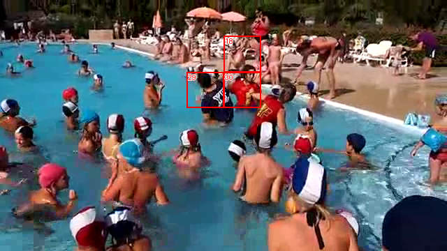
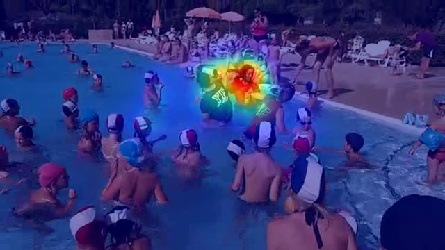

# Visual pattern report

Video 001 · 0032.png · frame position 32 · complete





Blue = lower predicted saliency; red = higher predicted saliency. Colors are normalized within each frame.

## Anchor 30: cell (2, 6)

Video 001 · frame 32 (0032.png)


```json
{
  "Description of each patch": [
    {
      "Anchor": {
        "Low-level visual features": "Dark hair, skin-toned regions, and reddish clothing/lighting within the rectangular border.",
        "Semantic object or part": "A person's head and upper body."
      }
    },
    {
      "Match 1": {
        "Low-level visual features": "Light skin tones, dark hair, and an open mouth showing teeth against a reddish and greenish background.",
        "Semantic object or part": "A person's face."
      }
    },
    {
      "Match 2": {
        "Low-level visual features": "Dark and reddish tones, indistinct facial features in dim lighting.",
        "Semantic object or part": "A person's face."
      }
    },
    {
      "Match 3": {
        "Low-level visual features": "Dark brown and black hair/skin tones with shadowed facial features.",
        "Semantic object or part": "A person's head and face."
      }
    },
    {
      "Match 4": {
        "Low-level visual features": "Dark hair framing light skin, with visible facial features like an eye, nose, and smiling mouth.",
        "Semantic object or part": "A person's face."
      }
    },
    {
      "Match 5": {
        "Low-level visual features": "Light skin tones, dark hair, and facial features under indoor lighting.",
        "Semantic object or part": "A person's face."
      }
    }
  ],
  "Description of the common visual pattern": "All target patches depict a human face or head under various lighting conditions and angles.",
  "Visual pattern title": "Human face",
  "Supporting patches": [
    "Anchor",
    "Match 1",
    "Match 2",
    "Match 3",
    "Match 4",
    "Match 5"
  ],
  "Non-supporting patches": []
}
```

Anchor top-k prototypes: [6, 9, 11, 33, 44, 58, 92, 121, 145, 182, 185, 205, 208, 215, 235, 250]

Prototypes common to every retrieved match: [6, 9, 11, 33, 44, 58, 92, 121, 182, 205, 208, 215, 235, 250]

| Match number | Node | Video / frame | Saliency label | Percentile | Stage-4 cosine |
| --- | --- | --- | --- | --- | --- |
| 1 | 118811 | 149 / 0608.png | non-salient | 0.880 | 0.6863 |
| 2 | 430386 | 568 / 0224.png | salient | 1.000 | 0.6592 |
| 3 | 81269 | 099 / 0224.png | salient | 1.000 | 0.6489 |
| 4 | 138306 | 173 / 0416.png | salient | 1.000 | 0.6292 |
| 5 | 130831 | 163 / 0672.png | salient | 1.000 | 0.6257 |

Node 118811 — shared with anchor: [6, 9, 11, 33, 44, 58, 92, 121, 145, 182, 185, 205, 208, 215, 235, 250]; recurring across matches (ID/count): [{'id': 6, 'count': 5}, {'id': 9, 'count': 5}, {'id': 11, 'count': 5}, {'id': 33, 'count': 5}, {'id': 44, 'count': 5}, {'id': 58, 'count': 5}, {'id': 92, 'count': 5}, {'id': 121, 'count': 5}, {'id': 145, 'count': 4}, {'id': 182, 'count': 5}, {'id': 185, 'count': 2}, {'id': 205, 'count': 5}, {'id': 208, 'count': 5}, {'id': 215, 'count': 5}, {'id': 235, 'count': 5}, {'id': 250, 'count': 5}]

Node 430386 — shared with anchor: [6, 9, 11, 33, 44, 58, 92, 121, 145, 182, 205, 208, 215, 235, 250]; recurring across matches (ID/count): [{'id': 6, 'count': 5}, {'id': 9, 'count': 5}, {'id': 11, 'count': 5}, {'id': 21, 'count': 3}, {'id': 33, 'count': 5}, {'id': 44, 'count': 5}, {'id': 58, 'count': 5}, {'id': 92, 'count': 5}, {'id': 121, 'count': 5}, {'id': 145, 'count': 4}, {'id': 182, 'count': 5}, {'id': 205, 'count': 5}, {'id': 208, 'count': 5}, {'id': 215, 'count': 5}, {'id': 235, 'count': 5}, {'id': 250, 'count': 5}]

Node 81269 — shared with anchor: [6, 9, 11, 33, 44, 58, 92, 121, 145, 182, 205, 208, 215, 235, 250]; recurring across matches (ID/count): [{'id': 6, 'count': 5}, {'id': 9, 'count': 5}, {'id': 11, 'count': 5}, {'id': 21, 'count': 3}, {'id': 33, 'count': 5}, {'id': 44, 'count': 5}, {'id': 58, 'count': 5}, {'id': 92, 'count': 5}, {'id': 121, 'count': 5}, {'id': 145, 'count': 4}, {'id': 182, 'count': 5}, {'id': 205, 'count': 5}, {'id': 208, 'count': 5}, {'id': 215, 'count': 5}, {'id': 235, 'count': 5}, {'id': 250, 'count': 5}]

Node 138306 — shared with anchor: [6, 9, 11, 33, 44, 58, 92, 121, 182, 185, 205, 208, 215, 235, 250]; recurring across matches (ID/count): [{'id': 6, 'count': 5}, {'id': 9, 'count': 5}, {'id': 11, 'count': 5}, {'id': 21, 'count': 3}, {'id': 33, 'count': 5}, {'id': 44, 'count': 5}, {'id': 58, 'count': 5}, {'id': 92, 'count': 5}, {'id': 121, 'count': 5}, {'id': 182, 'count': 5}, {'id': 185, 'count': 2}, {'id': 205, 'count': 5}, {'id': 208, 'count': 5}, {'id': 215, 'count': 5}, {'id': 235, 'count': 5}, {'id': 250, 'count': 5}]

Node 130831 — shared with anchor: [6, 9, 11, 33, 44, 58, 92, 121, 145, 182, 205, 208, 215, 235, 250]; recurring across matches (ID/count): [{'id': 6, 'count': 5}, {'id': 9, 'count': 5}, {'id': 11, 'count': 5}, {'id': 33, 'count': 5}, {'id': 44, 'count': 5}, {'id': 58, 'count': 5}, {'id': 92, 'count': 5}, {'id': 121, 'count': 5}, {'id': 145, 'count': 4}, {'id': 182, 'count': 5}, {'id': 205, 'count': 5}, {'id': 208, 'count': 5}, {'id': 215, 'count': 5}, {'id': 235, 'count': 5}, {'id': 250, 'count': 5}]

## Anchor 29: cell (2, 5)

Video 001 · frame 32 (0032.png)


```json
{
  "Description of each patch": [
    {
      "Anchor": {
        "Low-level visual features": "Dark tones, white graphic elements, curved contours of hair and neck.",
        "Semantic object or part": "Back of a person's head, neck, and upper torso wearing a dark jersey."
      }
    },
    {
      "Match 1": {
        "Low-level visual features": "Central dark patch surrounded by blurred multicolored areas.",
        "Semantic object or part": "Dark clothing or hair of a person in a crowd."
      }
    },
    {
      "Match 2": {
        "Low-level visual features": "Dark fabric texture next to skin-toned areas.",
        "Semantic object or part": "A person's shoulder and dark clothing."
      }
    },
    {
      "Match 3": {
        "Low-level visual features": "Maroon/dark red textured surface adjacent to skin tones.",
        "Semantic object or part": "A person's clothing and part of a face or skin."
      }
    },
    {
      "Match 4": {
        "Low-level visual features": "Dark, mottled brownish-black texture.",
        "Semantic object or part": "Dark clothing or hair."
      }
    },
    {
      "Match 5": {
        "Low-level visual features": "Bright red solid-colored fabric area with dark sleeves and a head/hat above.",
        "Semantic object or part": "A person wearing a red sweater."
      }
    }
  ],
  "Description of the common visual pattern": "Most patches depict a person's upper body, shoulders, or torso clad in dark or colored clothing (such as sweaters, jerseys, or jackets).",
  "Visual pattern title": "Upper body clothing and torso of a person",
  "Supporting patches": [
    "Anchor",
    "Match 1",
    "Match 2",
    "Match 4",
    "Match 5"
  ],
  "Non-supporting patches": [
    "Match 3"
  ]
}
```

Anchor top-k prototypes: [6, 9, 23, 29, 33, 44, 58, 92, 111, 121, 182, 205, 208, 215, 235, 250]

Prototypes common to every retrieved match: [92, 121, 182, 215, 235]

| Match number | Node | Video / frame | Saliency label | Percentile | Stage-4 cosine |
| --- | --- | --- | --- | --- | --- |
| 1 | 180224 | 233 / 0160.png | non-salient | 0.928 | 0.6344 |
| 2 | 127575 | 160 / 0096.png | non-salient | 0.855 | 0.6296 |
| 3 | 275649 | 362 / 0416.png | non-salient | 0.928 | 0.6266 |
| 4 | 301025 | 394 / 0864.png | salient | 0.976 | 0.6249 |
| 5 | 118314 | 149 / 0224.png | non-salient | 0.964 | 0.6233 |

Node 180224 — shared with anchor: [6, 23, 29, 44, 92, 111, 121, 182, 205, 215, 235]; recurring across matches (ID/count): [{'id': 6, 'count': 3}, {'id': 12, 'count': 2}, {'id': 15, 'count': 2}, {'id': 23, 'count': 4}, {'id': 29, 'count': 4}, {'id': 42, 'count': 3}, {'id': 44, 'count': 2}, {'id': 92, 'count': 5}, {'id': 121, 'count': 5}, {'id': 161, 'count': 2}, {'id': 182, 'count': 5}, {'id': 204, 'count': 2}, {'id': 205, 'count': 3}, {'id': 215, 'count': 5}, {'id': 235, 'count': 5}]

Node 127575 — shared with anchor: [23, 92, 121, 182, 215, 235]; recurring across matches (ID/count): [{'id': 23, 'count': 4}, {'id': 53, 'count': 2}, {'id': 68, 'count': 2}, {'id': 80, 'count': 2}, {'id': 87, 'count': 2}, {'id': 92, 'count': 5}, {'id': 104, 'count': 3}, {'id': 121, 'count': 5}, {'id': 134, 'count': 2}, {'id': 182, 'count': 5}, {'id': 215, 'count': 5}, {'id': 235, 'count': 5}]

Node 275649 — shared with anchor: [6, 9, 23, 29, 92, 121, 182, 205, 215, 235]; recurring across matches (ID/count): [{'id': 6, 'count': 3}, {'id': 9, 'count': 2}, {'id': 15, 'count': 2}, {'id': 23, 'count': 4}, {'id': 29, 'count': 4}, {'id': 35, 'count': 2}, {'id': 42, 'count': 3}, {'id': 92, 'count': 5}, {'id': 104, 'count': 3}, {'id': 121, 'count': 5}, {'id': 182, 'count': 5}, {'id': 205, 'count': 3}, {'id': 215, 'count': 5}, {'id': 235, 'count': 5}]

Node 301025 — shared with anchor: [6, 9, 23, 29, 44, 92, 121, 182, 205, 215, 235, 250]; recurring across matches (ID/count): [{'id': 6, 'count': 3}, {'id': 9, 'count': 2}, {'id': 12, 'count': 2}, {'id': 23, 'count': 4}, {'id': 29, 'count': 4}, {'id': 42, 'count': 3}, {'id': 44, 'count': 2}, {'id': 92, 'count': 5}, {'id': 121, 'count': 5}, {'id': 182, 'count': 5}, {'id': 205, 'count': 3}, {'id': 215, 'count': 5}, {'id': 235, 'count': 5}]

Node 118314 — shared with anchor: [29, 92, 121, 182, 215, 235]; recurring across matches (ID/count): [{'id': 29, 'count': 4}, {'id': 35, 'count': 2}, {'id': 53, 'count': 2}, {'id': 68, 'count': 2}, {'id': 80, 'count': 2}, {'id': 87, 'count': 2}, {'id': 92, 'count': 5}, {'id': 104, 'count': 3}, {'id': 121, 'count': 5}, {'id': 134, 'count': 2}, {'id': 161, 'count': 2}, {'id': 182, 'count': 5}, {'id': 204, 'count': 2}, {'id': 215, 'count': 5}, {'id': 235, 'count': 5}]

## Anchor 18: cell (1, 6)

Video 001 · frame 32 (0032.png)


```json
{
  "Description of each patch": [
    {
      "Anchor": {
        "Low-level visual features": "Skin tones, dark and light patches, vertical orientation.",
        "Semantic object or part": "Upper body and head of a person."
      }
    },
    {
      "Match 1": {
        "Low-level visual features": "Dark tones, blurred edges, small patch of skin/light area.",
        "Semantic object or part": "Head and face of a person in shadow."
      }
    },
    {
      "Match 2": {
        "Low-level visual features": "Vertical lines, mixed grayscale/color tones, cluttered details.",
        "Semantic object or part": "Architectural elements and people in a crowd."
      }
    },
    {
      "Match 3": {
        "Low-level visual features": "Dark hair texture at the top, pinkish skin tone below.",
        "Semantic object or part": "Back of a person's head and hair."
      }
    },
    {
      "Match 4": {
        "Low-level visual features": "Mottled skin tones, blurred textures, faint edge contours
.",
        "Semantic object or part": "Portion of a person's skin or face."
      }
    },
    {
      "Match 5": {
        "Low-level visual features": "Green foliage mixed with dark shadows and vertical structures.",
        "Semantic object or part": "Plants and background architecture."
      }
    }
  ],
  "Description of the common visual pattern": "Most of the patches depict parts of a human body, such as heads, skin, or upper bodies, rendered in low-resolution photography.",
  "Visual pattern title": "Human body parts",
  "Supporting patches": [
    "Anchor",
    "Match 1",
    "Match 3",
    "Match 4"
  ],
  "Non-supporting patches": [
    "Match 2",
    "Match 5"
  ]
}
```

Anchor top-k prototypes: [6, 9, 23, 33, 44, 66, 92, 111, 121, 182, 205, 208, 215, 224, 234, 235]

Prototypes common to every retrieved match: [92, 121, 182, 215, 235]

| Match number | Node | Video / frame | Saliency label | Percentile | Stage-4 cosine |
| --- | --- | --- | --- | --- | --- |
| 1 | 281010 | 369 / 0224.png | salient | 0.976 | 0.6718 |
| 2 | 144524 | 181 / 0352.png | non-salient | 0.819 | 0.6145 |
| 3 | 55881 | 067 / 0608.png | non-salient | 0.807 | 0.5884 |
| 4 | 300843 | 394 / 0736.png | non-salient | 0.916 | 0.5834 |
| 5 | 138054 | 173 / 0224.png | salient | 0.988 | 0.5727 |

Node 281010 — shared with anchor: [6, 23, 66, 92, 121, 182, 205, 215, 235]; recurring across matches (ID/count): [{'id': 6, 'count': 2}, {'id': 23, 'count': 2}, {'id': 66, 'count': 4}, {'id': 87, 'count': 4}, {'id': 92, 'count': 5}, {'id': 112, 'count': 2}, {'id': 121, 'count': 5}, {'id': 138, 'count': 2}, {'id': 161, 'count': 4}, {'id': 182, 'count': 5}, {'id': 192, 'count': 2}, {'id': 215, 'count': 5}, {'id': 235, 'count': 5}]

Node 144524 — shared with anchor: [66, 92, 121, 182, 215, 235]; recurring across matches (ID/count): [{'id': 66, 'count': 4}, {'id': 87, 'count': 4}, {'id': 92, 'count': 5}, {'id': 104, 'count': 3}, {'id': 112, 'count': 2}, {'id': 121, 'count': 5}, {'id': 132, 'count': 2}, {'id': 134, 'count': 3}, {'id': 136, 'count': 4}, {'id': 138, 'count': 2}, {'id': 161, 'count': 4}, {'id': 182, 'count': 5}, {'id': 215, 'count': 5}, {'id': 218, 'count': 3}, {'id': 235, 'count': 5}]

Node 55881 — shared with anchor: [6, 23, 66, 92, 121, 182, 215, 235]; recurring across matches (ID/count): [{'id': 6, 'count': 2}, {'id': 23, 'count': 2}, {'id': 30, 'count': 2}, {'id': 31, 'count': 2}, {'id': 66, 'count': 4}, {'id': 87, 'count': 4}, {'id': 92, 'count': 5}, {'id': 121, 'count': 5}, {'id': 136, 'count': 4}, {'id': 161, 'count': 4}, {'id': 182, 'count': 5}, {'id': 192, 'count': 2}, {'id': 215, 'count': 5}, {'id': 218, 'count': 3}, {'id': 235, 'count': 5}]

Node 300843 — shared with anchor: [66, 92, 121, 182, 215, 235]; recurring across matches (ID/count): [{'id': 66, 'count': 4}, {'id': 80, 'count': 2}, {'id': 87, 'count': 4}, {'id': 92, 'count': 5}, {'id': 104, 'count': 3}, {'id': 110, 'count': 2}, {'id': 121, 'count': 5}, {'id': 132, 'count': 2}, {'id': 134, 'count': 3}, {'id': 136, 'count': 4}, {'id': 161, 'count': 4}, {'id': 182, 'count': 5}, {'id': 215, 'count': 5}, {'id': 235, 'count': 5}]

Node 138054 — shared with anchor: [92, 121, 182, 215, 235]; recurring across matches (ID/count): [{'id': 30, 'count': 2}, {'id': 31, 'count': 2}, {'id': 80, 'count': 2}, {'id': 92, 'count': 5}, {'id': 104, 'count': 3}, {'id': 110, 'count': 2}, {'id': 121, 'count': 5}, {'id': 134, 'count': 3}, {'id': 136, 'count': 4}, {'id': 182, 'count': 5}, {'id': 215, 'count': 5}, {'id': 218, 'count': 3}, {'id': 235, 'count': 5}]
