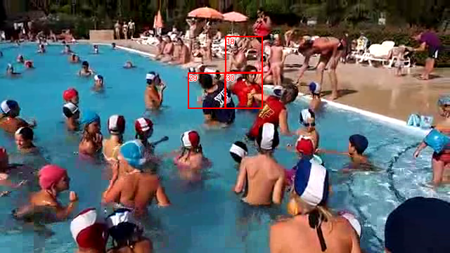
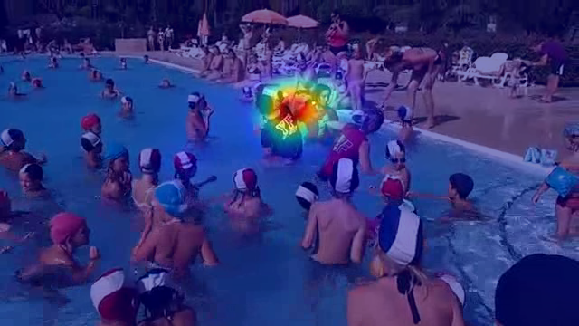

# Visual pattern report

Video 001 · 0032.png · frame position 32 · complete





Blue = lower predicted saliency; red = higher predicted saliency. Colors are normalized within each frame.

## Anchor 30: cell (2, 6)

Video 001 · frame 32 (0032.png)


```json
{
  "Description of each patch": [
    {
      "Anchor": {
        "Low-level visual features": "Red, black, and skin-toned color regions with soft and sharp edges forming human contours.",
        "Semantic object or part": "Upper body of a person wearing a red garment."
      }
    },
    {
      "Match 1": {
        "Low-level visual features": "White, grey, and metallic surfaces with circular and linear reflections.",
        "Semantic object or part": "Glassware and countertop surface near a sink."
      }
    },
    {
      "Match 2": {
        "Low-level visual features": "White and grey curved shapes with mottled texture against a brownish background.",
        "Semantic object or part": "Curved white object or foam on water or ground."
      }
    },
    {
      "Match 3": {
        "Low-level visual features": "Skin-toned hand, white rectangular strips, and dark vertical structural elements.",
        "Semantic object or part": "Hand interacting with white keys on a keyboard or instrument."
      }
    },
    {
      "Match 4": {
        "Low-level visual features": "Skin-toned fingers, white rectangular shapes, and a dark background.",
        "Semantic object or part": "Hand pressing keys on a keyboard or instrument."
      }
    },
    {
      "Match 5": {
        "Low-level visual features": "Skin-toned hand, white horizontal blocks, and dark surrounding surfaces.",
        "Semantic object or part": "Hand resting on keyboard keys."
      }
    },
    {
      "Match 6": {
        "Low-level visual features": "Skin-toned hand and fingers, white key surfaces, and dark background.",
        "Semantic object or part": "Hand resting on keyboard keys."
      }
    },
    {
      "Match 7": {
        "Low-level visual features": "Skin-toned fingers, white rectangular blocks, and dark structural areas.",
        "Semantic object or part": "Hand pressing keyboard keys."
      }
    },
    {
      "Match 8": {
        "Low-level visual features": "Brown, olive-green, and dark mottled textures with irregular gradients.",
        "Semantic object or part": "Textured organic surface or camouflage."
      }
    },
    {
      "Match 9": {
        "Low-level visual features": "High-contrast white, red, and dark rounded color patches.",
        "Semantic object or part": "Cartoon character head or stylized graphic."
      }
    },
    {
      "Match 10": {
        "Low-level visual features": "Vertical white rectangular band containing a dark and red shape, bordered by muted textures.",
        "Semantic object or part": "Vertical structure with a red object or graphic."
      }

Anchor top-k prototypes: [39, 45, 90]

Prototypes common to every retrieved match: [35, 39, 90]

| Match number | Node | Video / frame | Saliency label | Percentile | Stage-4 cosine |
| --- | --- | --- | --- | --- | --- |
| 1 | 44117 | 103 / 0160.png | salient | 1.000 | 0.1265 |
| 2 | 235525 | 589 / 0032.png | salient | 1.000 | 0.1544 |
| 3 | 143875 | 358 / 0032.png | salient | 1.000 | 0.1788 |
| 4 | 144043 | 358 / 0288.png | salient | 1.000 | 0.1880 |
| 5 | 144295 | 358 / 0672.png | salient | 1.000 | 0.1933 |
| 6 | 144211 | 358 / 0544.png | salient | 1.000 | 0.1697 |
| 7 | 144127 | 358 / 0416.png | salient | 1.000 | 0.1902 |
| 8 | 48497 | 114 / 0032.png | salient | 1.000 | 0.1890 |
| 9 | 12159 | 029 / 0800.png | salient | 1.000 | 0.2269 |
| 10 | 166637 | 412 / 0160.png | salient | 1.000 | 0.2323 |

Node 44117 — shared with anchor: [39, 90]; recurring across matches (ID/count): [{'id': 35, 'count': 10}, {'id': 39, 'count': 10}, {'id': 90, 'count': 10}]

Node 235525 — shared with anchor: [39, 90]; recurring across matches (ID/count): [{'id': 35, 'count': 10}, {'id': 39, 'count': 10}, {'id': 90, 'count': 10}]

Node 143875 — shared with anchor: [39, 90]; recurring across matches (ID/count): [{'id': 35, 'count': 10}, {'id': 39, 'count': 10}, {'id': 90, 'count': 10}]

Node 144043 — shared with anchor: [39, 90]; recurring across matches (ID/count): [{'id': 35, 'count': 10}, {'id': 39, 'count': 10}, {'id': 90, 'count': 10}]

Node 144295 — shared with anchor: [39, 90]; recurring across matches (ID/count): [{'id': 35, 'count': 10}, {'id': 39, 'count': 10}, {'id': 90, 'count': 10}]

Node 144211 — shared with anchor: [39, 90]; recurring across matches (ID/count): [{'id': 35, 'count': 10}, {'id': 39, 'count': 10}, {'id': 90, 'count': 10}]

Node 144127 — shared with anchor: [39, 90]; recurring across matches (ID/count): [{'id': 35, 'count': 10}, {'id': 39, 'count': 10}, {'id': 90, 'count': 10}]

Node 48497 — shared with anchor: [39, 90]; recurring across matches (ID/count): [{'id': 35, 'count': 10}, {'id': 39, 'count': 10}, {'id': 90, 'count': 10}]

Node 12159 — shared with anchor: [39, 90]; recurring across matches (ID/count): [{'id': 35, 'count': 10}, {'id': 39, 'count': 10}, {'id': 90, 'count': 10}]

Node 166637 — shared with anchor: [39, 90]; recurring across matches (ID/count): [{'id': 35, 'count': 10}, {'id': 39, 'count': 10}, {'id': 90, 'count': 10}]

## Anchor 29: cell (2, 5)

Video 001 · frame 32 (0032.png)


```json
{
  "Description of each patch": [
    {
      "Anchor": {
        "Low-level visual features": "Dark tones, white graphic elements, and smooth skin-toned areas.",
        "Semantic object or part": "Back of a head, neck, and dark shirt with white print."
      }
    },
    {
      "Match 1": {
        "Low-level visual features": "Very dark tones, irregular shadows, and rough texture.",
        "Semantic object or part": "Dark rock cavity or deep shadow."
      }
    },
    {
      "Match 2": {
        "Low-level visual features": "Skin-toned flesh colors with smooth gradients.",
        "Semantic object or part": "Human hand."
      }
    },
    {
      "Match 3": {
        "Low-level visual features": "Dark fabric texture with white alphanumeric characters.",
        "Semantic object or part": "Dark tank top with white text."
      }
    },
    {
      "Match 4": {
        "Low-level visual features": "Blue and dark blue tones with rippled patterns.",
        "Semantic object or part": "Water surface."
      }
    },
    {
      "Match 5": {
        "Low-level visual features": "Solid dark tone with a vertical outline.",
        "Semantic object or part": "Dark jacket or clothing."
      }
    },
    {
      "Match 6": {
        "Low-level visual features": "Dark background with a thin bright angled line.",
        "Semantic object or part": "Dark fabric with a strap or edge."
      }
    },
    {
      "Match 7": {
        "Low-level visual features": "Dark fabric texture alongside a

Anchor top-k prototypes: [42, 45, 91]

Prototypes common to every retrieved match: [91]

| Match number | Node | Video / frame | Saliency label | Percentile | Stage-4 cosine |
| --- | --- | --- | --- | --- | --- |
| 1 | 62947 | 151 / 0288.png | non-salient | 0.964 | 0.2082 |
| 2 | 33705 | 077 / 0032.png | non-salient | 0.904 | 0.2282 |
| 3 | 219941 | 549 / 0032.png | salient | 0.988 | 0.2187 |
| 4 | 16279 | 039 / 0288.png | salient | 1.000 | 0.2882 |
| 5 | 95310 | 233 / 0416.png | non-salient | 0.964 | 0.4542 |
| 6 | 4325 | 011 / 0672.png | salient | 0.988 | 0.1755 |
| 7 | 177876 | 441 / 0160.png | non-salient | 0.843 | 0.4074 |
| 8 | 29934 | 069 / 0160.png | salient | 0.976 | 0.3809 |
| 9 | 181457 | 449 / 0160.png | non-salient | 0.964 | 0.2767 |
| 10 | 29850 | 069 / 0032.png | salient | 0.988 | 0.3613 |

Node 62947 — shared with anchor: [91]; recurring across matches (ID/count): [{'id': 73, 'count': 5}, {'id': 90, 'count': 4}, {'id': 91, 'count': 10}]

Node 33705 — shared with anchor: [42, 91]; recurring across matches (ID/count): [{'id': 42, 'count': 3}, {'id': 91, 'count': 10}, {'id': 94, 'count': 7}]

Node 219941 — shared with anchor: [42, 91]; recurring across matches (ID/count): [{'id': 42, 'count': 3}, {'id': 91, 'count': 10}, {'id': 94, 'count': 7}]

Node 16279 — shared with anchor: [45, 91]; recurring across matches (ID/count): [{'id': 90, 'count': 4}, {'id': 91, 'count': 10}]

Node 95310 — shared with anchor: [42, 91]; recurring across matches (ID/count): [{'id': 42, 'count': 3}, {'id': 90, 'count': 4}, {'id': 91, 'count': 10}]

Node 4325 — shared with anchor: [91]; recurring across matches (ID/count): [{'id': 73, 'count': 5}, {'id': 91, 'count': 10}, {'id': 94, 'count': 7}]

Node 177876 — shared with anchor: [91]; recurring across matches (ID/count): [{'id': 73, 'count': 5}, {'id': 91, 'count': 10}, {'id': 94, 'count': 7}]

Node 29934 — shared with anchor: [91]; recurring across matches (ID/count): [{'id': 73, 'count': 5}, {'id': 91, 'count': 10}, {'id': 94, 'count': 7}]

Node 181457 — shared with anchor: [91]; recurring across matches (ID/count): [{'id': 73, 'count': 5}, {'id': 91, 'count': 10}, {'id': 94, 'count': 7}]

Node 29850 — shared with anchor: [91]; recurring across matches (ID/count): [{'id': 90, 'count': 4}, {'id': 91, 'count': 10}, {'id': 94, 'count': 7}]

## Anchor 18: cell (1, 6)

Video 001 · frame 32 (0032.png)


```json
{
  "Description of each patch": [
    {
      "Anchor": {
        "Low-level visual features": "Flesh-toned and dark pixel regions with varied contrast and blurry outlines.",
        "Semantic object or part": "Upper body of a person."
      }
    },
    {
      "Match 1": {
        "Low-level visual features": "Brownish, horizontal wood-grain texture with subtle lines.",
        "Semantic object or part": "Wooden surface or plank."
      }
    },
    {
      "Match 2": {
        "Low-level visual features": "Flesh tones, green vertical stalk shapes, and brown background textures.",
        "Semantic object or part": "A hand holding a vegetable stalk."
      }
    },
    {
      "Match 3": {
        "Low-level visual features": "Uniform light brown, smooth surface texture.",
        "Semantic object or part": "Wooden table or flat surface."
      }
    },
    {
      "Match 4": {
        "Low-level visual features": "Overexposed, bright yellow-white and pale flesh tones with blurred facial features.",
        "Semantic object or part": "Face of a child in a photo frame."
      }
    },
    {
      "Match 5": {
        "Low-level visual features": "Mixed blue, yellow, and white lighting with indistinct facial contours.",
        "Semantic object or part": "Head and face of a person."
      }
    },
    {
      "Match 6": {
        "Low-level visual features": "Dark typographic characters against a white background.",
        "Semantic object or part": "Printed text."
      }
    },
    {
      "Match 7": {
        "Low-level visual features": "Yellowish-brown tones and dark blurry vertical shapes.",
        "Semantic object or part": "Upper body of a person wearing a yellow shirt."
      }
    },
    {
      "Match 8": {
        "Low-level visual features": "White, black, and purplish patterns with high contrast.",
        "Semantic object or part": "Torso and clothing of a person."
      }
    },
    {
      "Match 9": {
        "Low-level visual features": "White and brown fur texture next to a dark grey/black surface.",
        "Semantic object or part": "Animal fur being touched by a hand or object."
      }
    },
    {
      "Match 10": {
        "Low-level visual features": "Dark grey upper background with mottled warm tones in the lower area.",
        "Semantic object or part": "A surface or floor with cluttered objects."
      }
    }
  ],
  "Description of the common visual pattern": "There is no clear visual pattern shared by most of the target patches. Each patch depicts entirely different semantic objects, textures, and scenes.",
  "Visual pattern title": "None",
  "Supporting patches": [],
  "Non-supporting patches": [
    "Anchor",
    "Match 1",
    "Match 2",
    "Match 3",
    "Match 4",
    "Match 5",
    "Match 6",
    "Match 7",
    "Match 8",
    "Match 9",
    "Match 10"
  ]
}
```

Anchor top-k prototypes: [39, 54, 116]

Prototypes common to every retrieved match: [116]

| Match number | Node | Video / frame | Saliency label | Percentile | Stage-4 cosine |
| --- | --- | --- | --- | --- | --- |
| 1 | 32598 | 075 / 0160.png | non-salient | 0.723 | 0.2960 |
| 2 | 218045 | 544 / 0160.png | non-salient | 0.916 | 0.2121 |
| 3 | 73578 | 175 / 0672.png | non-salient | 0.916 | 0.3195 |
| 4 | 88647 | 215 / 0032.png | non-salient | 0.892 | 0.2332 |
| 5 | 164981 | 408 / 0160.png | non-salient | 0.687 | 0.3251 |
| 6 | 182184 | 451 / 0544.png | non-salient | 0.711 | 0.2117 |
| 7 | 66984 | 160 / 0032.png | non-salient | 0.663 | 0.2918 |
| 8 | 71435 | 171 / 0032.png | non-salient | 0.566 | 0.2290 |
| 9 | 183940 | 456 / 0544.png | non-salient | 0.928 | 0.2202 |
| 10 | 77931 | 186 / 0416.png | non-salient | 0.904 | 0.2756 |

Node 32598 — shared with anchor: [116]; recurring across matches (ID/count): [{'id': 6, 'count': 8}, {'id': 48, 'count': 7}, {'id': 116, 'count': 10}]

Node 218045 — shared with anchor: [116]; recurring across matches (ID/count): [{'id': 6, 'count': 8}, {'id': 48, 'count': 7}, {'id': 116, 'count': 10}]

Node 73578 — shared with anchor: [39, 116]; recurring across matches (ID/count): [{'id': 6, 'count': 8}, {'id': 39, 'count': 3}, {'id': 116, 'count': 10}]

Node 88647 — shared with anchor: [116]; recurring across matches (ID/count): [{'id': 6, 'count': 8}, {'id': 48, 'count': 7}, {'id': 116, 'count': 10}]

Node 164981 — shared with anchor: [116]; recurring across matches (ID/count): [{'id': 6, 'count': 8}, {'id': 48, 'count': 7}, {'id': 116, 'count': 10}]

Node 182184 — shared with anchor: [116]; recurring across matches (ID/count): [{'id': 6, 'count': 8}, {'id': 48, 'count': 7}, {'id': 116, 'count': 10}]

Node 66984 — shared with anchor: [39, 54, 116]; recurring across matches (ID/count): [{'id': 39, 'count': 3}, {'id': 54, 'count': 2}, {'id': 116, 'count': 10}]

Node 71435 — shared with anchor: [116]; recurring across matches (ID/count): [{'id': 6, 'count': 8}, {'id': 48, 'count': 7}, {'id': 116, 'count': 10}]

Node 183940 — shared with anchor: [39, 54, 116]; recurring across matches (ID/count): [{'id': 39, 'count': 3}, {'id': 54, 'count': 2}, {'id': 116, 'count': 10}]

Node 77931 — shared with anchor: [116]; recurring across matches (ID/count): [{'id': 6, 'count': 8}, {'id': 48, 'count': 7}, {'id': 116, 'count': 10}]
