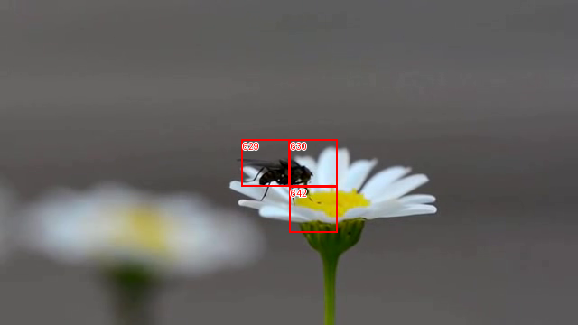
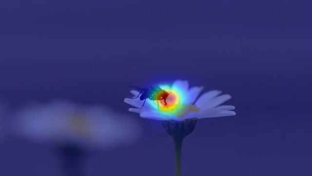
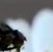
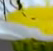
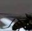

# Visual pattern report

Video 002 · 0032.png · frame position 32 · complete





Blue = lower predicted saliency; red = higher predicted saliency. Colors are normalized within each frame.

## Anchor 630: cell (3, 6)

Video 002 · frame 32 (0032.png)



```json
{
  "Description of each patch": [
    {
      "Anchor": {
        "Low-level visual features": "Dark brown/black patch on the left side, smooth grayish-white blurred background on the right, enclosed in a red border.",
        "Semantic object or part": "Part of an insect's head and body against a blurred petal background."
      }
    },
    {
      "Match 1": {
        "Low-level visual features": "Vertical green stem on the left with small dark oval shapes, smooth gray background on the right.",
        "Semantic object or part": "A green plant stem with small aphids."
      }
    },
    {
      "Match 2": {
        "Low-level visual features": "Dark brown and black rounded textures with slight specular highlights, set against a dark greenish-brown blurred background.",
        "Semantic object or part": "The dark head and body of an insect or small animal."
      }
    },
    {
      "Match 3": {
        "Low-level visual features": "Dark blue and black irregular shapes on a light blue and white background.",
        "Semantic object or part": "Parts of a blue insect or abstract blue subject on a light background."
      }
    },
    {
      "Match 4": {
        "Low-level visual features": "Orange-brown patch on the upper left, dark blue/black shapes on the lower left, and a bright bluish-white area on the right.",
        "Semantic object or part": "An insect or object with contrasting orange, blue, and white regions."
      }
    },
    {
      "Match 5": {
        "Low-level visual features": "Uniform muted green background with a small white and dark cluster near the center-right.",
        "Semantic object or part": "A tiny creature or feature on a solid green background."
      }
    },
    {
      "Match 6": {
        "Low-level visual features": "Bright green blurred foliage background with a small dark elongated shape extending from the lower left toward the center.",
        "Semantic object or part": "A small insect or object nestled in green grass or foliage."
      }
    },
    {
      "Match 7": {
        "Low-level visual features": "Dark green gradient with scattered small white specks and a bright yellow-green patch at the bottom.",
        "Semantic object or part": "Blurred green foliage or background with ambient lighting."
      }
    }
  ],
  "Description of the common visual pattern": "There is no clear pattern shared by most target patches, as the images depict completely different subjects, colors, and backgrounds.",
  "Visual pattern title": "None",
  "Supporting patches": [],
  "Non-supporting patches": [
    "Anchor",
    "Match 1",
    "Match 2",
    "Match 3",
    "Match 4",
    "Match 5",
    "Match 6",
    "Match 7"
  ]
}
```

Anchor top-k prototypes: [6, 9, 11, 21, 33, 44, 58, 92, 121, 145, 182, 205, 208, 215, 235, 250]

Prototypes common to every retrieved match: [6, 9, 11, 33, 44, 58, 92, 121, 182, 205, 208, 215, 235, 250]

| Match number | Node | Video / frame | Saliency label | Percentile | Stage-4 cosine |
| --- | --- | --- | --- | --- | --- |
| 1 | 425767 | 562 / 0096.png | salient | 1.000 | 0.7675 |
| 2 | 4830 | 007 / 0096.png | salient | 0.988 | 0.6860 |
| 3 | 183233 | 238 / 0032.png | salient | 1.000 | 0.6467 |
| 4 | 417331 | 551 / 0096.png | salient | 1.000 | 0.6174 |
| 5 | 388195 | 512 / 0480.png | salient | 1.000 | 0.6014 |
| 6 | 245899 | 321 / 0416.png | salient | 1.000 | 0.5920 |
| 7 | 285379 | 375 / 0288.png | salient | 0.976 | 0.5115 |

Node 425767 — shared with anchor: [6, 9, 11, 33, 44, 58, 92, 121, 145, 182, 205, 208, 215, 235, 250]; recurring across matches (ID/count): [{'id': 6, 'count': 7}, {'id': 9, 'count': 7}, {'id': 11, 'count': 7}, {'id': 33, 'count': 7}, {'id': 44, 'count': 7}, {'id': 58, 'count': 7}, {'id': 92, 'count': 7}, {'id': 121, 'count': 7}, {'id': 145, 'count': 5}, {'id': 182, 'count': 7}, {'id': 185, 'count': 3}, {'id': 205, 'count': 7}, {'id': 208, 'count': 7}, {'id': 215, 'count': 7}, {'id': 235, 'count': 7}, {'id': 250, 'count': 7}]

Node 4830 — shared with anchor: [6, 9, 11, 33, 44, 58, 92, 121, 182, 205, 208, 215, 235, 250]; recurring across matches (ID/count): [{'id': 6, 'count': 7}, {'id': 9, 'count': 7}, {'id': 11, 'count': 7}, {'id': 33, 'count': 7}, {'id': 44, 'count': 7}, {'id': 58, 'count': 7}, {'id': 92, 'count': 7}, {'id': 121, 'count': 7}, {'id': 182, 'count': 7}, {'id': 185, 'count': 3}, {'id': 205, 'count': 7}, {'id': 208, 'count': 7}, {'id': 215, 'count': 7}, {'id': 235, 'count': 7}, {'id': 250, 'count': 7}]

Node 183233 — shared with anchor: [6, 9, 11, 33, 44, 58, 92, 121, 145, 182, 205, 208, 215, 235, 250]; recurring across matches (ID/count): [{'id': 6, 'count': 7}, {'id': 9, 'count': 7}, {'id': 11, 'count': 7}, {'id': 33, 'count': 7}, {'id': 44, 'count': 7}, {'id': 58, 'count': 7}, {'id': 92, 'count': 7}, {'id': 121, 'count': 7}, {'id': 145, 'count': 5}, {'id': 182, 'count': 7}, {'id': 185, 'count': 3}, {'id': 205, 'count': 7}, {'id': 208, 'count': 7}, {'id': 215, 'count': 7}, {'id': 235, 'count': 7}, {'id': 250, 'count': 7}]

Node 417331 — shared with anchor: [6, 9, 11, 21, 33, 44, 58, 92, 121, 145, 182, 205, 208, 215, 235, 250]; recurring across matches (ID/count): [{'id': 6, 'count': 7}, {'id': 9, 'count': 7}, {'id': 11, 'count': 7}, {'id': 21, 'count': 3}, {'id': 33, 'count': 7}, {'id': 44, 'count': 7}, {'id': 58, 'count': 7}, {'id': 92, 'count': 7}, {'id': 121, 'count': 7}, {'id': 145, 'count': 5}, {'id': 182, 'count': 7}, {'id': 205, 'count': 7}, {'id': 208, 'count': 7}, {'id': 215, 'count': 7}, {'id': 235, 'count': 7}, {'id': 250, 'count': 7}]

Node 388195 — shared with anchor: [6, 9, 11, 21, 33, 44, 58, 92, 121, 145, 182, 205, 208, 215, 235, 250]; recurring across matches (ID/count): [{'id': 6, 'count': 7}, {'id': 9, 'count': 7}, {'id': 11, 'count': 7}, {'id': 21, 'count': 3}, {'id': 33, 'count': 7}, {'id': 44, 'count': 7}, {'id': 58, 'count': 7}, {'id': 92, 'count': 7}, {'id': 121, 'count': 7}, {'id': 145, 'count': 5}, {'id': 182, 'count': 7}, {'id': 205, 'count': 7}, {'id': 208, 'count': 7}, {'id': 215, 'count': 7}, {'id': 235, 'count': 7}, {'id': 250, 'count': 7}]

Node 245899 — shared with anchor: [6, 9, 11, 21, 33, 44, 58, 92, 121, 145, 182, 205, 208, 215, 235, 250]; recurring across matches (ID/count): [{'id': 6, 'count': 7}, {'id': 9, 'count': 7}, {'id': 11, 'count': 7}, {'id': 21, 'count': 3}, {'id': 33, 'count': 7}, {'id': 44, 'count': 7}, {'id': 58, 'count': 7}, {'id': 92, 'count': 7}, {'id': 121, 'count': 7}, {'id': 145, 'count': 5}, {'id': 182, 'count': 7}, {'id': 205, 'count': 7}, {'id': 208, 'count': 7}, {'id': 215, 'count': 7}, {'id': 235, 'count': 7}, {'id': 250, 'count': 7}]

Node 285379 — shared with anchor: [6, 9, 11, 33, 44, 58, 92, 121, 182, 205, 208, 215, 235, 250]; recurring across matches (ID/count): [{'id': 6, 'count': 7}, {'id': 9, 'count': 7}, {'id': 11, 'count': 7}, {'id': 33, 'count': 7}, {'id': 44, 'count': 7}, {'id': 58, 'count': 7}, {'id': 92, 'count': 7}, {'id': 121, 'count': 7}, {'id': 182, 'count': 7}, {'id': 205, 'count': 7}, {'id': 208, 'count': 7}, {'id': 215, 'count': 7}, {'id': 235, 'count': 7}, {'id': 250, 'count': 7}]

## Anchor 642: cell (4, 6)

Video 002 · frame 32 (0032.png)



```json
{
  "Description of each patch": [
    {
      "Anchor": {
        "Low-level visual features": "Yellow and white textured areas with dark linear elements and high contrast.",
        "Semantic object or part": "An insect part (legs and proboscis) on a flower center."
      }
    },
    {
      "Match 1": {
        "Low-level visual features": "Light green gradient background with a small dark shape on the right edge.",
        "Semantic object or part": "A small insect against a green background."
      }
    },
    {
      "Match 2": {
        "Low-level visual features": "Vertical green stem with multiple small dark oval shapes distributed along it.",
        "Semantic object or part": "Several small insects (aphids) on a plant stem."
      }
    },
    {
      "Match 3": {
        "Low-level visual features": "Bright green leafy background with a small dark clustered shape.",
        "Semantic object or part": "An insect on green foliage."
      }
    },
    {
      "Match 4": {
        "Low-level visual features": "Dark greyish-green textured background with a small dark shape on the right border.",
        "Semantic object or part": "A small insect on a dark surface."
      }
    },
    {
      "Match 5": {
        "Low-level visual features": "Turquoise textured surface with a small dark shape on the right edge.",
        "Semantic object or part": "An insect on a blue/turquoise surface."
      }
    },
    {
      "Match 6": {
        "Low-level visual features": "Dark purple textured surface with a small dark shape and white highlights near the right edge.",
        "Semantic object or part": "An insect on a purple surface."
      }
    },
    {
      "Match 7": {
        "Low-level visual features": "Tan/beige textured surface with a small dark rounded shape near the top edge.",
        "Semantic object or part": "An insect on a light brown surface."
      }
    }
  ],
  "Description of the common visual pattern": "All patches feature a small insect or bug positioned on various natural, fabric, or colored surfaces.",
  "Visual pattern title": "Insect on various surfaces",
  "Supporting patches": [
    "Anchor",
    "Match 1",
    "Match 2",
    "Match 3",
    "Match 4",
    "Match 5",
    "Match 6",
    "Match 7"
  ],
  "Non-supporting patches": []
}
```

Anchor top-k prototypes: [6, 9, 11, 21, 33, 44, 58, 92, 121, 145, 182, 205, 208, 215, 235, 250]

Prototypes common to every retrieved match: [6, 9, 11, 33, 44, 58, 92, 121, 145, 182, 205, 208, 215, 235, 250]

| Match number | Node | Video / frame | Saliency label | Percentile | Stage-4 cosine |
| --- | --- | --- | --- | --- | --- |
| 1 | 285318 | 375 / 0224.png | salient | 1.000 | 0.7051 |
| 2 | 425694 | 562 / 0032.png | salient | 1.000 | 0.6939 |
| 3 | 245899 | 321 / 0416.png | salient | 1.000 | 0.6465 |
| 4 | 388111 | 512 / 0416.png | salient | 1.000 | 0.6039 |
| 5 | 414486 | 546 / 0608.png | salient | 0.988 | 0.5999 |
| 6 | 417330 | 551 / 0096.png | salient | 0.976 | 0.5696 |
| 7 | 320910 | 421 / 0608.png | salient | 1.000 | 0.5552 |

Node 285318 — shared with anchor: [6, 9, 11, 21, 33, 44, 58, 92, 121, 145, 182, 205, 208, 215, 235, 250]; recurring across matches (ID/count): [{'id': 6, 'count': 7}, {'id': 9, 'count': 7}, {'id': 11, 'count': 7}, {'id': 21, 'count': 6}, {'id': 33, 'count': 7}, {'id': 44, 'count': 7}, {'id': 58, 'count': 7}, {'id': 92, 'count': 7}, {'id': 121, 'count': 7}, {'id': 145, 'count': 7}, {'id': 182, 'count': 7}, {'id': 205, 'count': 7}, {'id': 208, 'count': 7}, {'id': 215, 'count': 7}, {'id': 235, 'count': 7}, {'id': 250, 'count': 7}]

Node 425694 — shared with anchor: [6, 9, 11, 21, 33, 44, 58, 92, 121, 145, 182, 205, 208, 215, 235, 250]; recurring across matches (ID/count): [{'id': 6, 'count': 7}, {'id': 9, 'count': 7}, {'id': 11, 'count': 7}, {'id': 21, 'count': 6}, {'id': 33, 'count': 7}, {'id': 44, 'count': 7}, {'id': 58, 'count': 7}, {'id': 92, 'count': 7}, {'id': 121, 'count': 7}, {'id': 145, 'count': 7}, {'id': 182, 'count': 7}, {'id': 205, 'count': 7}, {'id': 208, 'count': 7}, {'id': 215, 'count': 7}, {'id': 235, 'count': 7}, {'id': 250, 'count': 7}]

Node 245899 — shared with anchor: [6, 9, 11, 21, 33, 44, 58, 92, 121, 145, 182, 205, 208, 215, 235, 250]; recurring across matches (ID/count): [{'id': 6, 'count': 7}, {'id': 9, 'count': 7}, {'id': 11, 'count': 7}, {'id': 21, 'count': 6}, {'id': 33, 'count': 7}, {'id': 44, 'count': 7}, {'id': 58, 'count': 7}, {'id': 92, 'count': 7}, {'id': 121, 'count': 7}, {'id': 145, 'count': 7}, {'id': 182, 'count': 7}, {'id': 205, 'count': 7}, {'id': 208, 'count': 7}, {'id': 215, 'count': 7}, {'id': 235, 'count': 7}, {'id': 250, 'count': 7}]

Node 388111 — shared with anchor: [6, 9, 11, 21, 33, 44, 58, 92, 121, 145, 182, 205, 208, 215, 235, 250]; recurring across matches (ID/count): [{'id': 6, 'count': 7}, {'id': 9, 'count': 7}, {'id': 11, 'count': 7}, {'id': 21, 'count': 6}, {'id': 33, 'count': 7}, {'id': 44, 'count': 7}, {'id': 58, 'count': 7}, {'id': 92, 'count': 7}, {'id': 121, 'count': 7}, {'id': 145, 'count': 7}, {'id': 182, 'count': 7}, {'id': 205, 'count': 7}, {'id': 208, 'count': 7}, {'id': 215, 'count': 7}, {'id': 235, 'count': 7}, {'id': 250, 'count': 7}]

Node 414486 — shared with anchor: [6, 9, 11, 21, 33, 44, 58, 92, 121, 145, 182, 205, 208, 215, 235, 250]; recurring across matches (ID/count): [{'id': 6, 'count': 7}, {'id': 9, 'count': 7}, {'id': 11, 'count': 7}, {'id': 21, 'count': 6}, {'id': 33, 'count': 7}, {'id': 44, 'count': 7}, {'id': 58, 'count': 7}, {'id': 92, 'count': 7}, {'id': 121, 'count': 7}, {'id': 145, 'count': 7}, {'id': 182, 'count': 7}, {'id': 205, 'count': 7}, {'id': 208, 'count': 7}, {'id': 215, 'count': 7}, {'id': 235, 'count': 7}, {'id': 250, 'count': 7}]

Node 417330 — shared with anchor: [6, 9, 11, 33, 44, 58, 92, 121, 145, 182, 205, 208, 215, 235, 250]; recurring across matches (ID/count): [{'id': 6, 'count': 7}, {'id': 9, 'count': 7}, {'id': 11, 'count': 7}, {'id': 33, 'count': 7}, {'id': 44, 'count': 7}, {'id': 58, 'count': 7}, {'id': 92, 'count': 7}, {'id': 121, 'count': 7}, {'id': 145, 'count': 7}, {'id': 182, 'count': 7}, {'id': 205, 'count': 7}, {'id': 208, 'count': 7}, {'id': 215, 'count': 7}, {'id': 235, 'count': 7}, {'id': 250, 'count': 7}]

Node 320910 — shared with anchor: [6, 9, 11, 21, 33, 44, 58, 92, 121, 145, 182, 205, 208, 215, 235, 250]; recurring across matches (ID/count): [{'id': 6, 'count': 7}, {'id': 9, 'count': 7}, {'id': 11, 'count': 7}, {'id': 21, 'count': 6}, {'id': 33, 'count': 7}, {'id': 44, 'count': 7}, {'id': 58, 'count': 7}, {'id': 92, 'count': 7}, {'id': 121, 'count': 7}, {'id': 145, 'count': 7}, {'id': 182, 'count': 7}, {'id': 205, 'count': 7}, {'id': 208, 'count': 7}, {'id': 215, 'count': 7}, {'id': 235, 'count': 7}, {'id': 250, 'count': 7}]

## Anchor 629: cell (3, 5)

Video 002 · frame 32 (0032.png)



```json
{
  "Description of each patch": [
    {
      "Anchor": {
        "Low-level visual features": "Dark grey and black tones, smooth wing texture, and a white curved edge against a muted grey background.",
        "Semantic object or part": "Portion of an insect's body and wing resting on a white petal."
      }
    },
    {
      "Match 1": {
        "Low-level visual features": "Vertical green stem texture, small dark oval shapes, and a muted grey-white background.",
        "Semantic object or part": "A green plant stem with small dark insects (aphids or ants)."
      }
    },
    {
      "Match 2": {
        "Low-level visual features": "Deep blue and purple gradients with a faint branching lighter line or reflection.",
        "Semantic object or part": "A dark blue-purple textured surface with a light-colored vein or mark."
      }
    },
    {
      "Match 3": {
        "Low-level visual features": "Mottled yellowish-green tones with soft, blurred gradients and a small dark speck near the bottom edge.",
        "Semantic object or part": "A blurred, out-of-focus greenish-yellow surface or background."
      }
    },
    {
      "Match 4": {
        "Low-level visual features": "Bright orange-yellow background with dark, curved chitinous structures and clustered black shapes.",
        "Semantic object or part": "Insect legs and body parts on an orange-yellow surface."
      }
    },
    {
      "Match 5": {
        "Low-level visual features": "Plain white background with smooth black curved lines terminating in rounded dots.",
        "Semantic object or part": "Drawn or crafted black curved lines on a white surface."
      }
    },
    {
      "Match 6": {
        "Low-level visual features": "Muted olive-green background on the right, dark patterned insect body and small bright white highlights on the left.",
        "Semantic object or part": "Part of an insect's body with white spots near a flower or foliage."
      }
    },
    {
      "Match 7": {
        "Low-level visual features": "Vibrant teal-green background with a dark, mottled central cluster marked by bright white dots.",
        "Semantic object or part": "A dark, textured cluster with reflective white spots on a turquoise surface."
      }
    }
  ],
  "Description of the common visual pattern": "The patches depict entirely different scenes, objects, and textures (including insects, plant stems, abstract lines, and surfaces), with no single visual pattern or subject shared by strictly more than half of the images.",
  "Visual pattern title": "None",
  "Supporting patches": [],
  "Non-supporting patches": [
    "Anchor",
    "Match 1",
    "Match 2",
    "Match 3",
    "Match 4",
    "Match 5",
    "Match 6",
    "Match 7"
  ]
}
```

Anchor top-k prototypes: [6, 9, 23, 33, 44, 58, 75, 92, 100, 121, 166, 182, 185, 215, 235, 250]

Prototypes common to every retrieved match: [44, 58, 92, 121, 182, 205, 215, 235]

| Match number | Node | Video / frame | Saliency label | Percentile | Stage-4 cosine |
| --- | --- | --- | --- | --- | --- |
| 1 | 425766 | 562 / 0096.png | salient | 0.988 | 0.7871 |
| 2 | 417330 | 551 / 0096.png | salient | 0.976 | 0.5967 |
| 3 | 285475 | 375 / 0352.png | salient | 1.000 | 0.5491 |
| 4 | 188714 | 244 / 0032.png | salient | 0.976 | 0.5435 |
| 5 | 72342 | 088 / 0352.png | salient | 0.976 | 0.5357 |
| 6 | 4748 | 007 / 0032.png | non-salient | 0.940 | 0.5319 |
| 7 | 41967 | 052 / 0416.png | non-salient | 0.940 | 0.5106 |

Node 425766 — shared with anchor: [6, 9, 33, 44, 58, 92, 121, 182, 215, 235, 250]; recurring across matches (ID/count): [{'id': 6, 'count': 6}, {'id': 9, 'count': 6}, {'id': 11, 'count': 5}, {'id': 33, 'count': 6}, {'id': 44, 'count': 7}, {'id': 58, 'count': 7}, {'id': 92, 'count': 7}, {'id': 111, 'count': 4}, {'id': 121, 'count': 7}, {'id': 182, 'count': 7}, {'id': 205, 'count': 7}, {'id': 208, 'count': 6}, {'id': 215, 'count': 7}, {'id': 234, 'count': 2}, {'id': 235, 'count': 7}, {'id': 250, 'count': 6}]

Node 417330 — shared with anchor: [6, 9, 33, 44, 58, 92, 121, 182, 215, 235, 250]; recurring across matches (ID/count): [{'id': 6, 'count': 6}, {'id': 9, 'count': 6}, {'id': 11, 'count': 5}, {'id': 33, 'count': 6}, {'id': 44, 'count': 7}, {'id': 58, 'count': 7}, {'id': 92, 'count': 7}, {'id': 111, 'count': 4}, {'id': 121, 'count': 7}, {'id': 145, 'count': 4}, {'id': 182, 'count': 7}, {'id': 205, 'count': 7}, {'id': 208, 'count': 6}, {'id': 215, 'count': 7}, {'id': 235, 'count': 7}, {'id': 250, 'count': 6}]

Node 285475 — shared with anchor: [6, 9, 33, 44, 58, 92, 121, 182, 185, 215, 235, 250]; recurring across matches (ID/count): [{'id': 6, 'count': 6}, {'id': 9, 'count': 6}, {'id': 11, 'count': 5}, {'id': 33, 'count': 6}, {'id': 44, 'count': 7}, {'id': 58, 'count': 7}, {'id': 92, 'count': 7}, {'id': 121, 'count': 7}, {'id': 145, 'count': 4}, {'id': 182, 'count': 7}, {'id': 185, 'count': 3}, {'id': 205, 'count': 7}, {'id': 208, 'count': 6}, {'id': 215, 'count': 7}, {'id': 235, 'count': 7}, {'id': 250, 'count': 6}]

Node 188714 — shared with anchor: [6, 9, 33, 44, 58, 92, 121, 182, 215, 235, 250]; recurring across matches (ID/count): [{'id': 6, 'count': 6}, {'id': 9, 'count': 6}, {'id': 11, 'count': 5}, {'id': 33, 'count': 6}, {'id': 44, 'count': 7}, {'id': 58, 'count': 7}, {'id': 92, 'count': 7}, {'id': 121, 'count': 7}, {'id': 145, 'count': 4}, {'id': 182, 'count': 7}, {'id': 205, 'count': 7}, {'id': 208, 'count': 6}, {'id': 215, 'count': 7}, {'id': 234, 'count': 2}, {'id': 235, 'count': 7}, {'id': 250, 'count': 6}]

Node 72342 — shared with anchor: [6, 9, 33, 44, 58, 92, 121, 182, 185, 215, 235, 250]; recurring across matches (ID/count): [{'id': 6, 'count': 6}, {'id': 9, 'count': 6}, {'id': 11, 'count': 5}, {'id': 33, 'count': 6}, {'id': 44, 'count': 7}, {'id': 58, 'count': 7}, {'id': 92, 'count': 7}, {'id': 121, 'count': 7}, {'id': 145, 'count': 4}, {'id': 182, 'count': 7}, {'id': 185, 'count': 3}, {'id': 205, 'count': 7}, {'id': 208, 'count': 6}, {'id': 215, 'count': 7}, {'id': 235, 'count': 7}, {'id': 250, 'count': 6}]

Node 4748 — shared with anchor: [23, 44, 58, 92, 121, 182, 185, 215, 235]; recurring across matches (ID/count): [{'id': 44, 'count': 7}, {'id': 58, 'count': 7}, {'id': 92, 'count': 7}, {'id': 111, 'count': 4}, {'id': 121, 'count': 7}, {'id': 182, 'count': 7}, {'id': 185, 'count': 3}, {'id': 205, 'count': 7}, {'id': 215, 'count': 7}, {'id': 235, 'count': 7}]

Node 41967 — shared with anchor: [6, 9, 33, 44, 58, 75, 92, 121, 182, 215, 235, 250]; recurring across matches (ID/count): [{'id': 6, 'count': 6}, {'id': 9, 'count': 6}, {'id': 33, 'count': 6}, {'id': 44, 'count': 7}, {'id': 58, 'count': 7}, {'id': 92, 'count': 7}, {'id': 111, 'count': 4}, {'id': 121, 'count': 7}, {'id': 182, 'count': 7}, {'id': 205, 'count': 7}, {'id': 208, 'count': 6}, {'id': 215, 'count': 7}, {'id': 235, 'count': 7}, {'id': 250, 'count': 6}]
