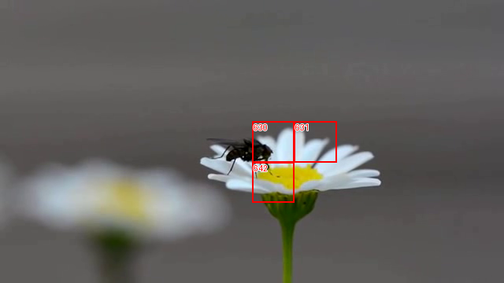
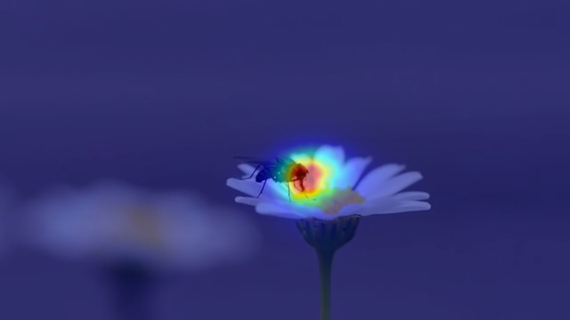
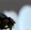
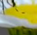

# Visual pattern report

Video 002 · 0032.png · frame position 32 · complete





Blue = lower predicted saliency; red = higher predicted saliency. Colors are normalized within each frame.

## Anchor 630: cell (3, 6)

Video 002 · frame 32 (0032.png)



```json
{
  "Description of each patch": [
    {
      "Anchor": {
        "Semantic object or part (inside patch)": "Head and thorax of a fly sitting on a flower",
        "Nearby objects (outside patch)": "Daisy flower petals and center",
        "Color": "Black and white",
        "Texture": "Smooth and textured insect body",
        "Structural or geometric description": "Small rounded organic shape next to white petal edges"
      }
    },
    {
      "Match 1": {
        "Semantic object or part (inside patch)": "Stem and leaves of a flower in a vase",
        "Nearby objects (outside patch)": "Tulips, vase, person",
        "Color": "Green and white",
        "Texture": "Smooth plant stem and leaves",
        "Structural or geometric description": "Thin vertical and curved green lines"
      }
    },
    {
      "Match 2": {
        "Semantic object or part (inside patch)": "Edge of a green can and background",
        "Nearby objects (outside patch)": "Can, hand",
        "Color": "Green, black, and light blue",
        "Texture": "Smooth cylindrical surface",
        "Structural or geometric description": "Vertical dark stripe and light background"
      }
    },
    {
      "Match 3": {
        "Semantic object or part (inside patch)": "Part of a white bird and dark background/water",
        "Nearby objects (outside patch)": "Log, egret bird",
        "Color": "White and dark brown/black",
        "Texture": "Feather texture and smooth water/wood",
        "Structural or geometric description": "Curved white mass meeting dark background"
      }
    },
    {
      "Match 4": {
        "Semantic object or part (inside patch)": "Dark clothing/hair and a light wall",
        "Nearby objects (outside patch)": "Person sitting on a chair, wall",
        "Color": "Black and off-white",
        "Texture": "Fabric texture and flat wall",
        "Structural or geometric description": "Vertical boundary between dark shape and light background"
      }
    },
    {
      "Match 5": {
        "Semantic object or part (inside patch)": "Red sleeve of a jacket and white background",
        "Nearby objects (outside patch)": "Person holding a guitar, building exterior",
        "Color": "Red and white",
        "Texture": "Fabric sleeve and smooth wall",
        "Structural or geometric description": "Vertical fabric fold and background contrast"
      }
    }
  ],
  "Description of the common visual pattern": "There is no significant visual pattern shared by a strict majority of the patches.",
  "Visual pattern title": "None",
  "Supporting patches": [],
  "Non-supporting patches": [
    "Anchor",
    "Match 1",
    "Match 2",
    "Match 3",
    "Match 4",
    "Match 5"
  ]
}
```

Anchor top-k prototypes: [129, 155, 162]

Prototypes common to every retrieved match: [155]

| Match number | Node | Video / frame | Saliency label | Percentile | Stage-4 cosine |
| --- | --- | --- | --- | --- | --- |
| 1 | 164695 | 211 / 0352.png | non-salient | 0.747 | 0.2439 |
| 2 | 7901 | 011 / 0544.png | non-salient | 0.663 | 0.0907 |
| 3 | 453054 | 598 / 0288.png | non-salient | 0.916 | 0.1205 |
| 4 | 177201 | 229 / 0160.png | non-salient | 0.386 | 0.0669 |
| 5 | 449625 | 595 / 0224.png | non-salient | 0.639 | 0.0142 |

Node 164695 — shared with anchor: [155]; recurring across matches (ID/count): [{'id': 89, 'count': 2}, {'id': 117, 'count': 2}, {'id': 155, 'count': 5}]

Node 7901 — shared with anchor: [155]; recurring across matches (ID/count): [{'id': 154, 'count': 4}, {'id': 155, 'count': 5}]

Node 453054 — shared with anchor: [155]; recurring across matches (ID/count): [{'id': 154, 'count': 4}, {'id': 155, 'count': 5}]

Node 177201 — shared with anchor: [155]; recurring across matches (ID/count): [{'id': 117, 'count': 2}, {'id': 154, 'count': 4}, {'id': 155, 'count': 5}]

Node 449625 — shared with anchor: [155]; recurring across matches (ID/count): [{'id': 89, 'count': 2}, {'id': 154, 'count': 4}, {'id': 155, 'count': 5}]

## Anchor 642: cell (4, 6)

Video 002 · frame 32 (0032.png)



```json
{
  "Description of each patch": [
    {
      "Anchor": {
        "Semantic object or part (
inside patch)": "Daisy flower center and petal base",
        "Nearby objects (outside patch)": "A fly on the flower",
        "Color": "Yellow and white",
        "Texture": "Granular and smooth",
        "Structural or geometric description": "Curved edge with a flower petal intersecting a yellow center"
      }
    },
    {
      "Match 1": {
        "Semantic object or part (inside patch)": "Cowboy hat brim and crown base",
        "Nearby objects (outside patch)": "A horse training ring",
        "Color": "White and dark brown",
        "Texture": "Smooth and matte",
        "Structural or geometric description": "Hats shape with curved brims"
      }
    },
    {
      "Match 2": {
        "Semantic object or part (inside patch)": "Floor shadow",
        "Nearby objects (outside patch)": "A choir and conductor",
        "Color": "Grey and white",
        "Texture": "Smooth surface",
        "Structural or geometric description": "Rectangular shadow cast on a tiled floor"
      }
    },
    {
      "Match 3": {
        "Semantic object or part (inside patch)": "Wooden table surface",
        "Nearby objects (outside patch)": "A chef's hands and dough",
        "Color": "Light brown",
        "Texture": "Wood grain",
        "Structural or geometric description": "Flat wooden surface"
      }
    },
    {
      "Match 4": {
        "Semantic object or part (inside patch)": "Concrete slab edge",
        "Nearby objects (outside patch)": "A squirrel eating",
        "Color": "Grey",
        "Texture": "Rough concrete",
        "Structural or geometric description": "Horizontal crack across a flat stone surface"
      }
    },
    {
      "Match 5": {
        "Semantic object or part (inside patch)": "Wooden table surface",
        "Nearby objects (outside patch)": "A chef preparing dough",
        "Color": "Light brown",
        "Texture": "Wood grain",
        "Structural or geometric description": "Flat wooden surface"
      }
    }
  ],
  "Description of the common visual pattern": "The patches in Match 3 and Match 5 share a smooth light brown wooden tabletop surface pattern.",
  "Visual pattern title": "Wooden table surface",
  "Supporting patches": [
    "Match 3",
    "Match 5"
  ],
  "Non-supporting patches": [
    "Anchor",
    "Match 1",
    "Match 2",
    "Match 4"
  ]
}
```

Anchor top-k prototypes: [121, 163, 248]

Prototypes common to every retrieved match: [178]

| Match number | Node | Video / frame | Saliency label | Percentile | Stage-4 cosine |
| --- | --- | --- | --- | --- | --- |
| 1 | 288366 | 379 / 0352.png | non-salient | 0.819 | 0.1118 |
| 2 | 159832 | 203 / 0160.png | non-salient | 0.687 | 0.0757 |
| 3 | 328766 | 432 / 0352.png | non-salient | 0.458 | 0.0573 |
| 4 | 216616 | 282 / 0352.png | non-salient | 0.759 | 0.0939 |
| 5 | 139683 | 175 / 0480.png | non-salient | 0.952 | 0.0600 |

Node 288366 — shared with anchor: []; recurring across matches (ID/count): [{'id': 178, 'count': 5}]

Node 159832 — shared with anchor: []; recurring across matches (ID/count): [{'id': 178, 'count': 5}, {'id': 214, 'count': 3}, {'id': 216, 'count': 2}]

Node 328766 — shared with anchor: []; recurring across matches (ID/count): [{'id': 178, 'count': 5}, {'id': 216, 'count': 2}]

Node 216616 — shared with anchor: []; recurring across matches (ID/count): [{'id': 178, 'count': 5}, {'id': 214, 'count': 3}]

Node 139683 — shared with anchor: [121]; recurring across matches (ID/count): [{'id': 178, 'count': 5}, {'id': 214, 'count': 3}]

## Anchor 631: cell (3, 7)

Video 002 · frame 32 (0032.png)


```json
{
  "Description of each patch": [
    {
      "Anchor": {
        "Semantic object or part (inside patch)": "Daisy flower petal tip",
        "Nearby objects (outside patch)": "Daisy flower and a fly",
        "Color": "White and grey background",
        "Texture": "Smooth",
        "Structural or geometric description": "Curved edge pointing upwards"
      }
    },
    {
      "Match 1": {
        "Semantic object or part (inside patch)": "Paper surface",
        "Nearby objects (outside patch)": "Hand with marker and paper",
        "Color": "White and beige",
        "Texture": "Smooth",
        "Structural or geometric description": "Diagonal edge of white paper"
      }
    },
    {
      "Match 2": {
        "Semantic object or part (inside patch)": "Killer whale jaw/teeth",
        "Nearby objects (outside patch)": "Killer whale and trainer",
        "Color": "White and black",
        "Texture": "Smooth",
        "Structural or geometric description": "Curved white jawline with teeth"
      }
    },
    {
      "Match 3": {
        "Semantic object or part (inside patch)": "Fabric fold",
        "Nearby objects (outside patch)": "Purple clothing on white sheet",
        "Color": "White and purple",
        "Texture": "Fabric texture",
        "Structural or geometric description": "Folded fabric edge"
      }
    },
    {
      "Match 4": {
        "Semantic object or part (inside patch)": "Beehive box lid",
        "Nearby objects (outside patch)": "Beehives outdoors",
        "Color": "White and green patterned",
        "Texture": "Patterned fabric/cover",
        "Structural or geometric description": "Flat rectangular surface edge"
      }
    },
    {
      "Match 5": {
        "Semantic object or part (inside patch)": "Dough edge",
        "Nearby objects (outside patch)": "Dough and hand",
        "Color": "Pale yellow",
        "Texture": "Dough texture",
        "Structural or geometric description": "Folded or rolled dough edge"
      }
    }
  ],
  "Description of the common visual pattern": "No clear majority visual pattern is shared by strictly more than half of the images, as each patch depicts completely different objects with varied colors, textures, and structures.",
  "Visual pattern title": "None",
  "Supporting patches": [],
  "Non-supporting patches": [
    "Anchor",
    "Match 1",
    "Match 2",
    "Match 3",
    "Match 4",
    "Match 5"
  ]
}
```

Anchor top-k prototypes: [68, 123, 217]

Prototypes common to every retrieved match: [128]

| Match number | Node | Video / frame | Saliency label | Percentile | Stage-4 cosine |
| --- | --- | --- | --- | --- | --- |
| 1 | 64474 | 077 / 0224.png | non-salient | 0.880 | 0.0300 |
| 2 | 421589 | 556 / 0608.png | non-salient | 0.880 | 0.0654 |
| 3 | 304651 | 399 / 0288.png | non-salient | 0.904 | 0.0683 |
| 4 | 84645 | 104 / 0352.png | non-salient | 0.482 | 0.0849 |
| 5 | 143109 | 180 / 0032.png | non-salient | 0.723 | 0.0670 |

Node 64474 — shared with anchor: []; recurring across matches (ID/count): [{'id': 39, 'count': 3}, {'id': 128, 'count': 5}]

Node 421589 — shared with anchor: []; recurring across matches (ID/count): [{'id': 39, 'count': 3}, {'id': 128, 'count': 5}]

Node 304651 — shared with anchor: []; recurring across matches (ID/count): [{'id': 39, 'count': 3}, {'id': 88, 'count': 3}, {'id': 128, 'count': 5}]

Node 84645 — shared with anchor: []; recurring across matches (ID/count): [{'id': 88, 'count': 3}, {'id': 128, 'count': 5}, {'id': 169, 'count': 2}]

Node 143109 — shared with anchor: []; recurring across matches (ID/count): [{'id': 88, 'count': 3}, {'id': 128, 'count': 5}, {'id': 169, 'count': 2}]
