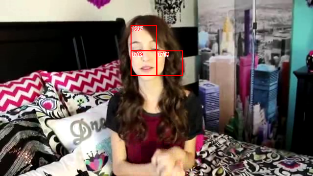
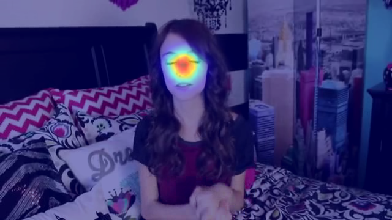

# Visual pattern report

Video 003 · 0096.png · frame position 96 · complete





Blue = lower predicted saliency; red = higher predicted saliency. Colors are normalized within each frame.

## Anchor 1709: cell (2, 5)

Video 003 · frame 96 (0096.png)


```json
{
  "Description of each patch": [
    {
      "Anchor": {
        "Semantic object or part": "Central lower face including nose, mouth, and parts of cheeks",
        "Color": "Skin tones, pinkish lips",
        "Texture": "Smooth skin, soft lighting",
        "Edge Description": "Vertical and horizontal facial contours around the nose and lips",
        "Low-level visual features": "Medium-contrast facial features centered in a red box"
      }
    },
    {
      "Match 1": {
        "Semantic object or part": "Central lower face of a child including nose, mouth, and chin",
        "Color": "Light skin tones, pinkish lips",
        "Texture": "Smooth child skin",
        "Edge Description": "Rounded facial and lip contours",
        "Low-level visual features": "Soft-focus facial region centered inside the red box"
      }
    },
    {
      "Match 2": {
        "Semantic object or part": "Central lower face of an adult including nose, philtrum, and lips",
        "Color": "Medium skin tones",
        "Texture": "Matte skin texture",
        "Edge Description": "Defined nose ridge and lip edges",
        "Low-level visual features": "Clear vertical and horizontal facial features within the bounding box"
      }
    },
    {
      "Match 3": {
        "Semantic object or part": "Central lower face of an adult including nose, philtrum, and lips",
        "Color": "Medium skin tones",
        "Texture": "Matte skin texture",
        "Edge Description": "Defined nose and mouth borders",
        "Low-level visual features": "Symmetric facial features centered inside the red box"
      }
    },
    {
      "Match 4": {
        "Semantic object or part": "Hand resting on piano keyboard",
        "Color": "Skin tone, white keys, black piano body",
        "Texture": "Smooth
 fingers, glossy piano surface",
        "Edge Description": "Linear keyboard edges and curved finger contours",
        "Low-level visual features": "Diagonal and horizontal lines of piano keys with a hand"
      }
    },
    {
      "Match 5": {
        "Semantic object or part": "Hand playing piano keys",
        "Color": "Skin tone, white keys, black piano body",
        "Texture": "Smooth fingers, glossy piano surface",
        "Edge Description": "Linear keyboard edges and curved finger contours",
        "Low-level visual features": "Diagonal and horizontal lines of piano keys with a hand"
      }
    }
  ],
  "Description of the common visual pattern": "The majority of the patches depict the central lower region of a human face, specifically featuring the nose, mouth, and surrounding skin area framed within a square region.",
  "Visual pattern title": "Central Lower Face (Nose and Mouth)",
  "Supporting patches": [
    "Anchor",
    "Match 1",
    "Match 2",
    "Match 3"
  ],
  "Non-supporting patches": [
    "Match 4",
    "Match 5"
  ]
}
```

Anchor top-k prototypes: [53, 121, 248]

Prototypes common to every retrieved match: [248]

| Match number | Node | Video / frame | Saliency label | Percentile | Stage-4 cosine |
| --- | --- | --- | --- | --- | --- |
| 1 | 238002 | 312 / 0416.png | salient | 1.000 | 0.2117 |
| 2 | 104789 | 130 / 0032.png | salient | 1.000 | 0.2838 |
| 3 | 104957 | 130 / 0160.png | salient | 1.000 | 0.2019 |
| 4 | 272731 | 358 / 0672.png | salient | 0.976 | 0.0475 |
| 5 | 272227 | 358 / 0288.png | salient | 0.988 | 0.1003 |

Node 238002 — shared with anchor: [248]; recurring across matches (ID/count): [{'id': 90, 'count': 3}, {'id': 101, 'count': 3}, {'id': 248, 'count': 5}]

Node 104789 — shared with anchor: [248]; recurring across matches (ID/count): [{'id': 101, 'count': 3}, {'id': 216, 'count': 2}, {'id': 248, 'count': 5}]

Node 104957 — shared with anchor: [248]; recurring across matches (ID/count): [{'id': 90, 'count': 3}, {'id': 101, 'count': 3}, {'id': 248, 'count': 5}]

Node 272731 — shared with anchor: [248]; recurring across matches (ID/count): [{'id': 90, 'count': 3}, {'id': 248, 'count': 5}]

Node 272227 — shared with anchor: [248]; recurring across matches (ID/count): [{'id': 216, 'count': 2}, {'id': 248, 'count': 5}]

## Anchor 1697: cell (1, 5)

Video 003 · frame 96 (0096.png)


```json
{
  "Description of each patch": [
    {
      "Anchor": {
        "Semantic object or part": "Forehead and eyebrow region",
        "Color": "Light skin tone with dark brown hair strand",
        "Texture": "Smooth skin with fine hair strands",
        "Edge Description": "Soft horizontal contour of the eyebrow",
        "Low-level visual features": "Gradient lighting across the forehead with a dark linear hair strand"
      }
    },
    {
      "Match 1": {
        "Semantic object or part": "Forehead and eyebrow region",
        "Color": "Skin tone and dark hair",
        "Texture": "Smooth skin texture",
        "Edge Description": "Curved edge defining the eyebrow and hairline",
        "Low-level visual features": "Moderate illumination on skin with dark features"
      }
    },
    {
      "Match 2": {
        "Semantic object or part": "Eye and nose bridge region",
        "Color": "Skin tone with dark eye features",
        "Texture": "Smooth skin and eye details",
        "Edge Description": "Curved outlines around the eye and eyelid",
        "Low-level visual features": "High contrast between the dark eye and lighter surrounding skin"
      }
    },
    {
      "Match 3": {
        "Semantic object or part": "Background and clothing area",
        "Color": "Light grey, neutral tones",
        "Texture": "Uniform and slightly blurry surface",
        "Edge Description": "Indistinct, soft edges",
        "Low-level visual features": "Low contrast, pale vertical background elements"
      }
    },
    {
      "Match 4": {
        "Semantic object or part": "Forehead and eyebrow region",
        "Color": "Skin tone with reddish-brown hair",
        "Texture": "Smooth skin with hair texture",
        "Edge Description": "Diagonal edge of hair strands across the forehead",
        "Low-level visual features": "Soft ambient lighting and subtle shadow gradients"
      }
    },
    {
      "Match 5": {
        "Semantic object or part": "Eye and eyebrow area under a cap",
        "Color": "Skin tone, dark eyebrow and eye shadow",
        "Texture": "Smooth skin with shadow gradients",
        "Edge Description": "Curved dark edge of the eyebrow",
        "Low-level visual features": "Dark shadow cast over the upper eye region by a cap"
      }
    }
  ],
  "Description of the common visual pattern": "Most of the patches depict close-up views of human facial features, specifically focusing on regions of the forehead, eyebrows, eyes, and surrounding skin with soft textures and natural lighting gradients.",
  "Visual pattern title": "Human Facial Features and Skin",
  "Supporting patches": [
    "Anchor",
    "Match 1",
    "Match 2",
    "Match 4",
    "Match 5"
  ],
  "Non-supporting patches": [
    "Match 3"
  ]
}
```

Anchor top-k prototypes: [91, 186, 234]

Prototypes common to every retrieved match: [234]

| Match number | Node | Video / frame | Saliency label | Percentile | Stage-4 cosine |
| --- | --- | --- | --- | --- | --- |
| 1 | 21278 | 027 / 0800.png | non-salient | 0.964 | 0.1459 |
| 2 | 440691 | 581 / 0032.png | salient | 1.000 | 0.5189 |
| 3 | 275882 | 362 / 0608.png | salient | 1.000 | 0.0819 |
| 4 | 412706 | 544 / 0224.png | non-salient | 0.843 | 0.3332 |
| 5 | 284101 | 373 / 0480.png | salient | 0.976 | 0.1903 |

Node 21278 — shared with anchor: [234]; recurring across matches (ID/count): [{'id': 21, 'count': 2}, {'id': 234, 'count': 5}]

Node 440691 — shared with anchor: [91, 186, 234]; recurring across matches (ID/count): [{'id': 91, 'count': 2}, {'id': 234, 'count': 5}]

Node 275882 — shared with anchor: [234]; recurring across matches (ID/count): [{'id': 234, 'count': 5}]

Node 412706 — shared with anchor: [91, 234]; recurring across matches (ID/count): [{'id': 91, 'count': 2}, {'id': 234, 'count': 5}]

Node 284101 — shared with anchor: [234]; recurring across matches (ID/count): [{'id': 21, 'count': 2}, {'id': 234, 'count': 5}]

## Anchor 1710: cell (2, 6)

Video 003 · frame 96 (0096.png)


```json
{
  "Description of each patch": [
    {
      "Anchor": {
        "Semantic object or part": "Human face cheek and adjacent dark hair",
        "Color": "Skin tone and dark brown/black",
        "Texture": "Smooth skin next to wavy hair texture",
        "Edge Description": "Vertical and curved boundary between skin and hair",
        "Low-level visual features": "Gradient from light skin to dark hair strands"
      }
    },
    {
      "Match 1": {
        "Semantic object or part": "Human shoulder in a dark suit jacket",
        "Color": "Dark grey/black and white",
        "Texture": "Fabric texture",
        "Edge Description": "Rounded curved edge of the shoulder",
        "Low-level visual features": "Uniform dark area with soft contours"
      }
    },
    {
      "Match 2": {
        "Semantic object or part": "Human hair strands",
        "Color": "Dark brown/black",
        "Texture": "Stranded hair texture",
        "Edge Description": "Vertical streaks and strands",
        "Low-level visual features": "Vertical dark lines and gradients"
      }
    },
    {
      "Match 3": {
        "Semantic object or part": "Animal fur",
        "Color": "Grey, white, and black",
        "Texture": "Soft fur / hair texture",
        "Edge Description": "Irregular, fuzzy edges",
        "Low-level visual features": "Fine fibrous patterns and high contrast spots"
      }
    },
    {
      "Match 4": {
        "Semantic object or part": "Crevice or gap between two surfaces",
        "Color": "Dark brown, white, and black",
        "Texture": "Rough or matte surfaces",
        "Edge Description": "Diagonal dark cleft dividing two lighter regions",
        "Low-level visual features": "Diagonal high-contrast edge"
      }
    },
    {
      "Match 5": {
        "Semantic object or part": "Human torso and armpit",
        "Color": "Skin tone and dark shadow",
        "Texture": "Smooth skin",
        "Edge Description": "Curved boundary between torso and shadowed armpit",
        "Low-level visual features": "Smooth gradient transitioning into a dark shadow cavity"
      }
    }
  ],
  "Description of the common visual pattern": "There is no clear pattern shared by most target patches, as each patch depicts entirely different semantic objects and parts (face and hair, suit shoulder, hair strands, animal fur, a surface crevice, and a torso/armpit) with distinct visual features, textures, and structures.",
  "Visual pattern title": "None",
  "Supporting patches": [],
  "Non-supporting patches": [
    "Anchor",
    "Match 1",
    "Match 2",
    "Match 3",
    "Match 4",
    "Match 5"
  ]
}
```

Anchor top-k prototypes: [120, 193, 208]

Prototypes common to every retrieved match: [120]

| Match number | Node | Video / frame | Saliency label | Percentile | Stage-4 cosine |
| --- | --- | --- | --- | --- | --- |
| 1 | 277084 | 363 / 0608.png | non-salient | 0.771 | 0.1255 |
| 2 | 4669 | 006 / 0544.png | non-salient | 0.337 | 0.2916 |
| 3 | 199888 | 261 / 0096.png | non-salient | 0.819 | 0.0963 |
| 4 | 332357 | 436 / 0800.png | non-salient | 0.819 | 0.0090 |
| 5 | 140175 | 176 / 0032.png | non-salient | 0.723 | 0.0315 |

Node 277084 — shared with anchor: [120]; recurring across matches (ID/count): [{'id': 25, 'count': 3}, {'id': 120, 'count': 5}, {'id': 134, 'count': 3}]

Node 4669 — shared with anchor: [120]; recurring across matches (ID/count): [{'id': 25, 'count': 3}, {'id': 120, 'count': 5}, {'id': 134, 'count': 3}]

Node 199888 — shared with anchor: [120]; recurring across matches (ID/count): [{'id': 120, 'count': 5}]

Node 332357 — shared with anchor: [120, 208]; recurring across matches (ID/count): [{'id': 120, 'count': 5}]

Node 140175 — shared with anchor: [120]; recurring across matches (ID/count): [{'id': 25, 'count': 3}, {'id': 120, 'count': 5}, {'id': 134, 'count': 3}]
