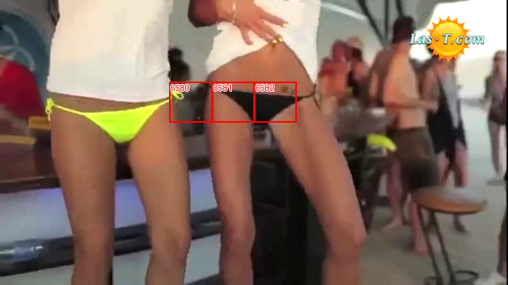
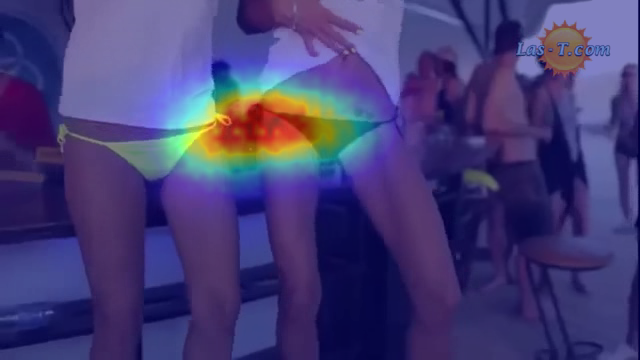
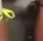
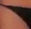
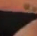

# Visual pattern report

Video 010 · 0096.png · frame position 96 · complete





Blue = lower predicted saliency; red = higher predicted saliency. Colors are normalized within each frame.

## Anchor 6580: cell (2, 4)

Video 010 · frame 96 (0096.png)



```json
{
  "Description of each patch": [
    {
      "Anchor": {
        "Semantic object or part": "Dark human hair and head",
        "Color": "Dark brown or black",
        "Texture": "Fine-textured hair strands",
        "Edge Description": "Diffuse and slightly blurred edges",
        "Low-level visual features": "Low luminance, dark monochromatic region with soft contrast against the background"
      }
    },
    {
      "Match 1": {
        "Semantic object or part": "Dark human hair and side of head",
        "Color": "Dark brown or black",
        "Texture": "Fine-textured hair",
        "Edge Description": "Defined vertical edge along the back of the head",
        "Low-level visual features": "Dark pixel cluster with vertical gradient"
      }
    },
    {
      "Match 2": {
        "Semantic object or part": "Dark animal fur or body part",
        "Color": "Dark brown or black",
        "Texture": "Rough, uneven fur or organic texture",
        "Edge Description": "Irregular, jagged edges",
        "Low-level visual features": "Mixed dark tones with mottled highlights"
      }
    },
    {
      "Match 3": {
        "Semantic object or part": "Dark human hair and side of head",
        "Color": "Dark brown or black",
        "Texture": "Dense hair texture",
        "Edge Description": "Sharp square border intersecting the head profile",
        "Low-level visual features": "Uniform dark region with high contrast against the bright background"
      }
    },
    {
      "Match 4": {
        "Semantic object or part": "Dark human hair and back of head",
        "Color": "Dark brown or black",
        "Texture": "Soft hair texture",
        "Edge Description": "Soft, indistinct boundaries",
        "Low-level visual features": "Low-contrast dark patch blending into natural outdoor lighting"
      }
    },
    {
      "Match 5": {
        "Semantic object or part": "Dark animal fur or textured hide",
        "Color": "Dark black and deep brown",
        "Texture": "Rough, glossy fur or textured surface",
        "Edge Description": "Vertical uneven edge",
        "Low-level visual features": "High-contrast specular highlights on dark textured surface"
      }
    }
  ],
  "Description of the common visual pattern": "The majority of the patches depict dark human hair and the side or back of a person's head, characterized by dark brown to black coloration, soft or fine textures, and low-luminance visual features.",
  "Visual pattern title": "Dark human hair and head",
  "Supporting patches": [
    "Anchor",
    "Match 1",
    "Match 3",
    "Match 4"
  ],
  "Non-supporting patches": [
    "Match 2",
    "Match 5"
  ]
}
```

Anchor top-k prototypes: [90, 192, 193]

Prototypes common to every retrieved match: [192]

| Match number | Node | Video / frame | Saliency label | Percentile | Stage-4 cosine |
| --- | --- | --- | --- | --- | --- |
| 1 | 371643 | 490 / 0160.png | non-salient | 0.964 | 0.1797 |
| 2 | 57569 | 069 / 0416.png | non-salient | 0.892 | 0.0380 |
| 3 | 242047 | 316 / 0672.png | non-salient | 0.892 | 0.2357 |
| 4 | 387271 | 511 / 0288.png | non-salient | 0.928 | 0.0172 |
| 5 | 399197 | 526 / 0544.png | salient | 0.976 | 0.0388 |

Node 371643 — shared with anchor: [192]; recurring across matches (ID/count): [{'id': 192, 'count': 5}]

Node 57569 — shared with anchor: [192, 193]; recurring across matches (ID/count): [{'id': 189, 'count': 2}, {'id': 192, 'count': 5}, {'id': 193, 'count': 3}]

Node 242047 — shared with anchor: [192]; recurring across matches (ID/count): [{'id': 192, 'count': 5}]

Node 387271 — shared with anchor: [192, 193]; recurring across matches (ID/count): [{'id': 192, 'count': 5}, {'id': 193, 'count': 3}]

Node 399197 — shared with anchor: [192, 193]; recurring across matches (ID/count): [{'id': 189, 'count': 2}, {'id': 192, 'count': 5}, {'id': 193, 'count': 3}]

## Anchor 6581: cell (2, 5)

Video 010 · frame 96 (0096.png)



```json
{
  "Description of each patch": [
    {
      "Anchor": {
        "Semantic object or part": "Black fabric strap and triangle against skin",
        "Color": "Black and light skin tone",
        "Texture": "Smooth fabric and skin",
        "Edge Description": "Diagonal and straight edges",
        "Low-level visual features": "High contrast between dark fabric and light skin"
      }
    },
    {
      "Match 1": {
        "Semantic object or part": "Black fabric with a vertical stripe",
        "Color": "Black and grey/white",
        "Texture": "Fabric texture",
        "Edge Description": "Vertical and rectangular edges",
        "Low-level visual features": "Dark region with a vertical lighter line against a light background"
      }
    },
    {
      "Match 2": {
        "Semantic object or part": "Dark object held in a hand with metallic highlights",
        "Color": "Dark, black, and white reflections",
        "Texture": "Smooth/metallic and skin",
        "Edge Description": "Irregular and curved edges",
        "Low-level visual features": "Dark patch with bright specular highlights"
      }
    },
    {
      "Match 3": {
        "Semantic object or part": "Dark blue or black shirt of a person",
        "Color": "Dark blue/black and a light hem",
        "Texture": "Fabric",
        "Edge Description": "Angled and straight boundary edges",
        "Low-level visual features": "Central dark blob with a light border at the bottom"
      }
    },
    {
      "Match 4": {
        "Semantic object or part": "Black carriage or clothing part",
        "Color": "Black",
        "Texture": "Smooth/glossy surface",
        "Edge Description": "Curved and rectangular structural edges",
        "Low-level visual features": "Dark enclosed area against lighter surroundings"
      }
    },
    {
      "Match 5": {
        "Semantic object or part": "Black silhouette of an animal",
        "Color": "Black",
        "Texture": "Solid dark silhouette",
        "Edge Description": "Sharp outline of an animal's body and tail",
        "Low-level visual features": "High-contrast dark shape against a textured lighter background"
      }
    }
  ],
  "Description of the common visual pattern": "All patches feature a prominent dark or black shape or object positioned against a lighter background, creating a strong tonal contrast.",
  "Visual pattern title": "Dark shape against a lighter background",
  "Supporting patches": [
    "Anchor",
    "Match 1",
    "Match 2",
    "Match 3",
    "Match 4",
    "Match 5"
  ],
  "Non-supporting patches": []
}
```

Anchor top-k prototypes: [41, 192, 193]

Prototypes common to every retrieved match: [41]

| Match number | Node | Video / frame | Saliency label | Percentile | Stage-4 cosine |
| --- | --- | --- | --- | --- | --- |
| 1 | 303078 | 397 / 0224.png | non-salient | 0.940 | 0.0142 |
| 2 | 354607 | 466 / 0416.png | non-salient | 0.807 | 0.0911 |
| 3 | 337879 | 443 / 0160.png | salient | 1.000 | 0.0771 |
| 4 | 341163 | 446 / 0672.png | non-salient | 0.831 | 0.0097 |
| 5 | 72604 | 089 / 0160.png | salient | 0.988 | 0.0635 |

Node 303078 — shared with anchor: [41]; recurring across matches (ID/count): [{'id': 41, 'count': 5}, {'id': 60, 'count': 3}, {'id': 209, 'count': 3}]

Node 354607 — shared with anchor: [41]; recurring across matches (ID/count): [{'id': 41, 'count': 5}, {'id': 60, 'count': 3}, {'id': 209, 'count': 3}]

Node 337879 — shared with anchor: [41]; recurring across matches (ID/count): [{'id': 41, 'count': 5}, {'id': 209, 'count': 3}]

Node 341163 — shared with anchor: [41]; recurring across matches (ID/count): [{'id': 41, 'count': 5}]

Node 72604 — shared with anchor: [41, 193]; recurring across matches (ID/count): [{'id': 41, 'count': 5}, {'id': 60, 'count': 3}]

## Anchor 6582: cell (2, 6)

Video 010 · frame 96 (0096.png)



```json
{
  "Description of each patch": [
    {
      "Anchor": {
        "Semantic object or part": "Skin and black fabric of a bikini bottom",
        "Color": "Skin tone and black",
        "Texture": "Smooth skin and fabric texture",
        "Edge Description": "Diagonal and horizontal edges of the clothing and body",
        "Low-level visual features": "Medium contrast, soft focus"
      }
    },
    {
      "Match 1": {
        "Semantic object or part": "Rear of a dark car on a street",
        "Color": "Dark grey/black and yellow license plate",
        "Texture": "Metallic and glossy surface",
        "Edge Description": "Rectangular and curved edges of the car body",
        "Low-level visual features": "Medium contrast, outdoor lighting"
      }
    },
    {
      "Match 2": {
        "Semantic object or part": "Dark blurry object or hand",
        "Color": "Dark blue/black and greenish background elements",
        "Texture": "Blurry, indistinct texture",
        "Edge Description": "Soft, indistinct edges",
        "Low-level visual features": "Low contrast, noisy"
      }
    },
    {
      "Match 3": {
        "Semantic object or part": "Text and barcode on a black package or marker",
        "Color": "Black background with white text and graphics",
        "Texture": "Printed surface texture",
        "Edge Description": "Sharp vertical and horizontal lines of text and barcode",
        "Low-level visual features": "High contrast between black and white"
      }
    },
    {
      "Match 4": {
        "Semantic object or part": "Text and barcode on a black package or marker",
        "Color": "Black background with white text and graphics",
        "Texture": "Printed surface texture",
        "Edge Description": "Sharp vertical and horizontal lines of text and barcode",
        "Low-level visual features": "High contrast between black and white"
      }
    },
    {
      "Match 5": {
        "Semantic object or part": "Text and barcode on a black package or marker",
        "Color": "Black background with white text and graphics",
        "Texture": "Printed surface texture",
        "Edge Description": "Sharp vertical and horizontal lines of text and barcode",
        "Low-level visual features": "High contrast between black and white"
      }
    }
  ],
  "Description of the common visual pattern": "There is no single visual pattern shared by strictly more than half of the 6 patches. While Matches 3, 4, and 5 share similar text and barcode features on a black background, three patches do not constitute a majority out of six total patches.",
  "Visual pattern title": "None",
  "Supporting patches": [],
  "Non-supporting patches": [
    "Anchor",
    "Match 1",
    "Match 2",
    "Match 3",
    "Match 4",
    "Match 5"
  ]
}
```

Anchor top-k prototypes: [71, 175, 180]

Prototypes common to every retrieved match: [0, 180]

| Match number | Node | Video / frame | Saliency label | Percentile | Stage-4 cosine |
| --- | --- | --- | --- | --- | --- |
| 1 | 321350 | 422 / 0160.png | non-salient | 0.940 | 0.0410 |
| 2 | 185849 | 240 / 0416.png | salient | 1.000 | 0.0857 |
| 3 | 64538 | 077 / 0288.png | non-salient | 0.855 | 0.0832 |
| 4 | 64622 | 077 / 0352.png | non-salient | 0.831 | 0.0816 |
| 5 | 64706 | 077 / 0416.png | non-salient | 0.867 | 0.0743 |

Node 321350 — shared with anchor: [180]; recurring across matches (ID/count): [{'id': 0, 'count': 5}, {'id': 73, 'count': 4}, {'id': 180, 'count': 5}]

Node 185849 — shared with anchor: [180]; recurring across matches (ID/count): [{'id': 0, 'count': 5}, {'id': 73, 'count': 4}, {'id': 180, 'count': 5}]

Node 64538 — shared with anchor: [180]; recurring across matches (ID/count): [{'id': 0, 'count': 5}, {'id': 180, 'count': 5}]

Node 64622 — shared with anchor: [180]; recurring across matches (ID/count): [{'id': 0, 'count': 5}, {'id': 73, 'count': 4}, {'id': 180, 'count': 5}]

Node 64706 — shared with anchor: [180]; recurring across matches (ID/count): [{'id': 0, 'count': 5}, {'id': 73, 'count': 4}, {'id': 180, 'count': 5}]
