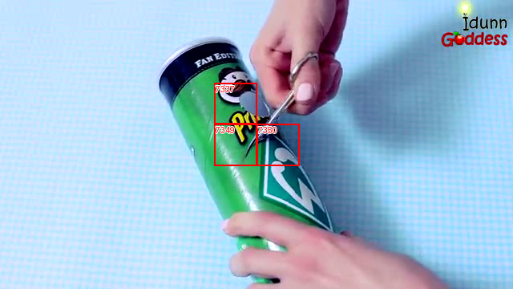
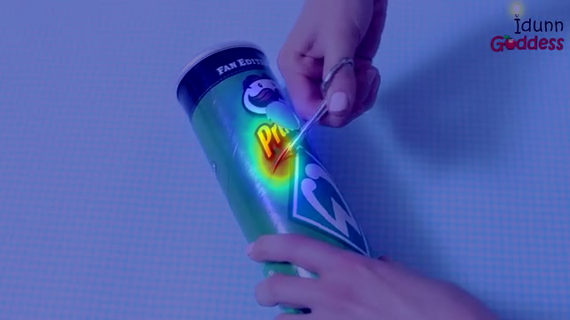
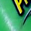
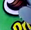
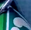

# Visual pattern report

Video 011 · 0096.png · frame position 96 · complete





Blue = lower predicted saliency; red = higher predicted saliency. Colors are normalized within each frame.

## Anchor 7349: cell (3, 5)

Video 011 · frame 96 (0096.png)



```json
{
  "Description of each patch": [
    {
      "Anchor": {
        "Semantic object or part": "Surface of a green cylindrical container",
        "Color": "Green with lighter highlights",
        "Texture": "Smooth and glossy",
        "Edge Description": "Faint vertical contours and specular highlights",
        "Low-level visual features": "Green gradient with soft lighting variations"
      }
    },
    {
      "Match 1": {
        "Semantic object or part": "Human facial region (nose, skin, and corner of eye)",
        "Color": "Skin tones (beige/peach) and dark eyelashes",
        "Texture": "Smooth skin texture",
        "Edge Description": "Soft facial contours and defined dark eyelashes",
        "Low-level visual features": "Medium brightness skin area with dark features"
      }
    },
    {
      "Match 2": {
        "Semantic object or part": "Human facial region (eye, eyebrow, and cheek)",
        "Color": "Skin tones and dark eyebrow/eye shadow",
        "Texture": "Smooth skin",
        "Edge Description": "Curved edges of the eyebrow and eyelid",
        "Low-level visual features": "Shadowed eye area contrasting with lighter skin on the cheek"
      }
    },
    {
      "Match 3": {
        "Semantic object or part": "Clothing and background in an indoor setting",
        "Color": "Light gray, off-white, and yellowish wall",
        "Texture": "Fabric texture and flat wall surface",
        "Edge Description": "Vertical edge of a person's back/shoulder",
        "Low-level visual features": "Low contrast light-colored regions"
      }
    },
    {
      "Match 4": {
        "Semantic object or part": "Portion of a digital drawing or graphic illustration",
        "Color": "Off-white, black, and hints of blue/purple",
        "Texture": "Digital graphic rendering",
        "Edge Description": "Sharp vertical and diagonal lines separating dark and light areas",
        "Low-level visual features": "High contrast between dark and light graphic elements"
      }
    },
    {
      "Match 5": {
        "Semantic object or part": "Human forehead and hairline",
        "Color": "Skin tones and dark hair",
        "Texture": "Smooth skin and hair strands",
        "Edge Description": "Hairline boundary and eyebrow contour",
        "Low-level visual features": "Dark upper region transitioning to lighter skin below"
      }
    }
  ],
  "Description of the common visual pattern": "There is no single visual pattern, texture, or semantic category shared by strictly more than half of the patches. The patches depict completely different subjects including a green can surface, human facial features, indoor clothing, and digital graphics.",
  "Visual pattern title": "None",
  "Supporting patches": [],
  "Non-supporting patches": [
    "Anchor",
    "Match 1",
    "Match 2",
    "Match 3",
    "Match 4",
    "Match 5"
  ]
}
```

Anchor top-k prototypes: [21, 100, 122]

Prototypes common to every retrieved match: [234]

| Match number | Node | Video / frame | Saliency label | Percentile | Stage-4 cosine |
| --- | --- | --- | --- | --- | --- |
| 1 | 440691 | 581 / 0032.png | salient | 1.000 | 0.0742 |
| 2 | 284101 | 373 / 0480.png | salient | 0.976 | 0.1324 |
| 3 | 275882 | 362 / 0608.png | salient | 1.000 | 0.0144 |
| 4 | 384086 | 507 / 0288.png | non-salient | 0.952 | 0.1763 |
| 5 | 21278 | 027 / 0800.png | non-salient | 0.964 | 0.0335 |

Node 440691 — shared with anchor: []; recurring across matches (ID/count): [{'id': 234, 'count': 5}]

Node 284101 — shared with anchor: [21]; recurring across matches (ID/count): [{'id': 21, 'count': 2}, {'id': 234, 'count': 5}]

Node 275882 — shared with anchor: []; recurring across matches (ID/count): [{'id': 234, 'count': 5}]

Node 384086 — shared with anchor: []; recurring across matches (ID/count): [{'id': 92, 'count': 2}, {'id': 234, 'count': 5}]

Node 21278 — shared with anchor: [21]; recurring across matches (ID/count): [{'id': 21, 'count': 2}, {'id': 92, 'count': 2}, {'id': 234, 'count': 5}]

## Anchor 7337: cell (2, 5)

Video 011 · frame 96 (0096.png)



```json
{
  "Description of each patch": [
    {
      "Anchor": {
        "Semantic object or part": "Portion of a green Pringles can with printed mascot and a cut-out hole",
        "Color": "Green, white, black, brown",
        "Texture": "Smooth, glossy, curved surface",
        "Edge Description": "Curved and linear edges of the mascot logo and hole",
        "Low-level visual features": "High-contrast color blocks on a curved surface"
      }
    },
    {
      "Match 1": {
        "Semantic object or part": "Green clover and low vegetation",
        "Color": "Various shades of green with small white flower details",
        "Texture": "Leafy and organic",
        "Edge Description": "Complex irregular edges of small leaves",
        "Low-level visual features": "Fine-grained green texture with scattered bright spots"
      }
    },
    {
      "Match 2": {
        "Semantic object or part": "Green clover and low vegetation",
        "Color": "Various shades of green with small white flower details",
        "Texture": "Leafy and organic",
        "Edge Description": "Complex irregular edges of small leaves",
        "Low-level visual features": "Fine-grained green texture with scattered bright spots"
      }
    },
    {
      "Match 3": {
        "Semantic object or part": "Grass and animal fur",
        "Color": "Green and brown/tan",
        "Texture": "Bladed grass texture mixed with soft fur",
        "Edge Description": "Directional blade edges and soft fur gradients",
        "Low-level visual features": "Mixed green and brown organic textures"
      }
    },
    {
      "Match 4": {
        "Semantic object or part": "Green lawn grass",
        "Color": "Uniform green",
        "Texture": "Fine grass blade texture",
        "Edge Description": "Directional, fine linear textures of grass",
        "Low-level visual features": "Green field with slight tonal variations"
      }
    },
    {
      "Match 5": {
        "Semantic object or part": "Dense tree foliage and leaves",
        "Color": "Shades of green",
        "Texture": "Dense, overlapping leafy texture",
        "Edge Description": "Irregular, overlapping leaf edges",
        "Low-level visual features": "Dense green patterns with small dark gaps"
      }
    }
  ],
  "Description of the common visual pattern": "A natural outdoor scene featuring green vegetation, grass, or foliage characterized by organic, leafy, or blade-like textures and shades of green.",
  "Visual pattern title": "Green vegetation and grass",
  "Supporting patches": [
    "Match 1",
    "Match 2",
    "Match 3",
    "Match 4",
    "Match 5"
  ],
  "Non-supporting patches": [
    "Anchor"
  ]
}
```

Anchor top-k prototypes: [60, 142, 179]

Prototypes common to every retrieved match: [179]

| Match number | Node | Video / frame | Saliency label | Percentile | Stage-4 cosine |
| --- | --- | --- | --- | --- | --- |
| 1 | 233810 | 306 / 0352.png | non-salient | 0.651 | 0.0915 |
| 2 | 233894 | 306 / 0416.png | non-salient | 0.651 | 0.0781 |
| 3 | 126907 | 159 / 0160.png | non-salient | 0.904 | 0.0755 |
| 4 | 214639 | 279 / 0288.png | non-salient | 0.892 | 0.0018 |
| 5 | 50510 | 061 / 0480.png | non-salient | 0.843 | 0.0123 |

Node 233810 — shared with anchor: [179]; recurring across matches (ID/count): [{'id': 179, 'count': 5}, {'id': 233, 'count': 2}]

Node 233894 — shared with anchor: [179]; recurring across matches (ID/count): [{'id': 179, 'count': 5}, {'id': 233, 'count': 2}]

Node 126907 — shared with anchor: [60, 179]; recurring across matches (ID/count): [{'id': 179, 'count': 5}]

Node 214639 — shared with anchor: [179]; recurring across matches (ID/count): [{'id': 179, 'count': 5}, {'id': 215, 'count': 2}]

Node 50510 — shared with anchor: [179]; recurring across matches (ID/count): [{'id': 179, 'count': 5}, {'id': 215, 'count': 2}]

## Anchor 7350: cell (3, 6)

Video 011 · frame 96 (0096.png)



```json
{
  "Description of each patch": [
    {
      "Anchor": {
        "Semantic object or part": "Portion of a green product packaging with white graphic elements and a peeling edge",
        "Color": "Green and white with dark shadows",
        "Texture": "Smooth, glossy surface",
        "Edge Description": "Sharp white graphic outlines and a curved peeling edge",
        "Low-level visual features": "Green background with high contrast white shapes and a metallic/plastic sheen"
      }
    },
    {
      "Match 1": {
        "Semantic object or part": "Dark outdoor brush and shrubs",
        "Color": "Dark brown, grey, and muted green",
        "Texture": "Rough, organic, and dense",
        "Edge Description": "Irregular, fine edges of twigs and foliage",
        "Low-level visual features": "Mottled dark tones with scattered fine details"
      }
    },
    {
      "Match 2": {
        "Semantic object or part": "Dense green foliage and bushes",
        "Color": "Dark green and earthy tones",
        "Texture": "Leafy and dense",
        "Edge Description": "Irregular, natural organic boundaries",
        "Low-level visual features": "Patches of dark green vegetation"
      }
    },
    {
      "Match 3": {
        "Semantic object or part": "Green trees and foliage above a guardrail",
        "Color": "Green and a grey horizontal line",
        "Texture": "Leafy foliage above a smooth surface",
        "Edge Description": "Horizontal straight edge combined with organic leaf edges",
        "Low-level visual features": "Green textured upper region with a distinct linear feature at the bottom"
      }
    },
    {
      "Match 4": {
        "Semantic object or part": "Green background foliage behind a barrier",
        "Color": "Dark and medium green",
        "Texture": "Dense, leafy organic texture",
        "Edge Description": "Irregular organic contours",
        "Low-level visual features": "Uniformly dense green visual patterns"
      }
    },
    {
      "Match 5": {
        "Semantic object or part": "Green tree foliage above a building roof",
        "Color": "Green, grey, and dark red",
        "Texture": "Leafy foliage meeting a constructed roof structure",
        "Edge Description": "Angular straight lines of the roof meeting organic foliage edges",
        "Low-level visual features": "Green upper canopy texture with geometric structural lines below"
      }
    }
  ],
  "Description of the common visual pattern": "Most patches depict natural outdoor foliage, bushes, or trees with organic textures and irregular green/earthy color tones.",
  "Visual pattern title": "Outdoor foliage and vegetation",
  "Supporting patches": [
    "Match 1",
    "Match 2",
    "Match 3",
    "Match 4",
    "Match 5"
  ],
  "Non-supporting patches": [
    "Anchor"
  ]
}
```

Anchor top-k prototypes: [114, 158, 205]

Prototypes common to every retrieved match: [27]

| Match number | Node | Video / frame | Saliency label | Percentile | Stage-4 cosine |
| --- | --- | --- | --- | --- | --- |
| 1 | 22216 | 029 / 0096.png | non-salient | 0.819 | 0.1250 |
| 2 | 52373 | 063 / 0416.png | non-salient | 0.819 | 0.0214 |
| 3 | 184411 | 239 / 0096.png | non-salient | 0.880 | 0.2144 |
| 4 | 9016 | 012 / 0672.png | non-salient | 0.843 | 0.0752 |
| 5 | 44992 | 056 / 0160.png | non-salient | 0.771 | 0.0510 |

Node 22216 — shared with anchor: [158]; recurring across matches (ID/count): [{'id': 27, 'count': 5}, {'id': 181, 'count': 4}]

Node 52373 — shared with anchor: [114]; recurring across matches (ID/count): [{'id': 27, 'count': 5}, {'id': 114, 'count': 3}, {'id': 181, 'count': 4}]

Node 184411 — shared with anchor: []; recurring across matches (ID/count): [{'id': 27, 'count': 5}]

Node 9016 — shared with anchor: [114]; recurring across matches (ID/count): [{'id': 27, 'count': 5}, {'id': 114, 'count': 3}, {'id': 181, 'count': 4}]

Node 44992 — shared with anchor: [114]; recurring across matches (ID/count): [{'id': 27, 'count': 5}, {'id': 114, 'count': 3}, {'id': 181, 'count': 4}]
