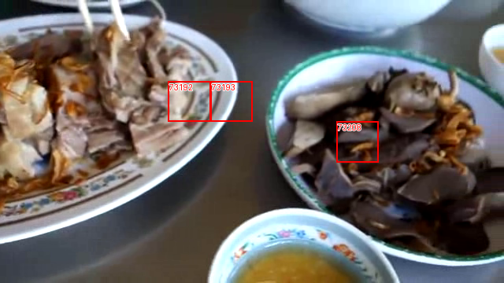
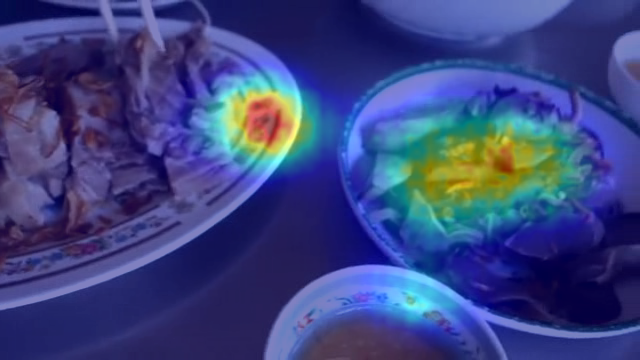
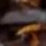
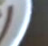
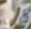

# Visual pattern report

Video 090 · 0032.png · frame position 32 · complete





Blue = lower predicted saliency; red = higher predicted saliency. Colors are normalized within each frame.

## Anchor 73208: cell (3, 8)

Video 090 · frame 32 (0032.png)



```json
{
  "Description of each patch": [
    {
      "Anchor": {
        "Semantic object or part (inside patch)": "wood ear mushroom and noodle",
        "Nearby objects (outside patch)": "bowl of food",
        "Color": "dark brown, beige",
        "Texture": "smooth, rubbery",
        "Structuralor geometric description": "irregular curved shapes"
      }
    },
    {
      "Match 1": {
        "Semantic object or part (inside patch)": "trees and foliage",
        "Nearby objects (outside patch)": "roller coaster track and amusement park",
        "Color": "dark green, brown",
        "Texture": "foliage texture",
        "Structural or geometric description": "irregular leafy patterns"
      }
    },
    {
      "Match 2": {
        "Semantic object or part (inside patch)": "packaged food products on shelf",
        "Nearby objects (outside patch)": "shelf with various merchandise",
        "Color": "brown, beige, dark red",
        "Texture": "smooth packaging",
        "Structural or geometric description": "rectangular packages"
      }
    },
    {
      "Match 3": {
        "Semantic object or part (inside patch)": "clothing of a person",
        "Nearby objects (outside patch)": "riding arena with horses",
        "Color": "dark gray, black",
        "Texture": "fabric",
        "Structural or geometric description": "soft folds"
      }
    },
    {
      "Match 4": {
        "Semantic object or part (inside patch)": "lid of a red pot",
        "Nearby objects (outside patch)": "kitchen counter, stove, utensils",
        "Color": "red, silver",
        "Texture": "glossy metallic",
        "Structural or geometric description": "circular lid with handle"
      }
    },
    {
      "Match 5": {
        "Semantic object or part (inside patch)": "trees and foliage",
        "Nearby objects (outside patch)": "roller coaster view of park",
        "Color": "dark green, white",
        "Texture": "foliage texture",
        "Structural or geometric description": "irregular shapes"
      }
    }
  ],
  "Description of the common visual pattern": "The patches in Match 1 and Match 5 depict trees and foliage viewed from a high vantage point near a roller coaster.",
  "Visual pattern title": "Trees and foliage from roller coaster",
  "Supporting patches": [
    "Match 1",
    "Match 5"
  ],
  "Non-supporting patches": [
    "Anchor",
    "Match 2",
    "Match 3",
    "Match 4"
  ]
}
```

Anchor top-k prototypes: [19, 74, 130]

Prototypes common to every retrieved match: [19]

| Match number | Node | Video / frame | Saliency label | Percentile | Stage-4 cosine |
| --- | --- | --- | --- | --- | --- |
| 1 | 332256 | 436 / 0736.png | non-salient | 0.313 | 0.1499 |
| 2 | 402900 | 531 / 0544.png | non-salient | 0.229 | 0.0587 |
| 3 | 123227 | 154 / 0672.png | non-salient | 0.108 | 0.1071 |
| 4 | 445236 | 588 / 0352.png | non-salient | 0.410 | 0.2306 |
| 5 | 344468 | 451 / 0608.png | non-salient | 0.482 | 0.0324 |

Node 332256 — shared with anchor: [19, 74]; recurring across matches (ID/count): [{'id': 19, 'count': 5}, {'id': 74, 'count': 3}, {'id': 117, 'count': 3}]

Node 402900 — shared with anchor: [19]; recurring across matches (ID/count): [{'id': 19, 'count': 5}, {'id': 117, 'count': 3}, {'id': 223, 'count': 2}]

Node 123227 — shared with anchor: [19, 74]; recurring across matches (ID/count): [{'id': 19, 'count': 5}, {'id': 74, 'count': 3}]

Node 445236 — shared with anchor: [19, 74]; recurring across matches (ID/count): [{'id': 19, 'count': 5}, {'id': 74, 'count': 3}, {'id': 223, 'count': 2}]

Node 344468 — shared with anchor: [19]; recurring across matches (ID/count): [{'id': 19, 'count': 5}, {'id': 117, 'count': 3}]

## Anchor 73193: cell (2, 5)

Video 090 · frame 32 (0032.png)



```json
{
  "Description of each patch": [
    {
      "Anchor": {
        "Semantic object or part (inside patch)": "Rim of a white ceramic plate with a brown pattern",
        "Nearby objects (outside patch)": "Plates with food",
        "Color": "White and brown",
        "Texture": "Smooth, glossy",
        "Structural or geometric description": "Curved edge with a vertical stripe"
      }
    },
    {
      "Match 1": {
        "Semantic object or part (inside patch)": "Fold of pastry or dough",
        "Nearby objects (outside patch)": "Pastry on a tray",
        "Color": "Light yellow or cream",
        "Texture": "Soft, flaky",
        "Structural or geometric description": "Diagonal ridge or fold line"
      }
    },
    {
      "Match 2": {
        "Semantic object or part (inside patch)": "Field or grass texture",
        "Nearby objects (outside patch)": "Green background surface",
        "Color": "Green",
        "Texture": "Grainy, textured",
        "Structural or geometric description": "Uniform surface with subtle horizontal lines"
      }
    },
    {
      "Match 3": {
        "Semantic object or part (inside patch)": "Part of a camera or electronic device",
        "Nearby objects (outside patch)": "Hand holding a camera, window view",
        "Color": "Black and metallic gray",
        "Texture": "Smooth, metallic",
        "Structural or geometric description": "Rounded contours and edges"
      }
    },
    {
      "Match 4": {
        "Semantic object or part (inside patch)": "Background person in a room",
        "Nearby objects (outside patch)": "People sitting and watching a breakdancer",
        "Color": "Dark, mixed colors",
        "Texture": "Blurred",
        "Structural or geometric description": "Small silhouette of a person standing"
      }
    },
    {
      "Match 5": {
        "Semantic object or part (inside patch)": "Fingers resting on a shoulder",
        "Nearby objects (outside patch)": "Man's neck, shoulder, and curtain background",
        "Color": "Skin tone and black clothing",
        "Texture": "Smooth",
        "Structural or geometric description": "Curved finger shapes"
      }
    }
  ],
  "Description of the common visual pattern": "None of the patches share a significant common visual pattern in color, texture, or semantic content.",
  "Visual pattern title": "None",
  "Supporting patches": [],
  "Non-supporting patches": [
    "Anchor",
    "Match 1",
    "Match 2",
    "Match 3",
    "Match 4",
    "Match 5"
  ]
}
```

Anchor top-k prototypes: [2, 47, 248]

Prototypes common to every retrieved match: [47]

| Match number | Node | Video / frame | Saliency label | Percentile | Stage-4 cosine |
| --- | --- | --- | --- | --- | --- |
| 1 | 143690 | 180 / 0480.png | non-salient | 0.386 | 0.1400 |
| 2 | 280325 | 368 / 0352.png | non-salient | 0.916 | 0.0200 |
| 3 | 256552 | 335 / 0352.png | non-salient | 0.855 | 0.0143 |
| 4 | 175927 | 227 / 0096.png | non-salient | 0.904 | 0.0033 |
| 5 | 453639 | 599 / 0160.png | non-salient | 0.783 | 0.0337 |

Node 143690 — shared with anchor: [47]; recurring across matches (ID/count): [{'id': 30, 'count': 3}, {'id': 47, 'count': 5}]

Node 280325 — shared with anchor: [2, 47]; recurring across matches (ID/count): [{'id': 2, 'count': 4}, {'id': 30, 'count': 3}, {'id': 47, 'count': 5}]

Node 256552 — shared with anchor: [2, 47]; recurring across matches (ID/count): [{'id': 2, 'count': 4}, {'id': 47, 'count': 5}]

Node 175927 — shared with anchor: [2, 47]; recurring across matches (ID/count): [{'id': 2, 'count': 4}, {'id': 47, 'count': 5}]

Node 453639 — shared with anchor: [2, 47]; recurring across matches (ID/count): [{'id': 2, 'count': 4}, {'id': 30, 'count': 3}, {'id': 47, 'count': 5}]

## Anchor 73192: cell (2, 4)

Video 090 · frame 32 (0032.png)



```json
{
  "Description of each patch": [
    {
      "Anchor": {
        "Semantic object or part (inside patch)": "A bone piece in a plate of food",
        "Nearby objects (outside patch)": "Plate of meat and chopsticks",
        "Color": "Beige and white",
        "Texture": "Smooth and glossy",
        "Structural or geometric description": "An oblong shape oriented vertically"
      }
    },
    {
      "Match 1": {
        "Semantic object or part (inside patch)": "A tube or container of ointment",
        "Nearby objects (outside patch)": "Other tubes and a person's hand",
        "Color": "Silvery white with faint text",
        "Texture": "Metallic and striated",
        "Structural or geometric description": "A cylindrical tube section tilted diagonally"
      }
    },
    {
      "Match 2": {
        "Semantic object or part (inside patch)": "Rim of a white sink or basin",
        "Nearby objects (outside patch)": "A hand and faucet handle",
        "Color": "White and metallic grey",
        "Texture": "Smooth and glossy",
        "Structural or geometric description": "A curved edge or corner of a sink fixture"
      }
    },
    {
      "Match 3": {
        "Semantic object or part (inside patch)": "Surface of a metal hydraulic cylinder",
        "Nearby objects (outside patch)": "Yellow and black warning stripes",
        "Color": "Silver and black",
        "Texture": "Polished and metallic with a circular opening",
        "Structural or geometric description": "Vertical cylindrical metal column with a round hole"
      }
    },
    {
      "Match 4": {
        "Semantic object or part (inside patch)": "A background wall seen through a doorway or archway",
        "Nearby objects (outside patch)": "A man's face and shoulder in the foreground",
        "Color": "White and muted grey/brown",
        "Texture": "Smooth architectural surface",
        "Structural or geometric description": "Vertical structural wall edge"
      }
    },
    {
      "Match 5": {
        "Semantic object or part (inside patch)": "Sky and landscape transition on a screen",
        "Nearby objects (outside patch)": "CBS This Morning graphic banner and mountain landscape",
        "Color": "White, blue, and brown",
        "Texture": "Digital screen texture",
        "Structural or geometric description": "Rectangular graphic screen insert"
      }
    }
  ],
  "Description of the common visual pattern": "No majority visual pattern is shared across strictly more than half of the images.",
  "Visual pattern title": "None",
  "Supporting patches": [],
  "Non-supporting patches": [
    "Anchor",
    "Match 1",
    "Match 2",
    "Match 3",
    "Match 4",
    "Match 5"
  ]
}
```

Anchor top-k prototypes: [2, 48, 172]

Prototypes common to every retrieved match: [42]

| Match number | Node | Video / frame | Saliency label | Percentile | Stage-4 cosine |
| --- | --- | --- | --- | --- | --- |
| 1 | 187225 | 242 / 0288.png | non-salient | 0.048 | 0.0194 |
| 2 | 249023 | 324 / 0352.png | non-salient | 0.373 | 0.1021 |
| 3 | 366761 | 483 / 0288.png | non-salient | 0.675 | 0.0537 |
| 4 | 412209 | 543 / 0544.png | non-salient | 0.518 | 0.1350 |
| 5 | 151597 | 191 / 0416.png | non-salient | 0.602 | 0.1251 |

Node 187225 — shared with anchor: [48]; recurring across matches (ID/count): [{'id': 42, 'count': 5}]

Node 249023 — shared with anchor: []; recurring across matches (ID/count): [{'id': 42, 'count': 5}, {'id': 120, 'count': 2}]

Node 366761 — shared with anchor: []; recurring across matches (ID/count): [{'id': 42, 'count': 5}, {'id': 66, 'count': 2}, {'id': 133, 'count': 3}]

Node 412209 — shared with anchor: []; recurring across matches (ID/count): [{'id': 42, 'count': 5}, {'id': 66, 'count': 2}, {'id': 133, 'count': 3}]

Node 151597 — shared with anchor: []; recurring across matches (ID/count): [{'id': 42, 'count': 5}, {'id': 120, 'count': 2}, {'id': 133, 'count': 3}]
