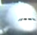
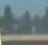

# Visual pattern report

Video 123 · 0096.png · frame position 96 · complete


Blue = lower predicted saliency; red = higher predicted saliency. Colors are normalized within each frame.

## Anchor 99580: cell (3, 4)

Video 123 · frame 96 (0096.png)



```json
{
  "Description of each patch": [
    {
      "Anchor": {
        "Semantic object or part": "Airplane nose section with cockpit windows",
        "Color": "White and dark grey",
        "Texture": "Smooth",
        "Edge Description": "Horizontal window slits and curved fuselage contour",
        "Low-level visual features": "High contrast between bright white fuselage and dark cockpit windows"
      }
    },
    {
      "Match 1": {
        "Semantic object or part": "Smooth white aircraft fuselage",
        "Color": "White",
        "Texture": "Smooth",
        "Edge Description": "Subtle curved edge at the bottom",
        "Low-level visual features": "Uniform white gradient with low contrast"
      }
    },
    {
      "Match 2": {
        "Semantic object or part": "Smooth white aircraft fuselage",
        "Color": "White",
        "Texture": "Smooth",
        "Edge Description": "None prominent",
        "Low-level visual features": "Bright white surface with minimal variation"
      }
    },
    {
      "Match 3": {
        "Semantic object or part": "Smooth white aircraft fuselage",
        "Color": "White",
        "Texture": "Smooth",
        "Edge Description": "None prominent",
        "Low-level visual features": "Bright white surface with slight shading"
      }
    },
    {
      "Match 4": {
        "Semantic object or part": "Smooth white aircraft fuselage",
        "Color": "White",
        "Texture": "Smooth",
        "Edge Description": "None prominent",
        "Low-level visual features": "Bright white surface"
      }
    },
    {
      "Match 5": {
        "Semantic object or part": "Smooth white aircraft fuselage",
        "Color": "White with small dark marks",
        "Texture": "Smooth",
        "Edge Description": "Horizontal faint lines on the left",
        "Low-level visual features": "Bright white surface with minor artifacts"
      }
    }
  ],
  "Description of the common visual pattern": "The patches consistently depict a smooth, bright white aircraft fuselage surface, characteristic of the body of the airplane shown in the anchor frame.",
  "Visual pattern title": "White Aircraft Fuselage",
  "Supporting patches": [
    "Anchor",
    "Match 1",
    "Match 2",
    "Match 3",
    "Match 4",
    "Match 5"
  ],
  "Non-supporting patches": []
}
```

Anchor top-k prototypes: [178, 247, 248]

Prototypes common to every retrieved match: [144, 247]

| Match number | Node | Video / frame | Saliency label | Percentile | Stage-4 cosine |
| --- | --- | --- | --- | --- | --- |
| 1 | 350400 | 460 / 0352.png | non-salient | 0.602 | 0.1644 |
| 2 | 211338 | 275 / 0544.png | non-salient | 0.398 | 0.0606 |
| 3 | 210918 | 275 / 0224.png | non-salient | 0.422 | 0.0610 |
| 4 | 211255 | 275 / 0480.png | non-salient | 0.229 | 0.0356 |
| 5 | 218807 | 285 / 0608.png | non-salient | 0.313 | 0.0189 |

Node 350400 — shared with anchor: [247]; recurring across matches (ID/count): [{'id': 110, 'count': 4}, {'id': 144, 'count': 5}, {'id': 247, 'count': 5}]

Node 211338 — shared with anchor: [247]; recurring across matches (ID/count): [{'id': 144, 'count': 5}, {'id': 247, 'count': 5}]

Node 210918 — shared with anchor: [247]; recurring across matches (ID/count): [{'id': 110, 'count': 4}, {'id': 144, 'count': 5}, {'id': 247, 'count': 5}]

Node 211255 — shared with anchor: [247]; recurring across matches (ID/count): [{'id': 110, 'count': 4}, {'id': 144, 'count': 5}, {'id': 247, 'count': 5}]

Node 218807 — shared with anchor: [247]; recurring across matches (ID/count): [{'id': 110, 'count': 4}, {'id': 144, 'count': 5}, {'id': 247, 'count': 5}]

## Anchor 99592: cell (4, 4)

Video 123 · frame 96 (0096.png)


```json
{
  "Description of each patch": [
    {
      "Anchor": {
        "Semantic object or part": "Runway surface and landing gear components in shadow",
        "Color": "Dark gray, black",
        "Texture": "Granular asphalt and metallic mechanical parts",
        "Edge Description": "Horizontal and vertical straight/angular edges of the landing gear",
        "Low-level visual features": "Dark low-contrast tones with mechanical highlights"
      }
    },
    {
      "Match 1": {
        "Semantic object or part": "Dense foliage and a vertical light-colored post",
        "Color": "Dark green, brown, and white",
        "Texture": "Leafy, fibrous natural texture",
        "Edge Description": "Irregular organic outlines with one vertical straight edge on the right",
        "Low-level visual features": "Mixed dark organic patterns with a bright vertical stripe"
      }
    },
    {
      "Match 2": {
        "Semantic object or part": "Dense shrubbery or foliage",
        "Color": "Dark brown and muted green",
        "Texture": "Rough, dense, leafy texture",
        "Edge Description": "Irregular organic edges",
        "Low-level visual features": "Low-contrast dark natural tones"
      }
    },
    {
      "Match 3": {
        "Semantic object or part": "Vegetation and bushes on a slope",
        "Color": "Dark green and earthy brown",
        "Texture": "Leafy, organic texture",
        "Edge Description": "Irregular organic boundaries",
        "Low-level visual features": "Natural green and earthy color gradients"
      }
    },
    {
      "Match 4": {
        "Semantic object or part": "Asphalt road surface and lower car body edge",
        "Color": "Dark gray, black, and white",
        "Texture": "Smooth paved asphalt with a painted line",
        "Edge Description": "Horizontal straight line and curved car body edge",
        "Low-level visual features": "Uniform dark gray background with a high-contrast white stripe"
      }
    },
    {
      "Match 5": {
        "Semantic object or part": "Tree foliage and canopy above a roof",
        "Color": "Dark green and brown",
        "Texture": "Dense leafy canopy texture",
        "Edge Description": "Irregular, rounded organic edges",
        "Low-level visual features": "Clustered natural green and dark vegetative tones"
      }
    }
  ],
  "Description of the common visual pattern": "Dense natural foliage or vegetation consisting of dark green and brown organic textures with irregular edges.",
  "Visual pattern title": "Dense Foliage",
  "Supporting patches": [
    "Match 1",
    "Match 2",
    "Match 3",
    "Match 5"
  ],
  "Non-supporting patches": [
    "Anchor",
    "Match 4"
  ]
}
```

Anchor top-k prototypes: [27, 122, 158]

Prototypes common to every retrieved match: [27]

| Match number | Node | Video / frame | Saliency label | Percentile | Stage-4 cosine |
| --- | --- | --- | --- | --- | --- |
| 1 | 152768 | 194 / 0032.png | non-salient | 0.639 | 0.3278 |
| 2 | 22216 | 029 / 0096.png | non-salient | 0.819 | 0.0607 |
| 3 | 52373 | 063 / 0416.png | non-salient | 0.819 | 0.0721 |
| 4 | 191236 | 247 / 0224.png | non-salient | 0.855 | 0.1302 |
| 5 | 44992 | 056 / 0160.png | non-salient | 0.771 | 0.1579 |

Node 152768 — shared with anchor: [27]; recurring across matches (ID/count): [{'id': 27, 'count': 5}, {'id': 102, 'count': 2}]

Node 22216 — shared with anchor: [27, 158]; recurring across matches (ID/count): [{'id': 27, 'count': 5}, {'id': 181, 'count': 4}]

Node 52373 — shared with anchor: [27]; recurring across matches (ID/count): [{'id': 27, 'count': 5}, {'id': 114, 'count': 2}, {'id': 181, 'count': 4}]

Node 191236 — shared with anchor: [27]; recurring across matches (ID/count): [{'id': 27, 'count': 5}, {'id': 102, 'count': 2}, {'id': 181, 'count': 4}]

Node 44992 — shared with anchor: [27]; recurring across matches (ID/count): [{'id': 27, 'count': 5}, {'id': 114, 'count': 2}, {'id': 181, 'count': 4}]

## Anchor 99568: cell (2, 4)

Video 123 · frame 96 (0096.png)



```json
{
  "Description of each patch": [
    {
      "Anchor": {
        "Semantic object or part": "Distant trees and foliage",
        "Color": "Dark green and brown silhouettes against a pale sky",
        "Texture": "Blurry, vertical foliage",
        "Edge Description": "Soft, indistinct vertical boundaries",
        "Low-level visual features": "Vertical low-contrast shapes"
      }
    },
    {
      "Match 1": {
        "Semantic object or part": "Distant tree or object in an outdoor street setting",
        "Color": "Muted green and grey",
        "Texture": "Blurry, low detail",
        "Edge Description": "Soft, hazy edges",
        "Low-level visual features": "Small conical shape against a light background"
      }
    },
    {
      "Match 2": {
        "Semantic object or part": "Skin and finger/hand holding an object",
        "Color": "Flesh-toned and yellowish-white",
        "Texture": "Smooth, blurry",
        "Edge Description": "Soft contours",
        "Low-level visual features": "Curved flesh-toned patch adjacent to a light object"
      }
    },
    {
      "Match 3": {
        "Semantic object or part": "Vertical slats of a bamboo mat or blind",
        "Color": "Shades of brown and tan",
        "Texture": "Striped, ribbed vertical pattern",
        "Edge Description": "Parallel vertical line edges",
        "Low-level visual features": "High-frequency vertical stripes"
      }
    },
    {
      "Match 4": {
        "Semantic object or part": "Distant tree in an outdoor landscape",
        "Color": "Greyish-green and pale background",
        "Texture": "Blurry foliage",
        "Edge Description": "Soft, scattered outlines",
        "Low-level visual features": "Small vertical shape beside a person's back"
      }
    },
    {
      "Match 5": {
        "Semantic object or part": "Bird's head and beak area",
        "Color": "White and dark blue-grey",
        "Texture": "Feathered and smooth skin",
        "Edge Description": "Mottled, curved edges",
        "Low-level visual features": "Dark patch surrounded by white"
      }
    }
  ],
  "Description of the common visual pattern": "The patches depict completely different scenes and objects (distant trees, a finger, bamboo blinds, and a bird's head), with only three patches sharing a similar background tree element. Since this does not constitute a majority (strictly more than half of the 6 patches), there is no common visual pattern.",
  "Visual pattern title": "None",
  "Supporting patches": [],
  "Non-supporting patches": [
    "Anchor",
    "Match 1",
    "Match 2",
    "Match 3",
    "Match 4",
    "Match 5"
  ]
}
```

Anchor top-k prototypes: [28, 90, 101]

Prototypes common to every retrieved match: [28]

| Match number | Node | Video / frame | Saliency label | Percentile | Stage-4 cosine |
| --- | --- | --- | --- | --- | --- |
| 1 | 169610 | 216 / 0736.png | non-salient | 0.855 | 0.1412 |
| 2 | 111789 | 141 / 0160.png | non-salient | 0.952 | 0.0148 |
| 3 | 186965 | 242 / 0096.png | non-salient | 0.892 | 0.0487 |
| 4 | 66989 | 080 / 0480.png | salient | 0.976 | 0.0521 |
| 5 | 114355 | 144 / 0416.png | salient | 0.976 | 0.0407 |

Node 169610 — shared with anchor: [28]; recurring across matches (ID/count): [{'id': 28, 'count': 5}]

Node 111789 — shared with anchor: [28]; recurring across matches (ID/count): [{'id': 28, 'count': 5}, {'id': 248, 'count': 2}]

Node 186965 — shared with anchor: [28]; recurring across matches (ID/count): [{'id': 28, 'count': 5}]

Node 66989 — shared with anchor: [28]; recurring across matches (ID/count): [{'id': 28, 'count': 5}]

Node 114355 — shared with anchor: [28]; recurring across matches (ID/count): [{'id': 28, 'count': 5}, {'id': 248, 'count': 2}]
