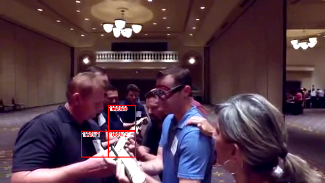
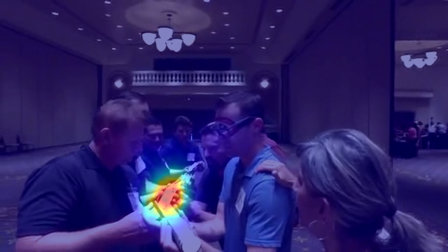
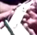

# Visual pattern report

Video 128 · 0096.png · frame position 96 · complete





Blue = lower predicted saliency; red = higher predicted saliency. Colors are normalized within each frame.

## Anchor 103972: cell (5, 4)

Video 128 · frame 96 (0096.png)



```json
{
  "Description of each patch": [
    {
      "Anchor": {
        "Semantic object or part": "Portion of a guitar neck and fretboard with fingers touching it",
        "Color": "Off-white, beige, and dark brown",
        "Texture": "Smooth wood grain and skin texture",
        "Edge Description": "Diagonal linear edges of the fretboard and fingers",
        "Low-level visual features": "High contrast between light wood and dark frets/fingers"
      }
    },
    {
      "Match 1": {
        "Semantic object or part": "Portion of a foaming surface and a hand",
        "Color": "Bright white, yellow, and skin-toned",
        "Texture": "Smooth and creamy or glossy",
        "Edge Description": "Vertical bright highlight with blurred boundaries on the right",
        "Low-level visual features": "Strong central vertical gradient from bright white to yellowish-tan"
      }
    },
    {
      "Match 2": {
        "Semantic object or part": "Head and muzzle of a white dog",
        "Color": "White, grey, and dark brown",
        "Texture": "Short fur texture",
        "Edge Description": "Curved outlines of the dog's head and snout",
        "Low-level visual features": "Moderate contrast between white fur and dark facial features"
      }
    },
    {
      "Match 3": {
        "Semantic object or part": "White pasty or creamy substance inside a container",
        "Color": "Light grey, off-white, and pale blue tint",
        "Texture": "Smooth with subtle curved streaks or ridges",
        "Edge Description": "Diagonal dark frame border at the top-right and faint curved lines",
        "Low-level visual features": "Low contrast monochromatic tonal variations"
      }
    },
    {
      "Match 4": {
        "Semantic object or part": "Yellowish-green tent fabric and a vertical seam/pole area",
        "Color": "Olive green, yellow, and deep shadow",
        "Texture": "Fabric texture with folds",
        "Edge Description": "Vertical and diagonal straight lines forming folds and seams",
        "Low-level visual features": "Moderate contrast between lit fabric and shadowed recesses"
      }
    },
    {
      "Match 5": {
        "Semantic object or part": "Portion of a person's face around the nose and upper lip covered in white cream",
        "Color": "Skin-toned and bright white",
        "Texture": "Smooth skin and creamy texture",
        "Edge Description": "Curved edges of the nose base and wavy edges of the white cream",
        "Low-level visual features": "High contrast between skin tones and white foam"
      }
    }
  ],
  "Description of the common visual pattern": "There is no consistent visual pattern, object, or texture shared by a majority of the target patches, as each patch depicts completely different subjects (a guitar fretboard, foam, a dog, a tray of cream, a tent, and a face with shaving cream).",
  "Visual pattern title": "None",
  "Supporting patches": [],
  "Non-supporting patches": [
    "Anchor",
    "Match 1",
    "Match 2",
    "Match 3",
    "Match 4",
    "Match 5"
  ]
}
```

Anchor top-k prototypes: [6, 80, 159]

Prototypes common to every retrieved match: [111]

| Match number | Node | Video / frame | Saliency label | Percentile | Stage-4 cosine |
| --- | --- | --- | --- | --- | --- |
| 1 | 235661 | 309 / 0032.png | salient | 1.000 | 0.0773 |
| 2 | 138979 | 174 / 0352.png | salient | 1.000 | 0.0588 |
| 3 | 89573 | 110 / 0160.png | salient | 0.976 | 0.0163 |
| 4 | 94134 | 116 / 0544.png | salient | 0.988 | 0.0620 |
| 5 | 349733 | 459 / 0608.png | salient | 0.988 | 0.0110 |

Node 235661 — shared with anchor: []; recurring across matches (ID/count): [{'id': 5, 'count': 3}, {'id': 111, 'count': 5}, {'id': 187, 'count': 3}]

Node 138979 — shared with anchor: [159]; recurring across matches (ID/count): [{'id': 111, 'count': 5}]

Node 89573 — shared with anchor: []; recurring across matches (ID/count): [{'id': 5, 'count': 3}, {'id': 111, 'count': 5}]

Node 94134 — shared with anchor: []; recurring across matches (ID/count): [{'id': 111, 'count': 5}, {'id': 187, 'count': 3}]

Node 349733 — shared with anchor: []; recurring across matches (ID/count): [{'id': 5, 'count': 3}, {'id': 111, 'count': 5}, {'id': 187, 'count': 3}]

## Anchor 103960: cell (4, 4)

Video 128 · frame 96 (0096.png)


{
  "Description of each patch": [
    {
      "Anchor": {
        "Semantic object or part": "A person's dark-colored shirt and torso",
        "Color": "Dark blue and black",
        "Texture": "Smooth fabric",
        "Edge Description": "Vertical and diagonal soft edges of clothing",
        "Low-level visual features": "Low luminance, uniform dark color regions"
      }
    },
    {
      "Match 1": {
        "Semantic object or part": "Outdoor foliage and bushes",
        "Color": "Dark green and brown",
        "Texture": "Leafy and rough",
        "Edge Description": "Irregular, organic edges",
        "Low-level visual features": "Mottled dark green and earthy tones"
      }
    },
    {
      "Match 2": {
        "Semantic object or part": "Dense forest foliage and trees",
        "Color": "Dark green",
        "Texture": "Leafy and dense",
        "Edge Description": "Soft, organic boundaries",
        "Low-level visual features": "Varied shades of dark green foliage"
      }
    },
    {
      "Match 3": {
        "Semantic object or part": "Bushes and vegetation along a riverbank",
        "Color": "Dark green",
        "Texture": "Leafy and textured",
        "Edge Description": "Natural, irregular edges",
        "Low-level visual features": "Dense green clusters with shadow gradients"
      }
    },
    {
      "Match 4": {
        "Semantic object or part": "Dark foliage and rocky terrain",
        "Color": "Dark gray and brown",
        "Texture": "Rough and uneven",
        "Edge Description": "Irregular shadow edges",
        "Low-level visual features": "High contrast dark tones with speckled highlights"
      }
    },
    {
      "Match 5": {
        "Semantic object or part": "Forest trees along a roadside",
        "Color": "Dark green",
        "Texture": "Leafy and dense",
        "Edge Description": "Curved and organic edges",
        "Low-level visual features": "Canopy of green trees against lighter background"
      }
    },
    {
      "Match 6": {
        "Semantic object or part": "Tree foliage above a rooftop",
        "Color": "Dark green",
        "Texture": "Leafy",
        "Edge Description": "Organic and linear rooftop intersection",
        "Low-level visual features": "Green foliage contrasting with a gray roof structure"
      }
    },
    {
      "Match 7": {
        "Semantic object or part": "Bushes and trees by a roadside",
        "Color": "Dark green and brown",
        "Texture": "Leafy",
        "Edge Description": "Vertical linear edge on the right and organic edges",
        "Low-level visual features": "Dark vegetation with vertical pole-like feature"
      }
    }
  ],
  "Description of the common visual pattern": "Most of the patches depict natural outdoor vegetation, specifically dark green or brownish foliage, trees, and bushes characterized by dense, leafy textures and organic edges.",
  "Visual pattern title": "Outdoor foliage and bushes",
  "Supporting patches": [
    "Match 1",
    "Match 2",
    "Match 3",
    "Match 4",
    "Match 5",
    "Match 6",
    "Match 7"
  ],
  "Non-supporting patches": [
    "Anchor"
  ]
}

Anchor top-k prototypes: [27, 103, 181]

Prototypes common to every retrieved match: [27]

| Match number | Node | Video / frame | Saliency label | Percentile | Stage-4 cosine |
| --- | --- | --- | --- | --- | --- |
| 1 | 22216 | 029 / 0096.png | non-salient | 0.819 | 0.0909 |
| 2 | 9016 | 012 / 0672.png | non-salient | 0.843 | 0.1065 |
| 3 | 52373 | 063 / 0416.png | non-salient | 0.819 | 0.0184 |
| 4 | 114440 | 144 / 0480.png | non-salient | 0.855 | 0.0011 |
| 5 | 184411 | 239 / 0096.png | non-salient | 0.880 | 0.0375 |
| 6 | 44992 | 056 / 0160.png | non-salient | 0.771 | 0.0618 |
| 7 | 152768 | 194 / 0032.png | non-salient | 0.639 | 0.0627 |

Node 22216 — shared with anchor: [27, 181]; recurring across matches (ID/count): [{'id': 27, 'count': 7}, {'id': 158, 'count': 2}, {'id': 181, 'count': 5}]

Node 9016 — shared with anchor: [27, 181]; recurring across matches (ID/count): [{'id': 27, 'count': 7}, {'id': 114, 'count': 3}, {'id': 181, 'count': 5}]

Node 52373 — shared with anchor: [27, 181]; recurring across matches (ID/count): [{'id': 27, 'count': 7}, {'id': 114, 'count': 3}, {'id': 181, 'count': 5}]

Node 114440 — shared with anchor: [27, 181]; recurring across matches (ID/count): [{'id': 27, 'count': 7}, {'id': 158, 'count': 2}, {'id': 181, 'count': 5}]

Node 184411 — shared with anchor: [27]; recurring across matches (ID/count): [{'id': 27, 'count': 7}, {'id': 102, 'count': 2}]

Node 44992 — shared with anchor: [27, 181]; recurring across matches (ID/count): [{'id': 27, 'count': 7}, {'id': 114, 'count': 3}, {'id': 181, 'count': 5}]

Node 152768 — shared with anchor: [27]; recurring across matches (ID/count): [{'id': 27, 'count': 7}, {'id': 102, 'count': 2}]

## Anchor 103971: cell (5, 3)

Video 128 · frame 96 (0096.png)


```json
{
  "Description of each patch": [
    {
      "Anchor": {
        "Semantic object or part": "A dark fabric shirt and a white vertical ID badge or tag",
        "Color": "Black and white",
        "Texture": "Smooth fabric and smooth card/tag",
        "Edge Description": "Straight vertical and diagonal edges of the tag against dark clothing",
        "Low-level visual features": "High contrast between dark shirt and white rectangular tag"
      }
    },
    {
      "Match 1": {
        "Semantic object or part": "Dark hair or fur and gloved hands",
        "Color": "Dark brown, black, and white",
        "Texture": "Fuzzy or hair-like",
        "Edge Description": "Soft, irregular edges",
        "Low-level visual features": "Dark tones with surrounding light-colored gloved hands"
      }
    },
    {
      "Match 2": {
        "Semantic object or part": "Brown hair and white collar/fabric",
        "Color": "Brown and white",
        "Texture": "Strand-like hair texture and smooth fabric",
        "Edge Description": "Curved and linear edges between hair and clothing",
        "Low-level visual features": "Medium contrast between brown hair and white coat"
      }
    },
    {
      "Match 3": {
        "Semantic object or part": "Brownish-red hair and a sign with red lettering",
        "Color": "Brown, red, and white",
        "Texture": "Wavy or curly hair texture and flat sign surface",
        "Edge Description": "Curved hair strands and sharp letters",
        "Low-level visual features": "High contrast between hair and white/red background"
      }
    }
  ],
  "Description of the common visual pattern": "There is no clear visual pattern shared by most target patches, as the anchor depicts a shirt with an ID badge while the match patches depict hair and various backgrounds.",
  "Visual pattern title": "None",
  "Supporting patches": [],
  "Non-supporting patches": [
    "Anchor",
    "Match 1",
    "Match 2",
    "Match 3"
  ]
}
```

Anchor top-k prototypes: [89, 169, 194]

Prototypes common to every retrieved match: [103, 194]

| Match number | Node | Video / frame | Saliency label | Percentile | Stage-4 cosine |
| --- | --- | --- | --- | --- | --- |
| 1 | 20214 | 026 / 0480.png | non-salient | 0.928 | 0.0436 |
| 2 | 261932 | 344 / 0096.png | non-salient | 0.916 | 0.0489 |
| 3 | 77734 | 095 / 0480.png | non-salient | 0.783 | 0.0690 |

Node 20214 — shared with anchor: [194]; recurring across matches (ID/count): [{'id': 103, 'count': 3}, {'id': 117, 'count': 2}, {'id': 194, 'count': 3}]

Node 261932 — shared with anchor: [194]; recurring across matches (ID/count): [{'id': 103, 'count': 3}, {'id': 194, 'count': 3}]

Node 77734 — shared with anchor: [194]; recurring across matches (ID/count): [{'id': 103, 'count': 3}, {'id': 117, 'count': 2}, {'id': 194, 'count': 3}]
