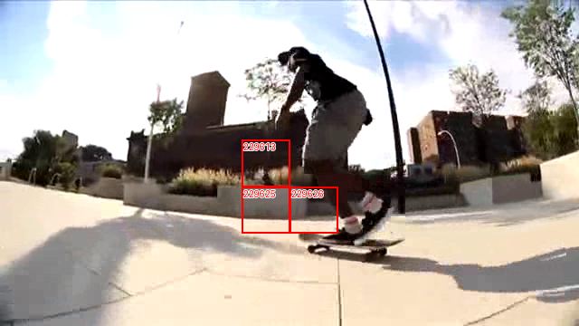
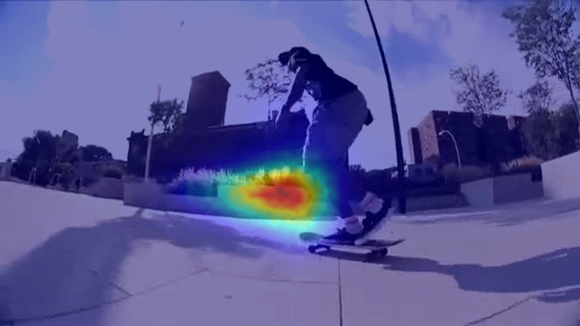
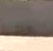
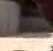
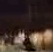

# Visual pattern report

Video 300 · 0096.png · frame position 96 · complete





Blue = lower predicted saliency; red = higher predicted saliency. Colors are normalized within each frame.

## Anchor 229625: cell (4, 5)

Video 300 · frame 96 (0096.png)



```json
{
  "Description of each patch": [
    {
      "Anchor": {
        "Semantic object or part": "Concrete wall surface",
        "Color": "Light gray",
        "Smooth",
        "Edge Description": "Vertical and horizontal boundaries of a flat wall section",
        "Low-level visual features": "Uniform low-contrast texture with minor surface variations"
      }
    },
    {
      "Match 1": {
        "Semantic object or part": "Dense foliage and bushes",
        "Color": "Dark green and brown",
        "Texture": "Rough, organic, leafy",
        "Edge Description": "Irregular organic outlines",
        "Low-level visual features": "High-contrast speckling of dark shadows and green leaves"
      }
    },
    {
      "Match 2": {
        "Semantic object or part": "Asphalt pavement and white painted line",
        "Color": "Dark gray and white",
        "Texture": "Fine-grained asphalt and smooth painted line",
        "Edge Description": "A sharp straight horizontal white stripe across dark pavement",
        "Low-level visual features": "Linear contrast between dark road surface and white marking"
      }
    },
    {
      "Match 3": {
        "Semantic object or part": "Tree foliage and a metal guardrail",
        "Color": "Dark green, greyish-silver",
        "Texture": "Organic leafy texture above a metallic rail",
        "Edge Description": "Curved horizontal metallic edge below organic foliage shapes",
        "Low-level visual features": "Combination of natural organic patterns and a man-made linear edge"
      }
    },
    {
      "Match 4": {
        "Semantic object or part": "Grass, dirt ground, and building foundation",
        "Color": "Brownish-green and off-white",
        "Texture": "Sparse grassy ground and smooth wall base",
        "Edge Description": "Angled corner where the building foundation meets the ground",
        "Low-level visual features": "Earthy tones with a sharp geometric corner edge"
      }
    },
    {
      "Match 5": {
        "Semantic object or part": "Dense green bushes and foliage",
        "Color": "Dark green and earthy brown",
        "Texture": "Dense, leafy, organic",
        "Edge Description": "Irregular boundaries of shrubbery along a ground line",
        "Low-level visual features": "Natural organic texture with varied shadow and highlight distribution"
      }
    },
    {
      "Match 6": {
        "Semantic object or part": "Dense tree foliage and background canopy",
        "Color": "Dark green",
        "Texture": "Densely packed leaves and branches",
        "Edge Description": "Diffuse organic canopy edges",
        "Low-level visual features": "Uniformly dark green organic texture with scattered shadows"
      }
    },
    {
      "Match 7": {
        "Semantic object or part": "Tree foliage above a roof edge",
        "Color": "Dark green and brown/grey",
        "Texture": "Leafy vegetation meeting a roof structure",
        "Edge Description": "Horizontal and slanted roof lines intersecting with organic foliage",
        "Low-level visual features": "Contrasting straight architectural lines against irregular natural shapes"
      }
    }
  ],
  "Description of the common visual pattern": "The majority of patches feature dense natural foliage and vegetation with dark green and brown organic textures and irregular organic edges.",
  "Visual pattern title": "Dense foliage and vegetation",
  "Supporting patches": [
    "Match 1",
    "Match 3",
    "Match 5",
    "Match 6",
    "Match 7"
  ],
  "Non-supporting patches": [
    "Anchor",
    "Match 2",
    "Match 4"
  ]
}
```

Anchor top-k prototypes: [100, 122, 205]

Prototypes common to every retrieved match: [27]

| Match number | Node | Video / frame | Saliency label | Percentile | Stage-4 cosine |
| --- | --- | --- | --- | --- | --- |
| 1 | 22216 | 029 / 0096.png | non-salient | 0.819 | 0.0856 |
| 2 | 191236 | 247 / 0224.png | non-salient | 0.855 | 0.1471 |
| 3 | 184411 | 239 / 0096.png | non-salient | 0.880 | 0.3188 |
| 4 | 158049 | 201 / 0032.png | non-salient | 0.530 | 0.0820 |
| 5 | 52373 | 063 / 0416.png | non-salient | 0.819 | 0.0103 |
| 6 | 9016 | 012 / 0672.png | non-salient | 0.843 | 0.0355 |
| 7 | 44992 | 056 / 0160.png | non-salient | 0.771 | 0.1530 |

Node 22216 — shared with anchor: []; recurring across matches (ID/count): [{'id': 27, 'count': 7}, {'id': 181, 'count': 5}]

Node 191236 — shared with anchor: []; recurring across matches (ID/count): [{'id': 27, 'count': 7}, {'id': 102, 'count': 2}, {'id': 181, 'count': 5}]

Node 184411 — shared with anchor: []; recurring across matches (ID/count): [{'id': 27, 'count': 7}, {'id': 102, 'count': 2}]

Node 158049 — shared with anchor: []; recurring across matches (ID/count): [{'id': 27, 'count': 7}]

Node 52373 — shared with anchor: []; recurring across matches (ID/count): [{'id': 27, 'count': 7}, {'id': 114, 'count': 3}, {'id': 181, 'count': 5}]

Node 9016 — shared with anchor: []; recurring across matches (ID/count): [{'id': 27, 'count': 7}, {'id': 114, 'count': 3}, {'id': 181, 'count': 5}]

Node 44992 — shared with anchor: []; recurring across matches (ID/count): [{'id': 27, 'count': 7}, {'id': 114, 'count': 3}, {'id': 181, 'count': 5}]

## Anchor 229626: cell (4, 6)

Video 300 · frame 96 (0096.png)



```json
{
  "Description of each patch": [
    {
      "Anchor": {
        "Semantic object or part": "A vertical edge of a gray concrete wall meeting a beige ground surface",
        "Color": "Gray, beige, and muted brown",
        "Texture": "Smooth to slightly rough matte surface",
        "Edge Description": "A vertical straight edge line meeting a horizontal ground line",
        "Low-level visual features": "Vertical and horizontal linear gradients with low contrast"
      }
    },
    {
      "Match 1": {
        "Semantic object or part": "Dense dark green bushes and vegetation",
        "Color": "Dark green, brown, and grayish tones",
        "Texture": "Rough, leafy, and organic",
        "Edge Description": "Irregular organic edges of foliage",
        "Low-level visual features": "High-frequency textural patterns with low overall brightness"
      }
    },
    {
      "Match 2": {
        "Semantic object or part": "Gray asphalt pavement with a horizontal white painted line",
        "Color": "Dark gray and bright white",
        "Texture": "Granular asphalt surface",
        "Edge Description": "A sharp horizontal white stripe edge against dark asphalt",
        "Low-level visual features": "High contrast straight linear element over a uniform textured background"
      }
    },
    {
      "Match 3": {
        "Semantic object or part": "Green foliage and a portion of a metallic road guardrail",
        "Color": "Green, dark gray, and metallic highlights",
        "Texture": "Leafy organic texture combined with a smooth metallic surface",
        "Edge Description": "Curved linear edge of the guardrail intersecting organic foliage edges",
        "Low-level visual features": "Mixed high-frequency organic textures and smooth linear highlights"
      }
    },
    {
      "Match 4": {
        "Semantic object or part": "Green foliage, bushes, and grassy ground near a water body",
        "Color": "Green, yellow-green, and grayish blue",
        "Texture": "Leafy and grassy organic texture",
        "Edge Description": "Irregular organic boundaries of bushes and a horizontal shoreline edge",
        "Low-level visual features": "Natural organic texture gradients with moderate contrast at the water boundary"
      }
    },
    {
      "Match 5": {
        "Semantic object or part": "Dense green trees and foliage canopy",
        "Color": "Dark green and muted olive tones",
        "Texture": "Dense, leafy, and dappled",
        "Edge Description": "Soft, irregular organic edges",
        "Low-level visual features": "Dappled lighting with high-frequency organic patterns"
      }
    },
    {
      "Match 6": {
        "Semantic object or part": "Green foliage above a sloped roof edge",
        "Color": "Green, dark brown, and grayish blue",
        "Texture": "Leafy texture combined with smooth architectural surfaces",
        "Edge Description": "Slanted straight roof edges intersecting organic foliage shapes",
        "Low-level visual features": "Combination of straight architectural lines and organic foliage textures"
      }
    },
    {
      "Match 7": {
        "Semantic object or part": "Dry grass, dirt, and the white foundation of a building",
        "Color": "Tan, brown, and off-white",
        "Texture": "Sparse grassy texture and smooth painted wall surface",
        "Edge Description": "Angular geometric lines of the building foundation meeting the ground",
        "Low-level visual features": "Horizontal and diagonal linear contrasts with earthy color palettes"
      }
    }
  ],
  "Description of the common visual pattern": "Most of the patches feature dense green foliage, bushes, or trees with organic textures and natural green and dark tones.",
  "Visual pattern title": "Green foliage and vegetation",
  "Supporting patches": [
    "Match 1",
    "Match 3",
    "Match 4",
    "Match 5",
    "Match 6"
  ],
  "Non-supporting patches": [
    "Anchor",
    "Match 2",
    "Match 7"
  ]
}
```

Anchor top-k prototypes: [21, 102, 122]

Prototypes common to every retrieved match: [27]

| Match number | Node | Video / frame | Saliency label | Percentile | Stage-4 cosine |
| --- | --- | --- | --- | --- | --- |
| 1 | 22216 | 029 / 0096.png | non-salient | 0.819 | 0.0612 |
| 2 | 191236 | 247 / 0224.png | non-salient | 0.855 | 0.1575 |
| 3 | 184411 | 239 / 0096.png | non-salient | 0.880 | 0.3538 |
| 4 | 52373 | 063 / 0416.png | non-salient | 0.819 | 0.0072 |
| 5 | 9016 | 012 / 0672.png | non-salient | 0.843 | 0.0734 |
| 6 | 44992 | 056 / 0160.png | non-salient | 0.771 | 0.1684 |
| 7 | 158049 | 201 / 0032.png | non-salient | 0.530 | 0.0657 |

Node 22216 — shared with anchor: []; recurring across matches (ID/count): [{'id': 27, 'count': 7}, {'id': 181, 'count': 5}]

Node 191236 — shared with anchor: [102]; recurring across matches (ID/count): [{'id': 27, 'count': 7}, {'id': 102, 'count': 2}, {'id': 181, 'count': 5}]

Node 184411 — shared with anchor: [102]; recurring across matches (ID/count): [{'id': 27, 'count': 7}, {'id': 102, 'count': 2}]

Node 52373 — shared with anchor: []; recurring across matches (ID/count): [{'id': 27, 'count': 7}, {'id': 114, 'count': 3}, {'id': 181, 'count': 5}]

Node 9016 — shared with anchor: []; recurring across matches (ID/count): [{'id': 27, 'count': 7}, {'id': 114, 'count': 3}, {'id': 181, 'count': 5}]

Node 44992 — shared with anchor: []; recurring across matches (ID/count): [{'id': 27, 'count': 7}, {'id': 114, 'count': 3}, {'id': 181, 'count': 5}]

Node 158049 — shared with anchor: []; recurring across matches (ID/count): [{'id': 27, 'count': 7}]

## Anchor 229613: cell (3, 5)

Video 300 · frame 96 (0096.png)



```json
{
  "Description of each patch": [
    {
      "Anchor": {
        "Semantic object or part": "Dark textured ground or vegetation",
        "Color": "Dark brown, black, and pale highlights",
        "Texture": "Rough and blurry",
        "Edge Description": "Vertical and irregular vertical edges",
        "Low-level visual features": "Low contrast, dark luminance with scattered bright spots"
      }
    },
    {
      "Match 1": {
        "Semantic object or part": "Asphalt road surface and car underbody shadow",
        "Color": "Dark gray and a horizontal white stripe at the bottom",
        "Texture": "Smooth asphalt grain with a sharp line",
        "Edge Description": "Horizontal straight edge from the painted line",
        "Low-level visual features": "Medium contrast between gray pavement and white line"
      }
    },
    {
      "Match 2": {
        "Semantic object or part": "Dirt ground and sparse brush",
        "Color": "Brown, gray, and earthy tones",
        "Texture": "Uneven, speckled",
        "Edge Description": "Soft, irregular edges",
        "Low-level visual features": "Muted contrast, natural outdoor lighting"
      }
    },
    {
      "Match 3": {
        "Semantic object or part": "Indoor ceiling or upper wall structure with a light band",
        "Color": "Dark tones with a purple horizontal stripe",
        "Texture": "Smooth with horizontal banding",
        "Edge Description": "Horizontal parallel lines",
        "Low-level visual features": "Low luminance overall with a distinct colored band"
      }
    },
    {
      "Match 4": {
        "Semantic object or part": "Rocky ground or cave entrance debris",
        "Color": "Dark gray, black, and brownish",
        "Texture": "Rough, rocky, uneven",
        "Edge Description": "Irregular jagged edges",
        "Low-level visual features": "High local contrast, dark shadows"
      }
    },
    {
      "Match 5": {
        "Semantic object or part": "Tree foliage above a roof",
        "Color": "Dark green and brown",
        "Texture": "Leafy, dense foliage",
        "Edge Description": "Organic, curved, irregular contours",
        "Low-level visual features": "Medium-low contrast natural texture"
      }
    },
    {
      "Match 6": {
        "Semantic object or part": "Ground patch near a building foundation",
        "Color": "Brown dirt, green-brown grass, and white wall base",
        "Texture": "Grassy and earthy",
        "Edge Description": "Straight horizontal and vertical architectural edges near the top-right",
        "Low-level visual features": "Clear demarcation between the white wall base and dark soil"
      }
    },
    {
      "Match 7": {
        "Semantic object or part": "Dense tree canopy or foliage",
        "Color": "Dark green and black",
        "Texture": "Foliage pattern",
        "Edge Description": "Irregular organic edges",
        "Low-level visual features": "Low contrast dark green tones"
      }
    }
  ],
  "Description of the common visual pattern": "There is no consistent visual pattern or shared object category across strictly more than half of the patches, as each patch depicts entirely different scenes and contents (e.g., pavement, foliage, indoor lighting, soil, and architecture).",
  "Visual pattern title": "None",
  "Supporting patches": [],
  "Non-supporting patches": [
    "Anchor",
    "Match 1",
    "Match 2",
    "Match 3",
    "Match 4",
    "Match 5",
    "Match 6",
    "Match 7"
  ]
}
```

Anchor top-k prototypes: [27, 95, 102]

Prototypes common to every retrieved match: [27]

| Match number | Node | Video / frame | Saliency label | Percentile | Stage-4 cosine |
| --- | --- | --- | --- | --- | --- |
| 1 | 191236 | 247 / 0224.png | non-salient | 0.855 | 0.1604 |
| 2 | 22216 | 029 / 0096.png | non-salient | 0.819 | 0.0769 |
| 3 | 255315 | 333 / 0224.png | non-salient | 0.807 | 0.0861 |
| 4 | 114440 | 144 / 0480.png | non-salient | 0.855 | 0.0826 |
| 5 | 44992 | 056 / 0160.png | non-salient | 0.771 | 0.1511 |
| 6 | 158049 | 201 / 0032.png | non-salient | 0.530 | 0.0871 |
| 7 | 9016 | 012 / 0672.png | non-salient | 0.843 | 0.0080 |

Node 191236 — shared with anchor: [27, 102]; recurring across matches (ID/count): [{'id': 27, 'count': 7}, {'id': 181, 'count': 5}]

Node 22216 — shared with anchor: [27]; recurring across matches (ID/count): [{'id': 27, 'count': 7}, {'id': 158, 'count': 2}, {'id': 181, 'count': 5}]

Node 255315 — shared with anchor: [27]; recurring across matches (ID/count): [{'id': 27, 'count': 7}, {'id': 39, 'count': 2}]

Node 114440 — shared with anchor: [27]; recurring across matches (ID/count): [{'id': 27, 'count': 7}, {'id': 158, 'count': 2}, {'id': 181, 'count': 5}]

Node 44992 — shared with anchor: [27]; recurring across matches (ID/count): [{'id': 27, 'count': 7}, {'id': 114, 'count': 2}, {'id': 181, 'count': 5}]

Node 158049 — shared with anchor: [27]; recurring across matches (ID/count): [{'id': 27, 'count': 7}, {'id': 39, 'count': 2}]

Node 9016 — shared with anchor: [27]; recurring across matches (ID/count): [{'id': 27, 'count': 7}, {'id': 114, 'count': 2}, {'id': 181, 'count': 5}]
