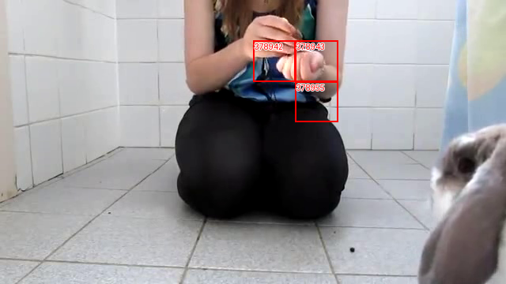
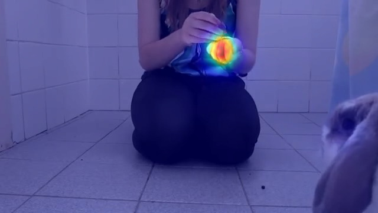
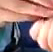

# Visual pattern report

Video 500 · 0096.png · frame position 96 · complete





Blue = lower predicted saliency; red = higher predicted saliency. Colors are normalized within each frame.

## Anchor 378943: cell (1, 7)

Video 500 · frame 96 (0096.png)


```json
{
  "Description of each patch": [
    {
      "Anchor": {
        "Semantic object or part": "Human hand and fingers",
        "Color": "Skin tone (peach, pinkish beige)",
        "Texture": "Smooth skin texture with faint creases",
        "Edge Description": "Curved, soft edges outlining the fingers and hand curvature",
        "Low-level visual features": "Gradient lighting across skin surface, soft blur"
      }
    },
    {
      "Match 1": {
        "Semantic object or part": "Outdoor ground or dirt path",
        "Color": "Greyish brown, earthy tones",
        "Texture": "Granular, earthy, uneven",
        "Edge Description": "Diffuse, natural boundaries",
        "Low-level visual features": "Low contrast, mottled shading"
      }
    },
    {
      "Match 2": {
        "Semantic object or part": "Edge of a painted surface or object",
        "Color": "Dark brown/maroon and grey",
        "Texture": "Smooth painted surface with a textured top plane",
        "Edge Description": "Straight horizontal edges and linear boundaries",
        "Low-level visual features": "Sharp linear contrast along the edge"
      }
    },
    {
      "Match 3": {
        "Semantic object or part": "Blue block or padded surface",
        "Color": "Blue",
        "Texture": "Smooth, matte texture",
        "Edge Description": "Straight geometric edges forming a corner/plane",
        "Low-level visual features": "Uniform blue color with lighting gradient"
      }
    },
    {
      "Match 4": {
        "Semantic object or part": "Human arm or skin area",
        "Color": "Warm flesh/skin tones",
        "Texture": "Smooth, out-of-focus skin",
        "Edge Description": "Soft, blurred boundaries",
        "Low-level visual features": "Heavy motion blur, warm lighting"
      }
    },
    {
      "Match 5": {
        "Semantic object or part": "Cross-section of a tree log or stump",
        "Color": "Brown, dark grey, and light tan",
        "Texture": "Rough wood grain and bark texture",
        "Edge Description": "Horizontal layered edges representing the top of the cut",
        "Low-level visual features": "High contrast between dark bark and lighter cut surface"
      }
    },
    {
      "Match 6": {
        "Semantic object or part": "Tan or beige flat surface (table/desk)",
        "Color": "Tan, light brown, beige",
        "Texture": "Slightly grainy or uniform flat surface",
        "Edge Description": "Straight horizontal border at the bottom",
        "Low-level visual features": "Uniform warm color with subtle shading"
      }
    },
    {
      "Match 7": {
        "Semantic object or part": "Snowy or icy ground / surface",
        "Color": "White, grey, and hints of purple/blue",
        "Texture": "Uneven, textured frozen or snowy surface with a dark hole/shadow",
        "Edge Description": "Irregular, jagged boundaries",
        "Low-level visual features": "High contrast spot (dark hole) against white/grey background"
      }
    }
  ],
  "Description of the common visual pattern": "There is no single visual pattern, object, or texture shared by strictly more than half of the target patches. Each patch depicts completely different objects and environments (skin, dirt, painted metal, blue blocks, wood, and snow).",
  "Visual pattern title": "None",
  "Supporting patches": [],
  "Non-supporting patches": [
    "Anchor",
    "Match 1",
    "Match 2",
    "Match 3",
    "Match 4",
    "Match 5",
    "Match 6",
    "Match 7"
  ]
}
```

Anchor top-k prototypes: [92, 121, 248]

Prototypes common to every retrieved match: [178]

| Match number | Node | Video / frame | Saliency label | Percentile | Stage-4 cosine |
| --- | --- | --- | --- | --- | --- |
| 1 | 355292 | 467 / 0288.png | non-salient | 0.783 | 0.0955 |
| 2 | 437594 | 577 / 0032.png | non-salient | 0.711 | 0.0431 |
| 3 | 421466 | 556 / 0544.png | non-salient | 0.590 | 0.0068 |
| 4 | 226423 | 296 / 0160.png | non-salient | 0.819 | 0.0404 |
| 5 | 331352 | 436 / 0032.png | non-salient | 0.771 | 0.0959 |
| 6 | 328937 | 432 / 0480.png | non-salient | 0.940 | 0.0886 |
| 7 | 228047 | 297 / 0608.png | non-salient | 0.229 | 0.0006 |

Node 355292 — shared with anchor: []; recurring across matches (ID/count): [{'id': 178, 'count': 7}]

Node 437594 — shared with anchor: []; recurring across matches (ID/count): [{'id': 178, 'count': 7}, {'id': 214, 'count': 5}, {'id': 216, 'count': 2}]

Node 421466 — shared with anchor: [121]; recurring across matches (ID/count): [{'id': 121, 'count': 2}, {'id': 178, 'count': 7}, {'id': 214, 'count': 5}]

Node 226423 — shared with anchor: []; recurring across matches (ID/count): [{'id': 152, 'count': 2}, {'id': 178, 'count': 7}, {'id': 214, 'count': 5}]

Node 331352 — shared with anchor: [121]; recurring across matches (ID/count): [{'id': 121, 'count': 2}, {'id': 178, 'count': 7}, {'id': 214, 'count': 5}]

Node 328937 — shared with anchor: []; recurring across matches (ID/count): [{'id': 178, 'count': 7}, {'id': 216, 'count': 2}]

Node 228047 — shared with anchor: []; recurring across matches (ID/count): [{'id': 152, 'count': 2}, {'id': 178, 'count': 7}, {'id': 214, 'count': 5}]

## Anchor 378942: cell (1, 6)

Video 500 · frame 96 (0096.png)



```json
{
  "Description of each patch": [
    {
      "Anchor": {
        "Semantic object or part": "Human fingers and skin",
        "Color": "Skin tones (beige, pinkish-brown)",
        "Texture": "Smooth",
        "Edge Description": "Horizontal and vertical edges formed by fingers",
        "Low-level visual features": "Medium contrast, warm lighting"
      }
    },
    {
      "Match 1": {
        "Semantic object or part": "Water surface / ripples",
        "Color": "Turquoise, blue-green",
        "Texture": "Rippled, grainy",
        "Edge Description": "Diffuse, soft edges",
        "Low-level visual features": "Low contrast, blurry"
      }
    },
    {
      "Match 2": {
        "Semantic object or part": "Fireplace / interior scene",
        "Color": "Dark brown, red, yellow highlights",
        "Texture": "Muted, grainy",
        "Edge Description": "Low contrast edges, blurry",
        "Low-level visual features": "High brightness variation, warm tone"
      }
    },
    {
      "Match 3": {
        "Semantic object or part": "Wooden surface or wall",
        "Color": "Orange-brown and light beige",
        "Texture": "Wood grain / smooth",
        "Edge Description": "A vertical dividing line/edge",
        "Low-level visual features": "Moderate contrast"
      }
    },
    {
      "Match 4": {
        "Semantic object or part": "Hair and background wall",
        "Color": "Dark brown, grey, beige",
        "Texture": "Smooth / strand-like",
        "Edge Description": "Vertical linear edges",
        "Low-level visual features": "Low-to-moderate contrast, blurry"
      }
    },
    {
      "Match 5": {
        "Semantic object or part": "Ground and pants/leg",
        "Color": "Grey and dark pink/red",
        "Texture": "Smooth asphalt/ground with a fabric texture",
        "Edge Description": "Vertical stripe edge",
        "Low-level visual features": "Low contrast"
      }
    },
    {
      "Match 6": {
        "Semantic object or part": "People in a crowd / room interior",
        "Color": "Dark tones, red, white",
        "Texture": "Cluttered, grainy",
        "Edge Description": "Multiple indistinct vertical and horizontal edges",
        "Low-level visual features": "Low contrast, blurry"
      }
    }
  ],
  "Description of the common visual pattern": "There is no clear pattern shared by most target patches, as each patch depicts entirely different semantic content, colors, and textures ranging from skin, water, fire, wood, hair, to clothing and pavement.",
  "Visual pattern title": "None",
  "Supporting patches": [],
  "Non-supporting patches": [
    "Anchor",
    "Match 1",
    "Match 2",
    "Match 3",
    "Match 4",
    "Match 5",
    "Match 6"
  ]
}
```

Anchor top-k prototypes: [53, 136, 150]

Prototypes common to every retrieved match: [136]

| Match number | Node | Video / frame | Saliency label | Percentile | Stage-4 cosine |
| --- | --- | --- | --- | --- | --- |
| 1 | 34655 | 044 / 0288.png | non-salient | 0.614 | 0.0512 |
| 2 | 145792 | 183 / 0160.png | non-salient | 0.940 | 0.0381 |
| 3 | 312330 | 409 / 0032.png | non-salient | 0.831 | 0.0944 |
| 4 | 406770 | 536 / 0096.png | non-salient | 0.952 | 0.0454 |
| 5 | 415769 | 548 / 0224.png | non-salient | 0.880 | 0.0218 |
| 6 | 176189 | 227 / 0288.png | non-salient | 0.964 | 0.0067 |

Node 34655 — shared with anchor: [136]; recurring across matches (ID/count): [{'id': 136, 'count': 6}, {'id': 139, 'count': 4}, {'id': 154, 'count': 4}]

Node 145792 — shared with anchor: [136]; recurring across matches (ID/count): [{'id': 28, 'count': 3}, {'id': 136, 'count': 6}, {'id': 139, 'count': 4}]

Node 312330 — shared with anchor: [136]; recurring across matches (ID/count): [{'id': 28, 'count': 3}, {'id': 136, 'count': 6}, {'id': 154, 'count': 4}]

Node 406770 — shared with anchor: [136]; recurring across matches (ID/count): [{'id': 136, 'count': 6}, {'id': 139, 'count': 4}, {'id': 154, 'count': 4}]

Node 415769 — shared with anchor: [136]; recurring across matches (ID/count): [{'id': 28, 'count': 3}, {'id': 136, 'count': 6}, {'id': 139, 'count': 4}]

Node 176189 — shared with anchor: [136]; recurring across matches (ID/count): [{'id': 136, 'count': 6}, {'id': 154, 'count': 4}]

## Anchor 378955: cell (2, 7)

Video 500 · frame 96 (0096.png)


```json
{
  "Description of each patch": [
    {
      "Anchor": {
        "Semantic object or part": "Dark fabric and a small area of skin",
        "Color": "Dark blue, black, and flesh-toned",
        "Texture": "Smooth fabric and skin",
        "Edge Description": "Straight horizontal and vertical boundaries",
        "Low-level visual features": "Low contrast with dark tones dominating"
      }
    },
    {
      "Match 1": {
        "Semantic object or part": "Dark fabric cap or hood",
        "Color": "Dark navy or black",
        "Texture": "Soft fabric texture",
        "Edge Description": "Curved and angled dark edges",
        "Low-level visual features": "Low luminance, dark pixels"
      }
    },
    {
      "Match 2": {
        "Semantic object or part": "Brown jacket fabric with folds",
        "Color": "Brown, tan, and dark shadows",
        "Texture": "Woven fabric with vertical creases",
        "Edge Description": "Vertical lines and folds",
        "Low-level visual features": "Medium contrast gradients"
      }
    },
    {
      "Match 3": {
        "Semantic object or part": "Dark blurry hair or shadow",
        "Color": "Dark gray and black with a reddish highlight",
        "Texture": "Indistinct and blurry",
        "Edge Description": "Diffuse, soft-edged boundaries",
        "Low-level visual features": "Low-light, low-contrast region"
      }
    },
    {
      "Match 4": {
        "Semantic object or part": "Human ear and blonde hair",
        "Color": "Flesh-toned and light brown/blonde",
        "Texture": "Soft hair strands and smooth skin",
        "Edge Description": "Curved contours",
        "Low-level visual features": "Medium contrast between skin and hair"
      }
    },
    {
      "Match 5": {
        "Semantic object or part": "Infant forehead and hairline",
        "Color": "Peach and flesh-toned",
        "Texture": "Smooth skin",
        "Edge Description": "Rounded contour",
        "Low-level visual features": "Smooth luminance gradient"
      }
    },
    {
      "Match 6": {
        "Semantic object or part": "Collar of a yellow-brown shirt and neck",
        "Color": "Yellowish-brown and skin tone",
        "Texture": "Fabric and skin",
        "Edge Description": "Diagonal and vertical clothing seams",
        "Low-level visual features": "Medium contrast lighting"
      }
    },
    {
      "Match 7": {
        "Semantic object or part": "Red jacket fabric",
        "Color": "Vibrant red",
        "Texture": "Coarse fabric",
        "Edge Description": "Vertical and diagonal creases",
        "Low-level visual features": "High color saturation in red channel"
      }
    }
  ],
  "Description of the common visual pattern": "There is no clear pattern shared by most target patches, as the images depict completely different scenes, objects, colors, textures, and semantic content ranging from skin and hair to various types of colored clothing.",
  "Visual pattern title": "None",
  "Supporting patches": [],
  "Non-supporting patches": [
    "Anchor",
    "Match 1",
    "Match 2",
    "Match 3",
    "Match 4",
    "Match 5",
    "Match 6",
    "Match 7"
  ]
}
```

Anchor top-k prototypes: [74, 139, 254]

Prototypes common to every retrieved match: [139, 254]

| Match number | Node | Video / frame | Saliency label | Percentile | Stage-4 cosine |
| --- | --- | --- | --- | --- | --- |
| 1 | 59924 | 072 / 0480.png | non-salient | 0.795 | 0.0252 |
| 2 | 370326 | 488 / 0736.png | non-salient | 0.964 | 0.0587 |
| 3 | 420029 | 554 / 0352.png | salient | 0.988 | 0.0932 |
| 4 | 166519 | 213 / 0160.png | non-salient | 0.843 | 0.1191 |
| 5 | 238409 | 312 / 0736.png | non-salient | 0.928 | 0.0443 |
| 6 | 20955 | 027 / 0544.png | non-salient | 0.892 | 0.0646 |
| 7 | 450200 | 595 / 0672.png | non-salient | 0.819 | 0.0288 |

Node 59924 — shared with anchor: [139, 254]; recurring across matches (ID/count): [{'id': 139, 'count': 7}, {'id': 149, 'count': 6}, {'id': 254, 'count': 7}]

Node 370326 — shared with anchor: [139, 254]; recurring across matches (ID/count): [{'id': 139, 'count': 7}, {'id': 149, 'count': 6}, {'id': 254, 'count': 7}]

Node 420029 — shared with anchor: [139, 254]; recurring across matches (ID/count): [{'id': 139, 'count': 7}, {'id': 149, 'count': 6}, {'id': 254, 'count': 7}]

Node 166519 — shared with anchor: [139, 254]; recurring across matches (ID/count): [{'id': 139, 'count': 7}, {'id': 254, 'count': 7}]

Node 238409 — shared with anchor: [139, 254]; recurring across matches (ID/count): [{'id': 139, 'count': 7}, {'id': 149, 'count': 6}, {'id': 254, 'count': 7}]

Node 20955 — shared with anchor: [139, 254]; recurring across matches (ID/count): [{'id': 139, 'count': 7}, {'id': 149, 'count': 6}, {'id': 254, 'count': 7}]

Node 450200 — shared with anchor: [139, 254]; recurring across matches (ID/count): [{'id': 139, 'count': 7}, {'id': 149, 'count': 6}, {'id': 254, 'count': 7}]
