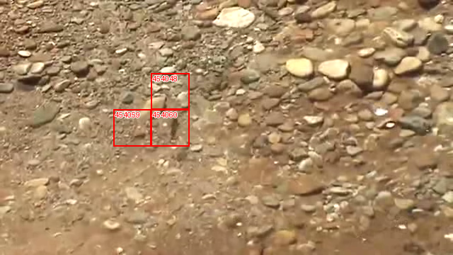
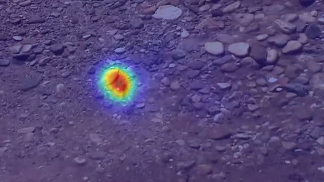
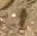
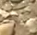
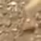

# Visual pattern report

Video 600 · 0096.png · frame position 96 · complete





Blue = lower predicted saliency; red = higher predicted saliency. Colors are normalized within each frame.

## Anchor 454060: cell (3, 4)

Video 600 · frame 96 (0096.png)



```json
{
  "Description of each patch": [
    {
      "Anchor": {
        "Semantic object or part": "A vertical dark elongated shadow or crevice on stony ground",
        "Color": "Dark brown and grey",
        "Texture": "Rough, grainy",
        "Edge Description": "Vertical, somewhat irregular edges",
        "Low-level visual features": "High contrast between dark interior and lighter surrounding pebbles"
      }
    },
    {
      "Match 1": {
        "Semantic object or part": "A small dark irregular patch on a rocky surface",
        "Color": "Dark brown, grey",
        "Texture": "Mottled, rough",
        "Edge Description": "Diffuse and irregular boundaries",
        "Low-level visual features": "Low-to-moderate contrast against the pale background rock"
      }
    },
    {
      "Match 2": {
        "Semantic object or part": "A vertical dark narrow line or gap at a corner",
        "Color": "Dark brown/black",
        "Texture": "Smooth vertical edge",
        "Edge Description": "Straight vertical line",
        "Low-level visual features": "Sharp contrast between the vertical dark line and lighter adjacent surfaces"
      }
    },
    {
      "Match 3": {
        "Semantic object or part": "A fingernail with a dark area underneath",
        "Color": "Skin tone, white, and dark grey/black",
        "Texture": "Smooth nail surface",
        "Edge Description": "Curved nail edges",
        "Low-level visual features": "Contrast between light nail plate and dark subungual region"
      }
    },
    {
      "Match 4": {
        "Semantic object or part": "Text printed on a yellow surface",
        "Color": "Black text on yellow background",
        "Texture": "Smooth painted metal",
        "Edge Description": "Sharp angular lettering ('ADAC')",
        "Low-level visual features": "High contrast black text on bright yellow and red background"
      }
    }
  ],
  "Description of the common visual pattern": "There is no clear visual pattern shared by a majority (three or more) of the target patches, as each depicts entirely different subjects such as rocky ground, a vertical line, a fingernail, and text on a vehicle.",
  "Visual pattern title": "None",
  "Supporting patches": [],
  "Non-supporting patches": [
    "Anchor",
    "Match 1",
    "Match 2",
    "Match 3",
    "Match 4"
  ]
}
```

Anchor top-k prototypes: [100, 112, 153]

Prototypes common to every retrieved match: [100, 112]

| Match number | Node | Video / frame | Saliency label | Percentile | Stage-4 cosine |
| --- | --- | --- | --- | --- | --- |
| 1 | 302089 | 395 / 0608.png | non-salient | 0.916 | 0.1950 |
| 2 | 86331 | 105 / 0480.png | salient | 1.000 | 0.0354 |
| 3 | 414593 | 546 / 0672.png | non-salient | 0.928 | 0.0344 |
| 4 | 431705 | 569 / 0352.png | non-salient | 0.916 | 0.0277 |

Node 302089 — shared with anchor: [100, 112]; recurring across matches (ID/count): [{'id': 100, 'count': 4}, {'id': 112, 'count': 4}, {'id': 233, 'count': 3}]

Node 86331 — shared with anchor: [100, 112, 153]; recurring across matches (ID/count): [{'id': 100, 'count': 4}, {'id': 112, 'count': 4}]

Node 414593 — shared with anchor: [100, 112]; recurring across matches (ID/count): [{'id': 100, 'count': 4}, {'id': 112, 'count': 4}, {'id': 233, 'count': 3}]

Node 431705 — shared with anchor: [100, 112]; recurring across matches (ID/count): [{'id': 100, 'count': 4}, {'id': 112, 'count': 4}, {'id': 233, 'count': 3}]

## Anchor 454048: cell (2, 4)

Video 600 · frame 96 (0096.png)



```json
{
  "Description of each patch": [
    {
      "Anchor": {
        "Semantic object or part": "Rocky terrain or pebbly ground",
        "Color": "Brownish-gray and tan",
        "Texture": "Rough, grainy, pebbly",
        "Edge Description": "Irregular edges of small stones",
        "Low-level visual features": "Small scattered pebbles and sandy soil patches"
      }
    },
    {
      "Match 1": {
        "Semantic object or part": "Asphalt road surface",
        "Color": "Gray",
        "Texture": "Fine-grained, smooth asphalt",
        "Edge Description": "Uniform flat surface with slight gradient",
        "Low-level visual features": "Uniform gray tone with subtle surface grain"
      }
    },
    {
      "Match 2": {
        "Semantic object or part": "Tent fabric",
        "Color": "Yellow-green",
        "Texture": "Smooth fabric with creases",
        "Edge Description": "Parallel linear folds and wrinkles",
        "Low-level visual features": "Diagonal fabric folds creating light and shadow gradients"
      }
    },
    {
      "Match 3": {
        "Semantic object or part": "Road and grass edge",
        "Color": "Gray, white, and green",
        "Texture": "Smooth road surface next to textured grass",
        "Edge Description": "Diagonal straight white line separating asphalt and grass",
        "Low-level visual features": "Diagonal white painted line dividing gray asphalt and green grass"
      }
    },
    {
      "Match 4": {
        "Semantic object or part": "Road edge with white line",
        "Color": "Gray, white, and green",
        "Texture": "Smooth road surface and grassy terrain",
        "Edge Description": "Curved diagonal white line along a road edge",
        "Low-level visual features": "White road marking bordering asphalt and green turf"
      }
    },
    {
      "Match 5": {
        "Semantic object or part": "Paved road or sidewalk surface",
        "Color": "Light gray",
        "Texture": "Smooth concrete or asphalt pavement",
        "Edge Description": "Faint horizontal line marking a curb or boundary",
        "Low-level visual features": "Light gray paved surface with uniform tone"
      }
    },
    {
      "Match 6": {
        "Semantic object or part": "Acoustic guitar body",
        "Color": "Light tan / wood tone",
        "Texture": "Smooth, polished wood grain",
        "Edge Description": "Curved upper bout edge",
        "Low-level visual features": "Smooth wooden surface with subtle horizontal grain lines"
      }
    }
  ],
  "Description of the common visual pattern": "The majority of the patches depict asphalt or paved road surfaces, characterized by a gray color palette, fine-grained texture, and road markings or edges.",
  "Visual pattern title": "Asphalt and Paved Road Surfaces",
  "Supporting patches": [
    "Match 1",
    "Match 3",
    "Match 4",
    "Match 5"
  ],
  "Non-supporting patches": [
    "Anchor",
    "Match 2",
    "Match 6"
  ]
}
```

Anchor top-k prototypes: [47, 66, 104]

Prototypes common to every retrieved match: [38, 63]

| Match number | Node | Video / frame | Saliency label | Percentile | Stage-4 cosine |
| --- | --- | --- | --- | --- | --- |
| 1 | 380395 | 502 / 0352.png | non-salient | 0.843 | 0.2994 |
| 2 | 94193 | 116 / 0608.png | non-salient | 0.904 | 0.1464 |
| 3 | 330331 | 434 / 0224.png | non-salient | 0.843 | 0.2324 |
| 4 | 269264 | 353 / 0160.png | non-salient | 0.795 | 0.1726 |
| 5 | 415830 | 548 / 0288.png | non-salient | 0.964 | 0.1373 |
| 6 | 70612 | 085 / 0096.png | non-salient | 0.807 | 0.0095 |

Node 380395 — shared with anchor: []; recurring across matches (ID/count): [{'id': 38, 'count': 6}, {'id': 63, 'count': 6}]

Node 94193 — shared with anchor: []; recurring across matches (ID/count): [{'id': 38, 'count': 6}, {'id': 63, 'count': 6}]

Node 330331 — shared with anchor: [47]; recurring across matches (ID/count): [{'id': 38, 'count': 6}, {'id': 63, 'count': 6}]

Node 269264 — shared with anchor: []; recurring across matches (ID/count): [{'id': 38, 'count': 6}, {'id': 63, 'count': 6}]

Node 415830 — shared with anchor: []; recurring across matches (ID/count): [{'id': 38, 'count': 6}, {'id': 63, 'count': 6}]

Node 70612 — shared with anchor: []; recurring across matches (ID/count): [{'id': 38, 'count': 6}, {'id': 63, 'count': 6}]

## Anchor 454059: cell (3, 3)

Video 600 · frame 96 (0096.png)



```json
{
  "Description of each patch": [
    {
      "Anchor": {
        "Semantic object or part": "Small stones, pebbles, and dirt on a ground surface",
        "Color": "Brown, tan, grey, and earthy tones",
        "Texture": "Granular, pebbly, rough, and uneven",
        "Edge Description": "Numerous small, irregular, sharp and curved edges of individual pebbles and gravel",
        "Low-level visual features": "High local contrast, heterogeneous texture, granular spatial frequency"
      }
    },
    {
      "Match 1": {
        "Semantic object or part": "Water surface",
        "Color": "Dark teal, greenish-blue, and grey",
        "Texture": "Smooth, subtle fluid gradients",
        "Edge Description": "Soft, blurred, indistinct edges",
        "Low-level visual features": "Low contrast, uniform liquid appearance"
      }
    },
    {
      "Match 2": {
        "Semantic object or part": "Water surface",
        "Color": "Dark grey, muted greenish-grey",
        "Texture": "Smooth, fluid",
        "Edge Description": "Soft, indistinct edges",
        "Low-level visual features": "Low contrast, uniform surface"
      }
    },
    {
      "Match 3": {
        "Semantic object or part": "Water surface",
        "Color": "Dark grey, brownish-grey",
        "Texture": "Smooth, subtle fluid texture",
        "Edge Description": "Soft, blurred edges",
        "Low-level visual features": "Low contrast, uniform surface"
      }
    },
    {
      "Match 4": {
        "Semantic object or part": "Water surface with faint light patterns",
        "Color": "Deep blue-green, teal",
        "Texture": "Fluid, rippled with faint caustic reflections",
        "Edge Description": "Soft, wavy, indistinct edges",
        "Low-level visual features": "Medium-low contrast, wavy patterns"
      }
    },
    {
      "Match 5": {
        "Semantic object or part": "Water surface",
        "Color": "Dark grey, muted olive-grey",
        "Texture": "Smooth, fluid",
        "Edge Description": "Soft, indistinct edges",
        "Low-level visual features": "Low contrast, uniform surface"
      }
    },
    {
      "Match 6": {
        "Semantic object or part": "Water surface",
        "Color": "Dark grey, olive-grey",
        "Texture": "Smooth, fluid",
        "Edge Description": "Soft, indistinct edges",
        "Low-level visual features": "Low contrast, uniform surface"
      }
    },
    {
      "Match 7": {
        "Semantic object or part": "Water surface",
        "Color": "Dark grey, greenish-grey",
        "Texture": "Smooth, fluid",
        "Edge Description": "Soft, indistinct edges",
        "Low-level visual features": "Low contrast, uniform surface"
      }
    }
  ],
  "Description of the common visual pattern": "The patches depict a smooth or softly rippled water surface featuring muted greenish, bluish, or grey tones, soft and indistinct edges, and low-contrast liquid textures.",
  "Visual pattern title": "Water Surface",
  "Supporting patches": [
    "Match 1",
    "Match 2",
    "Match 3",
    "Match 4",
    "Match 5",
    "Match 6",
    "Match 7"
  ],
  "Non-supporting patches": [
    "Anchor"
  ]
}
```

Anchor top-k prototypes: [0, 137, 180]

Prototypes common to every retrieved match: [173]

| Match number | Node | Video / frame | Saliency label | Percentile | Stage-4 cosine |
| --- | --- | --- | --- | --- | --- |
| 1 | 99091 | 122 / 0608.png | non-salient | 0.699 | 0.1286 |
| 2 | 79505 | 097 / 0032.png | non-salient | 0.880 | 0.0762 |
| 3 | 79506 | 097 / 0032.png | non-salient | 0.940 | 0.0693 |
| 4 | 15087 | 019 / 0672.png | non-salient | 0.614 | 0.3749 |
| 5 | 79578 | 097 / 0096.png | non-salient | 0.952 | 0.0626 |
| 6 | 79588 | 097 / 0096.png | non-salient | 0.892 | 0.0796 |
| 7 | 79517 | 097 / 0032.png | non-salient | 0.843 | 0.0362 |

Node 99091 — shared with anchor: [0]; recurring across matches (ID/count): [{'id': 0, 'count': 4}, {'id': 173, 'count': 7}]

Node 79505 — shared with anchor: []; recurring across matches (ID/count): [{'id': 90, 'count': 5}, {'id': 173, 'count': 7}]

Node 79506 — shared with anchor: []; recurring across matches (ID/count): [{'id': 90, 'count': 5}, {'id': 173, 'count': 7}]

Node 15087 — shared with anchor: [0]; recurring across matches (ID/count): [{'id': 0, 'count': 4}, {'id': 25, 'count': 2}, {'id': 173, 'count': 7}]

Node 79578 — shared with anchor: []; recurring across matches (ID/count): [{'id': 25, 'count': 2}, {'id': 90, 'count': 5}, {'id': 173, 'count': 7}]

Node 79588 — shared with anchor: [0]; recurring across matches (ID/count): [{'id': 0, 'count': 4}, {'id': 90, 'count': 5}, {'id': 173, 'count': 7}]

Node 79517 — shared with anchor: [0]; recurring across matches (ID/count): [{'id': 0, 'count': 4}, {'id': 90, 'count': 5}, {'id': 173, 'count': 7}]
