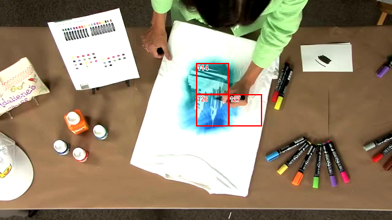
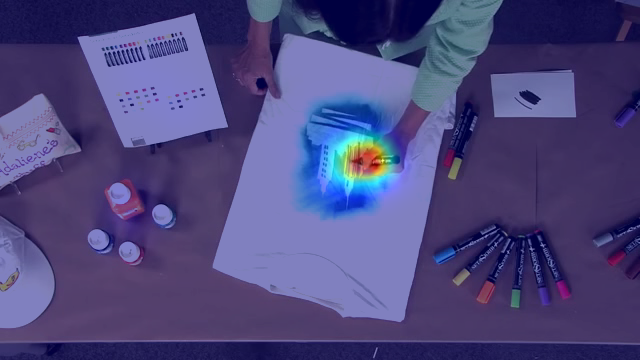
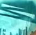
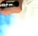

# Visual pattern report

Video 601 · 0096.png · frame position 96 · describing





Blue = lower predicted saliency; red = higher predicted saliency. Colors are normalized within each frame.

## Anchor 126: cell (3, 6)

Video 601 · frame 96 (0096.png)


```json
{
  "Description of each patch": [
    {
      "Anchor": {
        "Semantic object or part": "Blue and white watercolor or paper cutout with vertical architectural structures",
        "Color": "Blue and white",
        "Texture": "Smooth and blended",
        "Geometric or structural pattern": "Vertical lines and shapes",
        "Low-level visual features": "High contrast between blue background and white shapes"
      }
    },
    {
      "Match 1": {
        "Semantic object or part": "Brown skin or surface area",
        "Color": "Brown and tan",
        "Texture": "Smooth and blurry",
        "Geometric or structural pattern": "Featureless or indistinct shapes",
        "Low-level visual features": "Low contrast brown gradients"
      }
    },
    {
      "Match 2": {
        "Semantic object or part": "Dark vertical sign or plaque with horizontal striations mounted on a column",
        "Color": "Dark brown/black and light stone gray",
        "Texture": "Matte and structured",
        "Geometric or structural pattern": "Vertical rectangle with horizontal dividing lines",
        "Low-level visual features": "Moderate contrast between the dark object and the lighter background"
      }
    },
    {
      "Match 3": {
        "Semantic object or part": "Dark vertical sign or plaque with horizontal striations mounted on a column",
        "Color": "Dark brown/black and light stone gray",
        "Texture": "Matte and structured",
        "Geometric or structural pattern": "Vertical rectangle with horizontal dividing lines",
        "Low-level visual features": "Moderate contrast between the dark object and the lighter background"
      }
    },
    {
      "Match 4": {
        "Semantic object or part": "Lower legs of a horse",
        "Color": "Dark brown and white",
        "Texture": "Hair texture",
        "Geometric or structural pattern": "Vertical cylindrical limbs",
        "Low-level visual features": "High contrast between dark legs and white background/ground"
      }
    },
    {
      "Match 5": {
        "Semantic object or part": "Human facial profile (cheek and nose area)",
        "Color": "Dark skin tones",
        "Texture": "Smooth skin",
        "Geometric or structural pattern": "Curved contours",
        "Low-level visual features": "Shadows and highlights on facial features"
      }
    },
    {
      "Match 6": {
        "Semantic object or part": "Green foliage or plant stem against a green background",
        "Color": "Shades of green",
        "Texture": "Soft and blurry",
        "Geometric or structural pattern": "Organic vertical structure",
        "Low-level visual features": "Low contrast green tones"
      }
    },
    {
      "Match 7": {
        "Semantic object or part": "Dark vertical pole or stick with a central joint/knob against a blue sky",
        "Color": "Black and light blue",
        "Texture": "Solid and sharp",
        "Geometric or structural pattern": "Diagonal-to-vertical thin rod with a bulge",
        "Low-level visual features": "High contrast dark line against a light blue background"
      }
    }
  ],
  "Description of the common visual pattern": "There is no predominant visual pattern or semantic category shared by strictly more than half of the patches, as each image depicts completely different objects, colors, and contexts.",
  "Visual pattern title": "None",
  "Supporting patches": [],
  "Non-supporting patches": [
    "Anchor",
    "Match 1",
    "Match 2",
    "Match 3",
    "Match 4",
    "Match 5",
    "Match 6",
    "Match 7"
  ]
}
```

Anchor top-k prototypes: [100, 112, 153]

Prototypes common to every retrieved match: [160]

| Match number | Node | Video / frame | Saliency label | Percentile | Stage-4 cosine |
| --- | --- | --- | --- | --- | --- |
| 1 | 3471 | 604 / 0480.png | non-salient | 0.819 | 0.2045 |
| 2 | 41522 | 649 / 0032.png | non-salient | 0.361 | 0.0866 |
| 3 | 41942 | 649 / 0352.png | non-salient | 0.542 | 0.0397 |
| 4 | 26596 | 630 / 0800.png | non-salient | 0.783 | 0.0298 |
| 5 | 12025 | 613 / 0096.png | non-salient | 0.964 | 0.0991 |
| 6 | 75114 | 696 / 0096.png | non-salient | 0.964 | 0.0711 |
| 7 | 30247 | 634 / 0544.png | non-salient | 0.807 | 0.0483 |

Node 3471 — shared with anchor: []; recurring across matches (ID/count): [{'id': 30, 'count': 2}, {'id': 51, 'count': 2}, {'id': 160, 'count': 7}]

Node 41522 — shared with anchor: []; recurring across matches (ID/count): [{'id': 78, 'count': 2}, {'id': 160, 'count': 7}, {'id': 233, 'count': 4}]

Node 41942 — shared with anchor: []; recurring across matches (ID/count): [{'id': 160, 'count': 7}, {'id': 233, 'count': 4}]

Node 26596 — shared with anchor: []; recurring across matches (ID/count): [{'id': 160, 'count': 7}, {'id': 233, 'count': 4}]

Node 12025 — shared with anchor: []; recurring across matches (ID/count): [{'id': 30, 'count': 2}, {'id': 51, 'count': 2}, {'id': 160, 'count': 7}]

Node 75114 — shared with anchor: []; recurring across matches (ID/count): [{'id': 78, 'count': 2}, {'id': 160, 'count': 7}]

Node 30247 — shared with anchor: []; recurring across matches (ID/count): [{'id': 160, 'count': 7}, {'id': 233, 'count': 4}]

## Anchor 114: cell (2, 6)

Video 601 · frame 96 (0096.png)



```json
{
  "Description of each patch": [
    {
      "Anchor": {
        "Semantic object or part": "Layered blue and white paper-like objects with dark diagonal lines",
        "Color": "Blue, teal, white, dark blue/black",
        "Texture": "Smooth",
        "Geometric or structural pattern": "Diagonal and horizontal parallel lines",
        "Low-level visual features": "High contrast between light teal background and dark blue lines"
      }
    },
    {
      "Match 1": {
        "Semantic object or part": "Brown surface and the corner of an orange container with a white lid",
        "Color": "Brown, orange, white",
        "Texture": "Smooth, matte",
        "Geometric or structural pattern": "Rounded orange shape at the bottom-left corner against a uniform brown background",
        "Low-level visual features": "Moderate contrast between brown surface and orange/white object"
      }
    },
    {
      "Match 2": {
        "Semantic object or part": "Brown surface and the corner of an orange container with a white lid",
        "Color": "Brown, orange, white",
        "Texture": "Smooth, matte",
        "Geometric or structural pattern": "Rounded orange shape at the bottom-left corner against a uniform brown background",
        "Low-level visual features": "Moderate contrast between brown surface and orange/white object"
      }
    },
    {
      "Match 3": {
        "Semantic object or part": "Brown surface and the corner of an orange container with a white lid",
        "Color": "Brown, orange, white",
        "Texture": "Smooth, matte",
        "Geometric or structural pattern": "Rounded orange shape at the bottom-left corner against a uniform brown background",
        "Low-level visual features": "Moderate contrast between brown surface and orange/white object"
      }
    },
    {
      "Match 4": {
        "Semantic object or part": "Brown surface and the corner of an orange container with a white lid",
        "Color": "Brown, orange, white",
        "Texture": "Smooth, matte",
        "Geometric or structural pattern": "Rounded orange shape at the bottom-left corner against a uniform brown background",
        "Low-level visual features": "Moderate contrast between brown surface and orange/white object"
      }
    },
    {
      "Match 5": {
        "Semantic object or part": "Brown surface and the corner of an orange container with a white lid",
        "Color": "Brown, orange, white",
        "Texture": "Smooth, matte",
        "Geometric or structural pattern": "Rounded orange shape at the bottom-left corner against a uniform brown background",
        "Low-level visual features": "Moderate contrast between brown surface and orange/white object"
      }
    },
    {
      "Match 6": {
        "Semantic object or part": "Brown surface and the corner of an orange container with a white lid",
        "Color": "Brown, orange, white",
        "Texture": "Smooth, matte",
        "Geometric or structural pattern": "Rounded orange shape at the bottom-left corner against a uniform brown background",
        "Low-level visual features": "Moderate contrast between brown surface and orange/white object"
      }
    },
    {
      "Match 7": {
        "Semantic object or part": "Brown surface and the corner of an orange container with a white lid",
        "Color": "Brown, orange, white",
        "Texture": "Smooth, matte",
        "Geometric or structural pattern": "Rounded orange shape at the bottom-left corner against a uniform brown background",
        "Low-level visual features": "Moderate contrast between brown surface and orange/white object"
      }
    }
  ],
  "Description of the common visual pattern": "A brown background surface featuring the corner of an orange container or bottle with a white cap positioned in the bottom-left area of the patch.",
  "Visual pattern title": "Brown Surface with Orange Container Corner",
  "Supporting patches": [
    "Match 1",
    "Match 2",
    "Match 3",
    "Match 4",
    "Match 5",
    "Match 6",
    "Match 7"
  ],
  "Non-supporting patches": [
    "Anchor"
  ]
}
```

Anchor top-k prototypes: [21, 179, 234]

Prototypes common to every retrieved match: [21]

| Match number | Node | Video / frame | Saliency label | Percentile | Stage-4 cosine |
| --- | --- | --- | --- | --- | --- |
| 1 | 206 | 601 / 0160.png | non-salient | 0.928 | 0.1083 |
| 2 | 374 | 601 / 0288.png | non-salient | 0.904 | 0.0783 |
| 3 | 290 | 601 / 0224.png | non-salient | 0.904 | 0.0750 |
| 4 | 38 | 601 / 0032.png | non-salient | 0.916 | 0.0708 |
| 5 | 542 | 601 / 0416.png | non-salient | 0.916 | 0.0675 |
| 6 | 710 | 601 / 0544.png | non-salient | 0.892 | 0.0559 |
| 7 | 878 | 601 / 0672.png | non-salient | 0.892 | 0.0468 |

Node 206 — shared with anchor: [21]; recurring across matches (ID/count): [{'id': 21, 'count': 7}, {'id': 60, 'count': 5}, {'id': 106, 'count': 4}]

Node 374 — shared with anchor: [21]; recurring across matches (ID/count): [{'id': 21, 'count': 7}, {'id': 60, 'count': 5}, {'id': 106, 'count': 4}]

Node 290 — shared with anchor: [21]; recurring across matches (ID/count): [{'id': 21, 'count': 7}, {'id': 60, 'count': 5}, {'id': 106, 'count': 4}]

Node 38 — shared with anchor: [21]; recurring across matches (ID/count): [{'id': 21, 'count': 7}, {'id': 60, 'count': 5}]

Node 542 — shared with anchor: [21]; recurring across matches (ID/count): [{'id': 21, 'count': 7}, {'id': 60, 'count': 5}]

Node 710 — shared with anchor: [21, 234]; recurring across matches (ID/count): [{'id': 21, 'count': 7}, {'id': 106, 'count': 4}, {'id': 234, 'count': 2}]

Node 878 — shared with anchor: [21, 234]; recurring across matches (ID/count): [{'id': 21, 'count': 7}, {'id': 234, 'count': 2}]

## Anchor 127: cell (3, 7)

Video 601 · frame 96 (0096.png)



Pending Gemini inference.

Anchor top-k prototypes: [89, 129, 140]

Prototypes common to every retrieved match: [6, 140]

| Match number | Node | Video / frame | Saliency label | Percentile | Stage-4 cosine |
| --- | --- | --- | --- | --- | --- |
| 1 | 34815 | 640 / 0224.png | non-salient | 0.855 | 0.0665 |
| 2 | 30977 | 635 / 0160.png | non-salient | 0.675 | 0.3530 |
| 3 | 7189 | 608 / 0096.png | non-salient | 0.253 | 0.0392 |
| 4 | 56311 | 669 / 0160.png | non-salient | 0.783 | 0.0236 |
| 5 | 41190 | 648 / 0608.png | non-salient | 0.735 | 0.0162 |
| 6 | 56645 | 669 / 0416.png | non-salient | 0.928 | 0.0023 |
| 7 | 56727 | 669 / 0480.png | non-salient | 0.783 | 0.0484 |

Node 34815 — shared with anchor: [140]; recurring across matches (ID/count): [{'id': 6, 'count': 7}, {'id': 140, 'count': 7}]

Node 30977 — shared with anchor: [140]; recurring across matches (ID/count): [{'id': 6, 'count': 7}, {'id': 140, 'count': 7}, {'id': 159, 'count': 4}]

Node 7189 — shared with anchor: [140]; recurring across matches (ID/count): [{'id': 6, 'count': 7}, {'id': 140, 'count': 7}]

Node 56311 — shared with anchor: [129, 140]; recurring across matches (ID/count): [{'id': 6, 'count': 7}, {'id': 140, 'count': 7}]

Node 41190 — shared with anchor: [140]; recurring across matches (ID/count): [{'id': 6, 'count': 7}, {'id': 140, 'count': 7}, {'id': 159, 'count': 4}]

Node 56645 — shared with anchor: [140]; recurring across matches (ID/count): [{'id': 6, 'count': 7}, {'id': 140, 'count': 7}, {'id': 159, 'count': 4}]

Node 56727 — shared with anchor: [140]; recurring across matches (ID/count): [{'id': 6, 'count': 7}, {'id': 140, 'count': 7}, {'id': 159, 'count': 4}]
