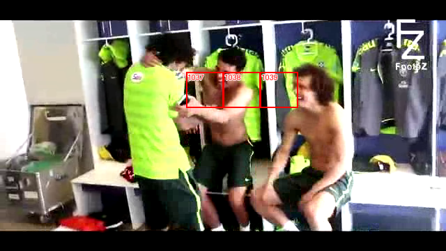
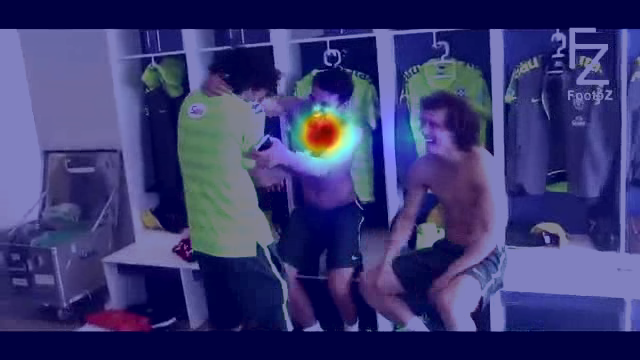
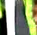

# Visual pattern report

Video 602 · 0032.png · frame position 32 · complete





Blue = lower predicted saliency; red = higher predicted saliency. Colors are normalized within each frame.

## Anchor 1038: cell (2, 6)

Video 602 · frame 32 (0032.png)


```json
{
  "Description of each patch": [
    {
      "Anchor": {
        "Semantic object or part": "Human shoulder and neck skin",
        "Color": "Skin tone (beige/brown)",
        "Texture": "Smooth",
        "Edge Description": "Diffuse and soft transitions due to lighting and blur",
        "Low-level visual features": "A gradual lighting gradient from brighter highlight on the left to shadow on the right"
      }
    },
    {
      "Match 1": {
        "Semantic object or part": "Textured ground or surface",
        "Color": "Brown and white",
        "Texture": "Rough/grainy",
        "Edge Description": "Irregular edges with high contrast around a bright spot",
        "Low-level visual features": "High luminance patch surrounded by mottled brownish texture"
      }
    },
    {
      "Match 2": {
        "Semantic object or part": "Rippling water surface",
        "Color": "Grayscale (black, white, grey)",
        "Texture": "Rippled/wavy",
        "Edge Description": "Sharp horizontal wave patterns with a vertical bright glare",
        "Low-level visual features": "High contrast alternating dark and light horizontal bands"
      }
    },
    {
      "Match 3": {
        "Semantic object or part": "Smooth paper or background surface",
        "Color": "Off-white / light grey",
        "Texture": "Smooth",
        "Edge Description": "Soft, diffuse edge from a shadow gradient",
        "Low-level visual features": "Subtle luminance gradient indicating a soft shadow"
      }
    },
    {
      "Match 4": {
        "Semantic object or part": "Smooth paper or background surface",
        "Color": "Off-white / light grey",
        "Texture": "Smooth",
        "Edge Description": "Soft, diffuse edge from a shadow gradient",
        "Low-level visual features": "Subtle luminance gradient indicating a soft shadow"
      }
    },
    {
      "Match 5": {
        "Semantic object or part": "Smooth paper or background surface",
        "Color": "Off-white / light grey",
        "Texture": "Smooth",
        "Edge Description": "Soft, diffuse edge from a shadow gradient",
        "Low-level visual features": "Subtle luminance gradient indicating a soft shadow"
      }
    },
    {
      "Match 6": {
        "Semantic object or part": "Circular sticker with printed text",
        "Color": "White background with dark red text ('RED')",
        "Texture": "Smooth with sharp typography",
        "Edge Description": "Curved circular boundary of the sticker combined with sharp letter edges",
        "Low-level visual features": "High contrast dark red letterforms on a white background"
      }
    },
    {
      "Match 7": {
        "Semantic object or part": "Smooth light-colored surface",
        "Color": "Light pinkish-white",
        "Texture": "Smooth",
        "Edge Description": "Curved, soft edge of a shadow or object boundary",
        "Low-level visual features": "Gentle gradient across a clean, featureless surface"
      }
    }
  ],
  "Description of the common visual pattern": "A smooth, uniform surface feature exhibiting a subtle lighting gradient or soft shadow transition without complex textures or busy patterns.",
  "Visual pattern title": "Smooth Surface with Soft Gradient/Shadow",
  "Supporting patches": [
    "Anchor",
    "Match 3",
    "Match 4",
    "Match 5",
    "Match 7"
  ],
  "Non-supporting patches": [
    "Match 1",
    "Match 2",
    "Match 6"
  ]
}
```

Anchor top-k prototypes: [53, 129, 155]

Prototypes common to every retrieved match: [89]

| Match number | Node | Video / frame | Saliency label | Percentile | Stage-4 cosine |
| --- | --- | --- | --- | --- | --- |
| 1 | 24365 | 629 / 0096.png | non-salient | 0.373 | 0.0280 |
| 2 | 48978 | 658 / 0160.png | non-salient | 0.554 | 0.1070 |
| 3 | 53746 | 665 / 0224.png | non-salient | 0.241 | 0.1100 |
| 4 | 53494 | 665 / 0032.png | non-salient | 0.229 | 0.0919 |
| 5 | 53914 | 665 / 0352.png | non-salient | 0.277 | 0.0243 |
| 6 | 42312 | 650 / 0032.png | non-salient | 0.518 | 0.0676 |
| 7 | 31242 | 635 / 0352.png | non-salient | 0.470 | 0.0671 |

Node 24365 — shared with anchor: [129]; recurring across matches (ID/count): [{'id': 89, 'count': 7}, {'id': 129, 'count': 6}]

Node 48978 — shared with anchor: [129]; recurring across matches (ID/count): [{'id': 40, 'count': 4}, {'id': 89, 'count': 7}, {'id': 129, 'count': 6}]

Node 53746 — shared with anchor: [129]; recurring across matches (ID/count): [{'id': 89, 'count': 7}, {'id': 129, 'count': 6}, {'id': 252, 'count': 3}]

Node 53494 — shared with anchor: [129]; recurring across matches (ID/count): [{'id': 89, 'count': 7}, {'id': 129, 'count': 6}, {'id': 252, 'count': 3}]

Node 53914 — shared with anchor: [129]; recurring across matches (ID/count): [{'id': 40, 'count': 4}, {'id': 89, 'count': 7}, {'id': 129, 'count': 6}]

Node 42312 — shared with anchor: []; recurring across matches (ID/count): [{'id': 40, 'count': 4}, {'id': 89, 'count': 7}, {'id': 252, 'count': 3}]

Node 31242 — shared with anchor: [129]; recurring across matches (ID/count): [{'id': 40, 'count': 4}, {'id': 89, 'count': 7}, {'id': 129, 'count': 6}]

## Anchor 1037: cell (2, 5)

Video 602 · frame 32 (0032.png)


```json
{
  "Description of each patch": [
    {
      "Anchor": {
        "Semantic object or part": "A person's bare arm and torso with skin texture and a dark vertical shadow or object.",
        "Color": "Skin tones (beige/brown) and dark brown or black.",
        "Texture": "Smooth skin surface and somewhat grainy or pixelated low-resolution texture.",
        "Edge Description": "Vertical and diagonal soft edges.",
        "Low-level visual features": "Gradient skin tones contrasting with a dark vertical stripe."
      }
    },
    {
      "Match 1": {
        "Semantic object or part": "An orange container or bottle with a white cap.",
        "Color": "Orange and white.",
        "Texture": "Smooth, glossy surface.",
        "Edge Description": "Curved and angled boundaries forming a rectangular container shape with a circular cap.",
        "Low-level visual features": "High contrast between the bright orange body and white cap on a brownish background."
      }
    },
    {
      "Match 2": {
        "Semantic object or part": "An orange container or bottle with a white cap.",
        "Color": "Orange and white.",
        "Texture": "Smooth, glossy surface.",
        "Edge Description": "Curved and angled boundaries forming a rectangular container shape with a circular cap.",
        "Low-level visual features": "High contrast between the bright orange body and white cap on a brownish background."
      }
    },
    {
      "Match 3": {
        "Semantic object or part": "An orange container or bottle with a white cap.",
        "Color": "Orange and white.",
        "Texture": "Smooth, glossy surface.",
        "Edge Description": "Curved and angled boundaries forming a rectangular container shape with a circular cap.",
        "Low-level visual features": "High contrast between the bright orange body and white cap on a brownish background."
      }
    },
    {
      "Match 4": {
        "Semantic object or part": "An orange container or bottle with a white cap.",
        "Color": "Orange and white.",
        "Texture": "Smooth, glossy surface.",
        "Edge Description": "Curved and angled boundaries forming a rectangular container shape with a circular cap.",
        "Low-level visual features": "High contrast between the bright orange body and white cap on a brownish background."
      }
    },
    {
      "Match 5": {
        "Semantic object or part": "An orange container or bottle with a white cap.",
        "Color": "Orange and white.",
        "Texture": "Smooth, glossy surface.",
        "Edge Description": "Curved and angled boundaries forming a rectangular container shape with a circular cap.",
        "Low-level visual features": "High contrast between the bright orange body and white cap on a brownish background."
      }
    },
    {
      "Match 6": {
        "Semantic object or part": "An orange container or bottle with a white cap.",
        "Color": "Orange and white.",
        "Texture": "Smooth, glossy surface.",
        "Edge Description": "Curved and angled boundaries forming a rectangular container shape with a circular cap.",
        "Low-level visual features": "High contrast between the bright orange body and white cap on a brownish background."
      }
    },
    {
      "Match 7": {
        "Semantic object or part": "An orange container or bottle with a white cap.",
        "Color": "Orange and white.",
        "Texture": "Smooth, glossy surface.",
        "Edge Description": "Curved and angled boundaries forming a rectangular container shape with a circular cap.",
        "Low-level visual features": "High contrast between the bright orange body and white cap on a brownish background."
      }
    }
  ],
  "Description of the common visual pattern": "The majority of patches feature an orange rectangular container or bottle with a distinct white cap, resting on a brownish surface.",
  "Visual pattern title": "Orange Container with White Cap",
  "Supporting patches": [
    "Match 1",
    "Match 2",
    "Match 3",
    "Match 4",
    "Match 5",
    "Match 6",
    "Match 7"
  ],
  "Non-supporting patches": [
    "Anchor"
  ]
}
```

Anchor top-k prototypes: [85, 193, 208]

Prototypes common to every retrieved match: [21]

| Match number | Node | Video / frame | Saliency label | Percentile | Stage-4 cosine |
| --- | --- | --- | --- | --- | --- |
| 1 | 374 | 601 / 0288.png | non-salient | 0.904 | 0.0880 |
| 2 | 290 | 601 / 0224.png | non-salient | 0.904 | 0.0803 |
| 3 | 206 | 601 / 0160.png | non-salient | 0.928 | 0.0844 |
| 4 | 710 | 601 / 0544.png | non-salient | 0.892 | 0.0809 |
| 5 | 878 | 601 / 0672.png | non-salient | 0.892 | 0.0806 |
| 6 | 38 | 601 / 0032.png | non-salient | 0.916 | 0.0777 |
| 7 | 542 | 601 / 0416.png | non-salient | 0.916 | 0.0763 |

Node 374 — shared with anchor: []; recurring across matches (ID/count): [{'id': 21, 'count': 7}, {'id': 60, 'count': 5}, {'id': 106, 'count': 4}]

Node 290 — shared with anchor: []; recurring across matches (ID/count): [{'id': 21, 'count': 7}, {'id': 60, 'count': 5}, {'id': 106, 'count': 4}]

Node 206 — shared with anchor: []; recurring across matches (ID/count): [{'id': 21, 'count': 7}, {'id': 60, 'count': 5}, {'id': 106, 'count': 4}]

Node 710 — shared with anchor: []; recurring across matches (ID/count): [{'id': 21, 'count': 7}, {'id': 106, 'count': 4}, {'id': 234, 'count': 2}]

Node 878 — shared with anchor: []; recurring across matches (ID/count): [{'id': 21, 'count': 7}, {'id': 234, 'count': 2}]

Node 38 — shared with anchor: []; recurring across matches (ID/count): [{'id': 21, 'count': 7}, {'id': 60, 'count': 5}]

Node 542 — shared with anchor: []; recurring across matches (ID/count): [{'id': 21, 'count': 7}, {'id': 60, 'count': 5}]

## Anchor 1039: cell (2, 7)

Video 602 · frame 32 (0032.png)



```json
{
  "Description of each patch": [
    {
      "Anchor": {
        "Semantic object or part": "A vertical white bar or boundary line dividing a dark grey surface",
        "Color": "White and dark grey",
        "Texture": "Smooth",
        "Edge Description": "Sharp vertical straight edges",
        "Low-level visual features": "High contrast between a vertical white strip and dark background"
      }
    },
    {
      "Match 1": {
        "Semantic object or part": "Bird's claws gripping a surface",
        "Color": "Dark grey/greenish and white highlights",
        "Texture": "Rough, scaly",
        "Edge Description": "Curved, sharp edges of claws",
        "Low-level visual features": "Complex overlapping lines against a blurred green and white bokeh background"
      }
    },
    {
      "Match 2": {
        "Semantic object or part": "The number '5' on a sports jersey sleeve",
        "Color": "Black digit on a yellow and white background",
        "Texture": "Fabric texture",
        "Edge Description": "Clear geometric edges forming the digit 5",
        "Low-level visual features": "High contrast dark typography on a bright yellow fabric"
      }
    },
    {
      "Match 3": {
        "Semantic object or part": "Metal balcony railings or bars",
        "Color": "Grey and dark silhouettes",
        "Texture": "Metallic, smooth",
        "Edge Description": "Parallel horizontal and vertical straight lines",
        "Low-level visual features": "Linear geometric structures with mixed lighting and shadows"
      }
    },
    {
      "Match 4": {
        "Semantic object or part": "Part of a beverage bottle with a red label",
        "Color": "Greenish translucent plastic, red, white letter 'G', orange cap",
        "Texture": "Smooth, glossy",
        "Edge Description": "Curved cylindrical edges",
        "Low-level visual features": "Saturated red and green color patches with a bold white letter"
      }
    },
    {
      "Match 5": {
        "Semantic object or part": "A small shed or outbuilding in the distance",
        "Color": "White walls with a dark roof",
        "Texture": "Matte, distant",
        "Edge Description": "Rectangular and triangular architectural outlines",
        "Low-level visual features": "Small structural shapes set against greenery"
      }
    }
  ],
  "Description of the common visual pattern": "There is no common visual pattern shared among the target patches, as each patch depicts entirely different semantic objects, colors, textures, and structures (such as a vertical stripe, bird claws, a jersey number, metal railings, a bottle, and a distant building).",
  "Visual pattern title": "None",
  "Supporting patches": [],
  "Non-supporting patches": [
    "Anchor",
    "Match 1",
    "Match 2",
    "Match 3",
    "Match 4",
    "Match 5"
  ]
}
```

Anchor top-k prototypes: [38, 47, 163]

Prototypes common to every retrieved match: [30]

| Match number | Node | Video / frame | Saliency label | Percentile | Stage-4 cosine |
| --- | --- | --- | --- | --- | --- |
| 1 | 34301 | 639 / 0352.png | salient | 0.988 | 0.0437 |
| 2 | 63872 | 680 / 0224.png | non-salient | 0.807 | 0.0331 |
| 3 | 10544 | 611 / 0480.png | non-salient | 0.855 | 0.0394 |
| 4 | 54387 | 666 / 0224.png | non-salient | 0.940 | 0.0520 |
| 5 | 40947 | 648 / 0416.png | non-salient | 0.867 | 0.1027 |

Node 34301 — shared with anchor: []; recurring across matches (ID/count): [{'id': 30, 'count': 5}]

Node 63872 — shared with anchor: [47]; recurring across matches (ID/count): [{'id': 30, 'count': 5}, {'id': 47, 'count': 3}, {'id': 151, 'count': 2}]

Node 10544 — shared with anchor: [47]; recurring across matches (ID/count): [{'id': 30, 'count': 5}, {'id': 47, 'count': 3}, {'id': 151, 'count': 2}]

Node 54387 — shared with anchor: []; recurring across matches (ID/count): [{'id': 30, 'count': 5}, {'id': 116, 'count': 2}]

Node 40947 — shared with anchor: [47]; recurring across matches (ID/count): [{'id': 30, 'count': 5}, {'id': 47, 'count': 3}, {'id': 116, 'count': 2}]
