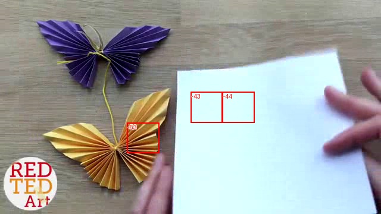
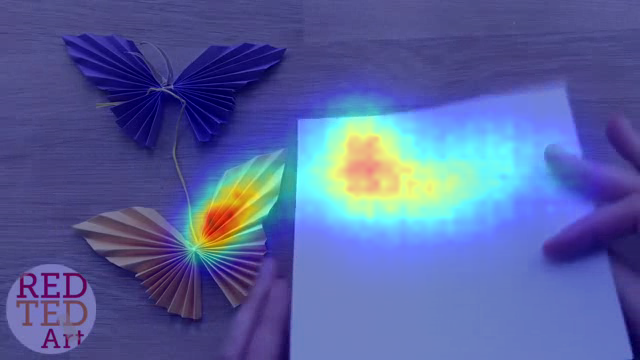

# Visual pattern report

Video 650 · 0032.png · frame position 32 · describing





Blue = lower predicted saliency; red = higher predicted saliency. Colors are normalized within each frame.

## Anchor -44: cell (3, 7)

Video 650 · frame 32 (0032.png)


```json
{
  "Description of each patch": [
    {
      "Anchor": {
        "Semantic object or part (inside patch)": "White paper surface",
        "Nearby objects (outside patch)": "Wooden table and origami paper",
        "Color": "White",
        "Texture": "Smooth",
        "Structural or geometric description": "Uniform plain surface"
      }
    },
    {
      "Match 1": {
        "Semantic object or part (inside patch)": "White paper surface",
        "Nearby objects (outside patch)": "Blue water container",
        "Color": "White",
        "Texture": "Smooth",
        "Structural or geometric description": "Uniform plain surface with a horizontal edge below"
      }
    },
    {
      "Match 2": {
        "Semantic object or part (inside patch)": "Blue cutting mat",
        "Nearby objects (outside patch)": "Pringles can and cutting mat",
        "Color": "Light blue",
        "Texture": "Grid patterned",
        "Structural or geometric description": "Grid lines intersecting"
      }
    },
    {
      "Match 3": {
        "Semantic object or part (inside patch)": "Blue cutting mat",
        "Nearby objects (outside patch)": "Hand and cutting mat",
        "Color": "Light blue",
        "Texture": "Grid patterned",
        "Structural or geometric description": "Grid lines intersecting"
      }
    },
    {
      "Match 4": {
        "Semantic object or part (inside patch)": "White paper surface",
        "Nearby objects (outside patch)": "Cardboard box and hand",
        "Color": "White",
        "Texture": "Smooth",
        "Structural or geometric description": "Uniform plain surface"
      }
    },
    {
      "Match 5": {
        "Semantic object or part (inside patch)": "Blue cutting mat",
        "Nearby objects (outside patch)": "White paper and cutting mat",
        "Color": "Light blue",
        "Texture": "Grid patterned",
        "Structural or geometric description": "Grid lines intersecting"
      }
    }
  ],
  "Description of the common visual pattern": "The majority of patches depict a smooth, solid white paper surface.",
  "Visual pattern title": "White Paper Surface",
  "Supporting patches": [
    "Anchor",
    "Match 1",
    "Match 4"
  ],
  "Non-supporting patches": [
    "Match 2",
    "Match 3",
    "Match 5"
  ]
}
```

Anchor top-k prototypes: [5, 111, 156]

Prototypes common to every retrieved match: [5]

| Match number | Node | Video / frame | Saliency label | Percentile | Stage-4 cosine |
| --- | --- | --- | --- | --- | --- |
| 1 | 183327 | 238 / 0096.png | non-salient | 0.711 | 0.1290 |
| 2 | 7442 | 011 / 0160.png | non-salient | 0.482 | 0.3762 |
| 3 | 279841 | 367 / 0608.png | non-salient | 0.386 | 0.2896 |
| 4 | 263629 | 346 / 0160.png | non-salient | 0.699 | 0.1405 |
| 5 | 219467 | 286 / 0224.png | non-salient | 0.301 | 0.3242 |

Node 183327 — shared with anchor: [5]; recurring across matches (ID/count): [{'id': 5, 'count': 5}]

Node 7442 — shared with anchor: [5, 111]; recurring across matches (ID/count): [{'id': 5, 'count': 5}, {'id': 111, 'count': 3}, {'id': 187, 'count': 2}]

Node 279841 — shared with anchor: [5, 111]; recurring across matches (ID/count): [{'id': 5, 'count': 5}, {'id': 111, 'count': 3}]

Node 263629 — shared with anchor: [5, 111]; recurring across matches (ID/count): [{'id': 5, 'count': 5}, {'id': 111, 'count': 3}, {'id': 187, 'count': 2}]

Node 219467 — shared with anchor: [5]; recurring across matches (ID/count): [{'id': 5, 'count': 5}]

## Anchor -43: cell (3, 6)

Video 650 · frame 32 (0032.png)


Pending Gemini inference.

Anchor top-k prototypes: [5, 111, 156]

Prototypes common to every retrieved match: [5]

| Match number | Node | Video / frame | Saliency label | Percentile | Stage-4 cosine |
| --- | --- | --- | --- | --- | --- |
| 1 | 183243 | 238 / 0032.png | non-salient | 0.627 | 0.0611 |
| 2 | 340083 | 445 / 1056.png | non-salient | 0.904 | 0.0366 |
| 3 | 7693 | 011 / 0352.png | non-salient | 0.133 | 0.3306 |
| 4 | 279841 | 367 / 0608.png | non-salient | 0.386 | 0.2838 |
| 5 | 261954 | 344 / 0096.png | non-salient | 0.952 | 0.0207 |

Node 183243 — shared with anchor: [5]; recurring across matches (ID/count): [{'id': 5, 'count': 5}]

Node 340083 — shared with anchor: [5, 111]; recurring across matches (ID/count): [{'id': 5, 'count': 5}, {'id': 66, 'count': 2}, {'id': 111, 'count': 3}]

Node 7693 — shared with anchor: [5]; recurring across matches (ID/count): [{'id': 5, 'count': 5}]

Node 279841 — shared with anchor: [5, 111]; recurring across matches (ID/count): [{'id': 5, 'count': 5}, {'id': 66, 'count': 2}, {'id': 111, 'count': 3}]

Node 261954 — shared with anchor: [5, 111, 156]; recurring across matches (ID/count): [{'id': 5, 'count': 5}, {'id': 111, 'count': 3}]

## Anchor -53: cell (4, 4)

Video 650 · frame 32 (0032.png)


Pending Gemini inference.

Anchor top-k prototypes: [15, 31, 139]

Prototypes common to every retrieved match: [31]

| Match number | Node | Video / frame | Saliency label | Percentile | Stage-4 cosine |
| --- | --- | --- | --- | --- | --- |
| 1 | 414159 | 546 / 0352.png | non-salient | 0.771 | 0.1823 |
| 2 | 342179 | 448 / 0160.png | non-salient | 0.386 | 0.1738 |
| 3 | 387712 | 512 / 0096.png | non-salient | 0.807 | 0.0999 |
| 4 | 304725 | 399 / 0352.png | non-salient | 0.867 | 0.0851 |
| 5 | 442465 | 583 / 0416.png | non-salient | 0.494 | 0.0739 |

Node 414159 — shared with anchor: [31]; recurring across matches (ID/count): [{'id': 31, 'count': 5}, {'id': 73, 'count': 3}, {'id': 175, 'count': 2}]

Node 342179 — shared with anchor: [31]; recurring across matches (ID/count): [{'id': 31, 'count': 5}, {'id': 73, 'count': 3}, {'id': 74, 'count': 2}]

Node 387712 — shared with anchor: [31]; recurring across matches (ID/count): [{'id': 31, 'count': 5}, {'id': 175, 'count': 2}]

Node 304725 — shared with anchor: [31]; recurring across matches (ID/count): [{'id': 31, 'count': 5}, {'id': 73, 'count': 3}]

Node 442465 — shared with anchor: [31]; recurring across matches (ID/count): [{'id': 31, 'count': 5}, {'id': 74, 'count': 2}]
